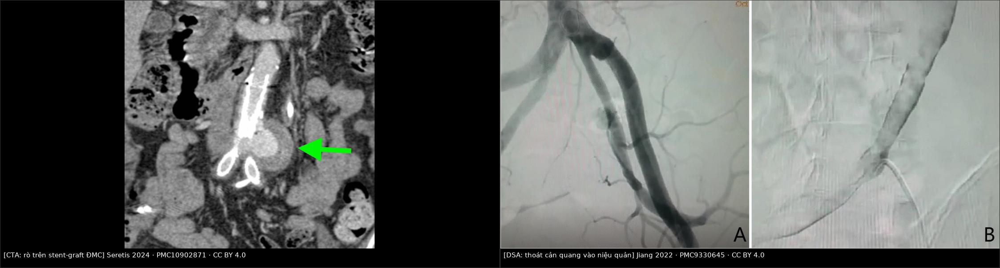
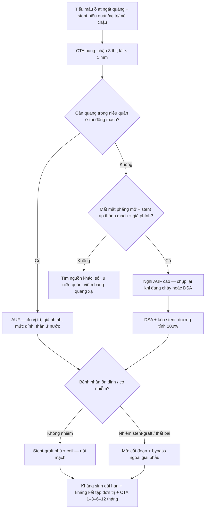
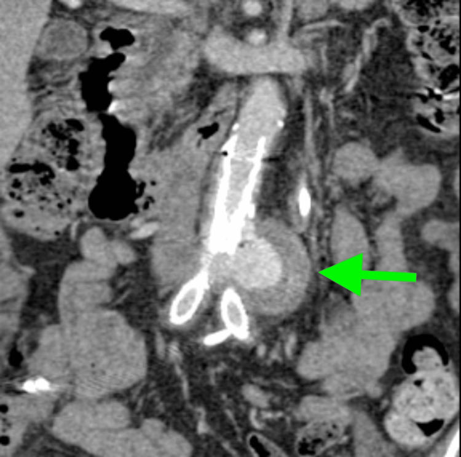
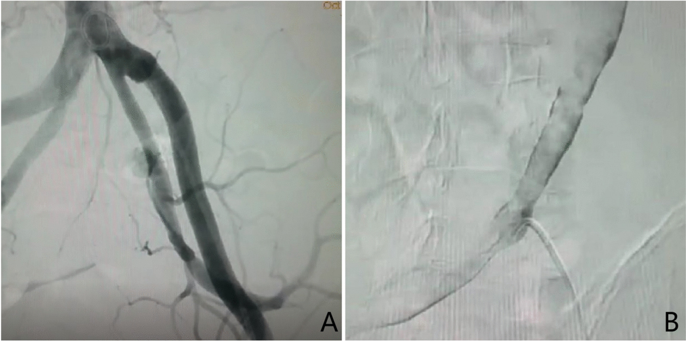
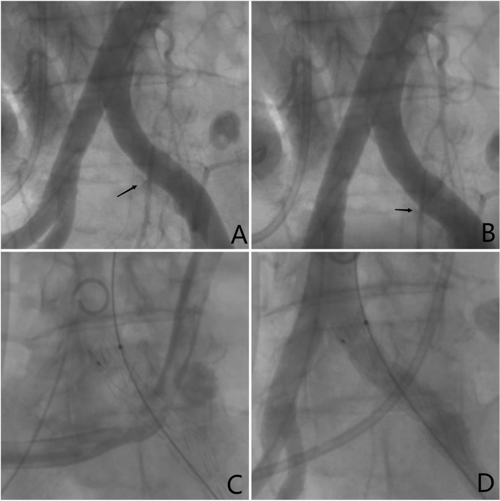
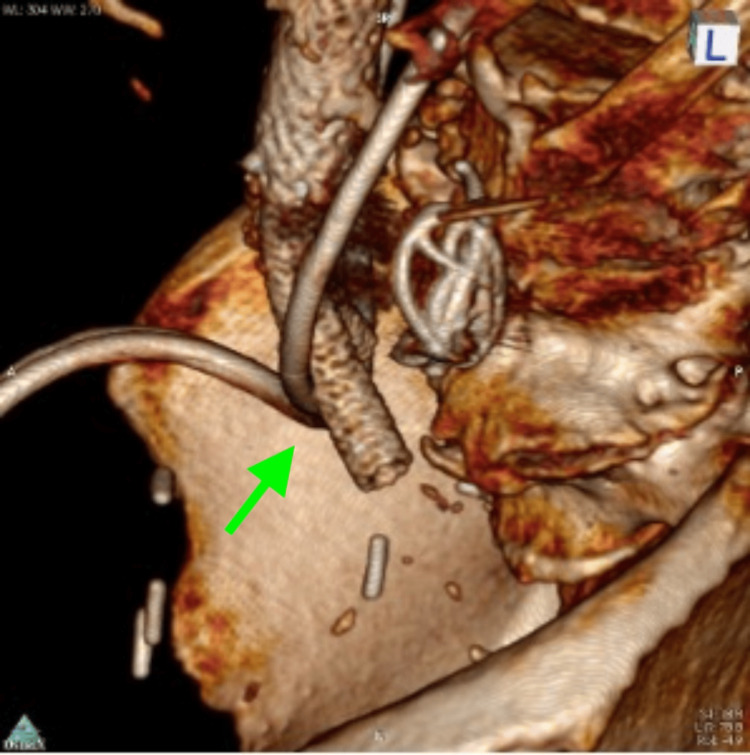

# 942 — Rò động mạch chủ–niệu quản (aorto-ureteric fistula, AUF): tiểu máu ồ ạt + cản quang trong niệu quản ở thì động mạch

**Tags:** `pattern:ro-dong-mach-nieu-quan` `pattern:tieu-mau-o-at` `pattern:thoat-can-quang` `pattern:gia-phinh-mien-noi` `pattern:mat-mat-phang-mo` `vung:dong-mach-chu-bung` `vung:dong-mach-chau` `vung:nieu-quan` `vung:than` `protocol:CTA-bung-3-thi` `protocol:DSA` `protocol:EVAR`

**Mức chắc chắn (certainty):** tổng hợp y văn (literature synthesis) — 1 tổng quan hệ thống 216 ca 2011–2021 kèm 2 ca nguyên văn có ảnh DSA (*BMC Urol* 2022, PMC9330645), 1 ca nguyên văn có 6 ảnh CTA (*Cureus* 2024, PMC10902871), 1 loạt 17 rò/16 bệnh nhân + tổng quan 152 ca liều điều trị nội mạch (PMC8053137), 1 loạt 5 ca nội mạch (PMC6806659). Không có thử nghiệm ngẫu nhiên; mọi ngưỡng là tổng hợp thực hành, chỗ suy luận ghi rõ.

> **Câu chốt:** AUF là **đường thông giữa niệu quản và động mạch** (chủ/chậu) ở đúng chỗ niệu quản **bắt chéo** mạch. Bệnh cảnh điển hình **không phải** "sỏi niệu quản" mà là **tiểu máu ồ ạt, ngắt quãng, tái diễn nhiều đợt, ở người có stent niệu quản lâu dài ± xạ trị ± mổ chậu**; đợt chảy máu tự cầm rồi bùng lại. Dấu chốt trên CTA là **cản quang trong lòng niệu quản ở thì động mạch (25–35 giây)** — bình thường niệu quản chỉ có cản quang ở **thì bài tiết 5–15 phút**. Bỏ sót = mất máu ồ ạt; tử vong **10–20%**, tới **22%** nếu nhập viện trong sốc (PMC6806659).

## 1. Tổng quan bệnh học – cơ chế hình ảnh (TẠI SAO)

### 1.1 Dịch tễ và bối cảnh

- **Tần suất:** rất hiếm — **235 ca** được báo cáo tính đến tổng quan 2022, ca đầu tiên do **Moschcowitz mô tả năm 1908** (PMC10902871). Số ca tăng mạnh **từ khi stent niệu quản ra đời năm 1978**: trước đó chỉ **12 ca**, đến 2022 là **235 ca** (PMC10902871).
- **Nguyên phát vs thứ phát:** **15% nguyên phát** (phình/giả phình động mạch ăn mòn niệu quản) và **85% thứ phát** (sau mổ chậu, xạ trị, stent niệu quản lâu dài, bệnh động mạch ngoại biên) — PMC9330645.
- **Loạt 445 bệnh nhân:** **80% có stent niệu quản lưu lâu dài**, **70% có tiền sử ung thư chậu**, và phần lớn rò xảy ra **đúng chỗ niệu quản bắt chéo động mạch chậu chung** (PMC9330645).
- **Tổng quan 216 ca (2011–2021, 92 bài):** ung thư **173 ca**, stent niệu quản **187 ca**, xạ trị **136 ca**, phình/giả phình động mạch chậu **19 ca**, mổ mạch **21 ca**; **131 nữ / 82 nam**, tuổi trung bình **65,1** (35–90) — PMC9330645.
- **Tử vong:** **66% trước 1980 → 13% gần đây** (PMC10902871); các tổng quan khác ghi **10–20%** và tăng khi chẩn đoán trước mổ bị chậm (PMC9330645), **10–13%**, riêng **22%** nếu nhập viện trong tình trạng huyết động không ổn định (PMC6806659).

### 1.2 Sinh lý bệnh — vì sao niệu quản bị "ăn mòn"

1. **Điểm cố định giải phẫu:** niệu quản nằm sau phúc mạc, **bắt chéo động mạch chậu chung** ở khung chậu; hai cấu trúc **không có lớp mỡ đệm đủ dày** ở người đã mổ/xạ (dính, xơ hóa) → thành niệu quản **áp sát thành động mạch**.
2. **Vật rắn trong lòng + mạch đập:** stent niệu quản cứng (đặc biệt stent kim loại toàn chiều dài) ép niêm mạc niệu quản vào thành mạch; **áp lực đập của động mạch** (tần số 60–100/phút) gây **thiếu máu cục bộ thành niệu quản rồi thành động mạch** → loét → dò (PMC10902871; PMC9330645).
3. **Xạ trị làm mô xơ, mất khả năng sửa chữa:** mạch nuôi thành niệu quản bị tổn thương → vết loét không lành, tiến triển thành lỗ dò.
4. **Cơ chế "ngắt quãng":** khi lỗ dò chảy, huyết áp tụt + **cục máu đông bịt lỗ** + niệu quản co thắt → cầm máu tạm; vài ngày sau cục máu tan/rửa trôi → **chảy lại ồ ạt**. Đây là lý do bệnh nhân có **nhiều đợt tiểu máu cách nhau**, bị điều trị như "nhiễm khuẩn tiết niệu" hoặc "viêm bàng quang xạ", và **nhiều lần chụp hình âm tính** (2 ca PMC9330645: CT và MRI đều không tìm được nguyên nhân trước khi chụp mạch).

### 1.3 TẠI SAO nhìn thấy trên CT (vật lý + thời điểm)

| Đại lượng | Con số | Ý nghĩa đọc phim |
|---|---|---|
| Cản quang trong động mạch | **300–400 HU** | Mốc "máu động mạch" |
| Nước tiểu (niệu quản) thì động mạch | **0–20 HU** | Niệu quản **phải tối** ở thì này |
| Cản quang bài tiết trong niệu quản | **5–15 phút**, thường **500–1.500 HU** | Chỉ xuất hiện ở thì muộn — nếu thấy sớm là bất thường |
| Mỡ quanh niệu quản–động mạch | **−100 đến −50 HU** | **Mất mặt phẳng mỡ** = dấu sớm của dính/xơ |
| Vôi hóa/túi phình thành mạch | **> 400 HU** | Gián đoạn vôi hóa tại chỗ dò là dấu định vị |
| Thì động mạch | **25–35 giây** | Thời điểm **duy nhất** chứng minh dò |
| Thì tĩnh mạch | **70–90 giây** | Trước khi cản quang xuống niệu quản do bài tiết |

- **Nguyên lý chốt:** cản quang đi **tắt** qua lỗ dò vào lòng niệu quản → **niệu quản sáng ngang động mạch ở thì động mạch**. Trên MPR coronal, thấy **một "đoạn niệu quản trắng"** nối liền với động mạch, dài vài mm đến vài cm, kèm **giả phình nhỏ** ở chỗ bắt chéo. Đây là dấu **đặc hiệu** nhưng **không liên tục** — chỉ thấy khi đang chảy máu.
- **Vì sao CTA có thể âm:** khi cục máu bịt lỗ dò, không có dòng cản quang đi qua; CT chỉ còn **mất mặt phẳng mỡ + dày thành + stent áp sát mạch**. Vì vậy **CTA âm không loại trừ AUF** — phải chụp lại khi đang chảy hoặc chuyển DSA (PMC9330645; PMC8053137).
- **Vì sao thận ứ nước cùng bên:** cục máu đông trong niệu quản + stent bị bít → **ứ nước/thận to cùng bên**; đây là dấu phụ rất hay gặp nhưng dễ bị quy cho sỏi.

## 2. Mẫu hình + chẩn đoán phân biệt theo cơ chế & vị trí (Gamut)

- **Theo cơ chế:** **nguyên phát 15%** (phình/giả phình động mạch ăn mòn niệu quản, thường ở người có phình chậu) vs **thứ phát 85%** (stent lâu dài ± xạ ± mổ chậu) — PMC9330645.
- **Theo vị trí (quan trọng nhất):**
  - **Động mạch chậu chung** — thường gặp nhất (chỗ niệu quản bắt chéo);
  - **chỗ chia đôi động mạch chủ** (ca PMC10902871: niệu quản trái bắt chéo **ngay trên chỗ chia đôi**);
  - **động mạch chậu ngoài** (sau mổ chậu rộng, ghép mạch);
  - **động mạch chủ bụng** — hiếm, thường sau **stent-graft ĐMC**;
  - **động mạch chậu trong** — hiếm, sau can thiệp.
- **Ba trụ nguy cơ — nhớ "STENT":** **S**tent niệu quản lưu lâu (yếu tố mạnh nhất, 80–87% ca), **T**ia xạ vùng chậu, **E**ndovascular/stent-graft động mạch chủ–chậu, **N**goại khoa chậu (cắt bàng quang, cắt tử cung, mổ trực tràng), **T**umor (ung thư chậu tiến triển).
- **Họ hàng "rò động mạch chủ":** AUF là **mặt thứ ba** của cùng một nhóm bệnh — xem **938 (rò ĐMC–ruột)** và **939 (rò ĐMC–tĩnh mạch chủ)**; cùng cơ chế "vật liệu nhân tạo/túi phình ăn mòn cơ quan kề", nhưng **biểu hiện và đường can thiệp khác nhau**.

## 3. Bảng so sánh phân biệt (ma trận đối chiếu)

| Thực thể (entity) | Hình ảnh điển hình | Chốt vào (rule-in) | Chốt loại (rule-out) | Gợi ý xác nhận |
|---|---|---|---|---|
| **AUF (rò niệu quản–ĐM chậu/ĐMC)** | **Cản quang trong lòng niệu quản ở thì động mạch** tại chỗ bắt chéo; giả phình nhỏ; mất mặt phẳng mỡ; stent áp thành mạch; ứ nước cùng bên | **Niệu quản sáng 300–400 HU ở 25–35 giây** + giả phình tại chỗ bắt chéo | Cản quang trong niệu quản **chỉ ở thì bài tiết** (5–15 phút) → không phải rò | CTA 3 thì lát ≤ 1 mm + MPR; **DSA khi đang chảy** (chẩn đoán 69% ca, **100% nếu kéo/đẩy stent lúc chụp**) |
| **AUF sau stent-graft ĐMC (endoleak ăn mòn)** | Stent-graft cũ, **endoleak** + cản quang quanh graft, niệu quản dính, **tiểu máu tái phát sau nhiều tháng–năm** | **Endoleak + cản quang vào niệu quản**; túi không teo | Không endoleak, không cản quang ngoài lòng → chưa dò | CTA 3 thì; so phim cũ; DSA + bơm qua catheter |
| **Sỏi niệu quản** | **Nốt tăng đậm độ 300–1.000 HU trên phim KHÔNG cản quang**, nằm trong lòng; dấu hiệu viền (rim sign); **không có cản quang lòng mạch** | **Đậm độ cao trên phim không cản quang + không ngấm ở thì động mạch** | Có **cản quang lòng mạch đi vào niệu quản ở thì động mạch** → là rò | So phim không cản quang; siêu âm thấy sỏi + bóng lưng |
| **Ung thư biểu mô niệu quản / tái phát bàng quang** | Khối đặc trong lòng niệu quản, **ngấm thuốc dạng nốt**, không thoát mạch | **Khối trong lòng, ngấm thuốc thì muộn, không có dòng thoát từ động mạch** | **Thấy lỗ dò + cản quang từ động mạch** → loại u đơn thuần | Nội soi + sinh thiết; nhưng **không sinh thiết khi nghi rò** |
| **Viêm bàng quang xạ / chảy máu do xạ** | Niêm mạc dày, **không có tổn thương mạch**, không cản quang ngoài lòng | **Tiểu máu + tiền sử xạ, mạch bình thường, không dò** | **Giả phình + dòng cản quang vào niệu quản** → là rò, không phải chỉ viêm xạ | CTA; soi bàng quang thấy máu từ một lỗ niệu quản |
| **Giả phình động mạch chậu đơn thuần (chưa dò)** | Túi cản quang cạnh mạch, **không thông với niệu quản** | **Túi ngấm thuốc nhưng không có cản quang trong niệu quản** | Có cản quang lòng niệu quản cùng thì → đã dò | CTA + DSA; theo dõi kích thước |
| **Rò ĐMC–ruột (bài 938)** | Khí trong túi/quanh graft, ruột dính, **máu báo**, nôn/đi cầu máu | **Khí ngoài lòng + XHTH + ruột dính** | Tiểu máu đơn thuần, không khí, không XHTH → nghĩ AUF | Nội soi + CTA (bài 938) |
| **Rò ĐMC–tĩnh mạch chủ (bài 939)** | **IVC ngấm đồng thời với ĐMC**, mất mặt phẳng mỡ, phù chi, suy tim cung lượng cao | **IVC ngấm sớm + suy tim cầu lượng cao** | Không ngấm IVC sớm → không phải ACF | CTA 3 thì (bài 939) |

*Trái: CTA coronal ca 79 tuổi sau cắt bàng quang — **endoleak (mũi tên xanh)** quanh stent-graft cũ ở chỗ chia đôi ĐMC, nơi niệu quản trái có J-stent bắt chéo. Phải: DSA chậu trái — (A) **thoát cản quang từ động mạch chậu chung vào niệu quản**, (B) catheter đi **qua lỗ dò vào niệu quản**. Ảnh ghép letterbox từ 2 nguồn **CC BY 4.0** (PMC10902871; PMC9330645).*

### Ba dấu hiệu định vị lỗ dò (đọc theo thứ tự)
1. **Niệu quản và động mạch "dính" nhau** — mất lớp mỡ −100 đến −50 HU giữa hai cấu trúc, thành dày.
2. **Giả phình/túi phình nhỏ** đúng tại điểm bắt chéo (đường kính vài mm đến 2–3 cm).
3. **Cản quang trong lòng niệu quản ở thì động mạch** — dấu chốt, chỉ dương khi đang chảy.

## 4. Protocol chụp + xử trí

### 4.1 Chẩn đoán hình ảnh

- **CTA bụng–chậu 3 thì** (không cản quang → động mạch → tĩnh mạch/bài tiết), lát **≤ 1 mm**, **MPR coronal/curved planar** dọc niệu quản và dọc trục mạch; bắt đầu từ **trên chỗ chia đôi ĐMC** xuống **hết khung chậu**.
- **Chụp khi đang chảy máu** (bệnh nhân vừa tiểu máu đỏ) — thời điểm quyết định độ nhạy. **CTA âm không loại trừ.**
- **DSA** là chuẩn: trong **139 ca** tổng quan, **DSA chẩn đoán 69%**; **kéo/đẩy stent niệu quản trong lúc chụp nâng lên 100%**; **chụp niệu quản ngược dòng có kích thích (provocative) chỉ 63%** (PMC9330645).
- **Nội soi bàng quang:** thấy **máu phun theo nhịp mạch từ một lỗ niệu quản** — dấu lâm sàng rất gợi ý, nhưng **không được đặt stent mù** vì có thể làm lỗ dò to hơn.
- **Bóng chèn (balloon tamponade) trong niệu quản** là biện pháp cầm máu tạm thời đã dùng trong ca PMC6806659, giúp ổn định để chuyển can thiệp.

### 4.2 Điều trị

- **Nội mạch là lựa chọn đầu tay:** **stent-graft phủ (covered stent) ± nút mạch coil** — trong tổng quan 152 ca, **đặt stent-graft 92,1%**, **chỉ nút mạch 7,9%** (PMC8053137).
- **Kết quả:** kỹ thuật thành công **100%**; hết tiểu máu trong đợt nằm viện **82,4% (14/17)**; **tái phát 11,8% (18/152)** — phần lớn trong **năm thứ 1–2**, có ca tái phát **ngày 8 và 13** sau can thiệp; **tắc stent 5%**, **nhiễm stent-graft 3,6%**, biến chứng chung **13,8%**, **tử vong do AUF 3,3%** (PMC8053137).
- **Nhiễm là giới hạn của nội mạch:** stent-graft đặt trong vùng nhiễm/nhiễm tiềm ẩn → **nhiễm muộn**, phải **kháng sinh dài hạn**, có ca dùng **ciprofloxacin suốt đời** để dự phòng nhiễm khuẩn tiết niệu (PMC6806659); nhiễm stent-graft là biến chứng "đáng sợ" buộc **lấy graft** (PMC10902871).
- **Mổ hở** (cắt đoạn mạch + ghép, **bypass ngoài giải phẫu** + cắt bỏ đoạn nhiễm) khi: nhiễm stent-graft, thất bại nội mạch, lỗ dò lớn, bệnh nhân trẻ ổn định.
- **Cầu nối chiến lược:** nội mạch thường chỉ là **"bridge"** — graft sẽ nhiễm dần và phải lấy về sau (PMC10902871).
- **Kháng kết tập tiểu cầu đơn trị** giúp stent-graft bền; **theo dõi CTA 1–3–6–12 tháng** rồi hằng năm, tìm endoleak/tái phát (PMC8053137).

## 5. Biến thể bình thường và cạm bẫy

- **Cản quang trong niệu quản do lần chụp trước:** bệnh nhân vừa chụp CT có cản quang 5–15 phút trước → niệu quản sáng ở thì muộn; **phải xem thì động mạch**, và hỏi lịch chụp. Đây là **giả dương** hay gặp nhất.
- **CTA âm khi không chảy máu:** lỗ dò bị cục máu bịt; chỉ còn mất mặt phẳng mỡ. **Không được kết luận "không rò"** — hẹn chụp lại khi có đợt tiểu máu, hoặc DSA.
- **Stent kim loại gây nhiễu mạnh:** dải giả ảnh dọc stent che lỗ dò; dùng **lát mỏng + MPR + cửa sổ mạch**, và **chụp thì không cản quang** để thấy stent/vôi hóa.
- **Nội soi niệu quản "bình thường" không loại trừ:** niêm mạc quanh lỗ dò có thể chỉ "sần" (ca PMC9330645: **niêm mạc sần cách lỗ niệu quản 15 cm**, chẩn đoán chỉ đặt được khi chụp mạch đúng lúc).
- **Thay stent định kỳ có thể khởi phát chảy máu ồ ạt:** 2 ca trong PMC9330645 chảy máu ngay sau **thay stent** — động vào stent ở bệnh nhân nguy cơ phải chuẩn bị sẵn khả năng can thiệp.
- **Bỏ sót vì "thận ứ nước + sỏi":** AUF thường kèm ứ nước cùng bên; nếu chỉ điều trị sỏi/đặt stent mà không nhìn mạch, bệnh nhân có thể tử vong trong đợt sau.
- **Sốc không loại trừ, và sốc cũng không bắt buộc:** chỉ **41,2%** ca nhập viện trong sốc (PMC8053137); nhiều ca ổn định huyết động giữa các đợt.

## 6. Tự lượng giá — Blind Quiz

**Ca 1 — Nam 79 tuổi, cắt toàn bộ bàng quang vì ung thư 1 năm trước, hai niệu quản đưa ra một lỗ niệu quản tạo hình ở hố chậu phải; nhiều đợt tiểu máu, lần này sốc giảm thể tích, Hb 6,7 g/dL.**

- Gợi ý lâm sàng: tiểu máu tái diễn nhiều đợt, đã can thiệp mạch 4 tháng trước, không có hồ sơ.
- Câu hỏi: Có gì bất thường quanh stent-graft? Vì sao đây là **tái phát của rò** chứ không phải "endoleak đơn thuần"? Bước tiếp theo?

<b>Bấm để hiện đáp án (findings + chẩn đoán)</b>

- Dấu hiệu: **cản quang ngoài lòng stent-graft** (mũi tên xanh) ở chỗ chia đôi ĐMC, nơi niệu quản trái có J-stent bắt chéo; bệnh nhân có **giả phình ĐMC nhiễm khuẩn** đã được bịt bằng coil + stent trần 4 tháng trước.
- Chẩn đoán: **AUF tái phát do endoleak** — máu vẫn đi qua lỗ dò vào niệu quản. Xử trí: "xây lại" toàn bộ stent-graft từ bên trong, thêm **vascular plug ở động mạch chậu chung trái + bypass đùi–đùi** để chuyển dòng khỏi lỗ dò.
- Vì sao khó: không có hồ sơ → tưởng là endoleak type I thông thường; đây là **cạm bẫy "thiếu thông tin can thiệp cũ"**.
- Nguồn ảnh: Seretis KG và cs., *Cureus* 2024 (PMC10902871), **CC BY 4.0**.

**Ca 2 — Nam 74 tuổi, cắt bàng quang tận gốc + niệu quản da, stent J thay mỗi 3 tháng; tiểu máu ồ ạt + đau hông lưng, huyết động không ổn định.**

- Gợi ý: 3 ngày sau thay stent thì chảy máu; CT có cản quang trước đó chỉ thấy **ứ nước bể thận trái**.
- Câu hỏi: Dấu hiệu nào chứng minh rò? Vì sao CT trước đó âm tính? Can thiệp gì đã cầm máu?

<b>Bấm để hiện đáp án (findings + chẩn đoán)</b>

- Dấu hiệu: (A) **thoát cản quang từ động mạch chậu chung trái vào niệu quản** đúng chỗ bắt chéo; (B) **catheter đi qua lỗ dò vào trong niệu quản** — bằng chứng trực tiếp.
- Chẩn đoán: **AUF sau stent niệu quản lâu dài**. CT âm vì chụp lúc không chảy máu; ứ nước do cục máu + stent bít.
- Xử trí: **stent-graft phủ heparin** trong động mạch chậu trái; hết tiểu máu, ra viện ngày 5. Ảnh 4 ô dưới: (A,B) trước — thoát cản quang vào niệu quản; (C,D) sau stent-graft — không còn thoát.

- Nguồn ảnh: Jiang Z và cs., *BMC Urol* 2022 (PMC9330645), **CC BY 4.0**.

**Ca 3 — Nam 79 tuổi (tiếp ca 1): nhìn 3D volume rendering, mô tả quan hệ giữa stent niệu quản và mạch.**

- Câu hỏi: Cấu trúc nào bắt chéo cấu trúc nào? Vì sao vị trí này là "điểm nóng" của AUF? Có cần chụp thêm gì trước can thiệp?

<b>Bấm để hiện đáp án (findings + chẩn đoán)</b>

- Dấu hiệu: **J-stent niệu quản trái bắt chéo ngay trên chỗ chia đôi động mạch chủ**, sát túi/giả phình và stent-graft — không có lớp mỡ đệm.
- Vì sao: đây là **điểm cố định giải phẫu** giữa niệu quản sau phúc mạc và mạch chậu; stent cứng + mạch đập → loét → dò.
- Trước can thiệp: **DSA** để xác định chính xác lỗ dò và **đo đường kính mạch** chọn stent-graft; chuẩn bị khả năng nút coil nhánh.
- Nguồn ảnh: Seretis KG và cs., *Cureus* 2024 (PMC10902871), **CC BY 4.0**.

## Bài liên quan chéo
- [938 – Rò động mạch chủ–ruột (AEF)](../938-ro-dong-mach-chu-ruot/lesson.md)
- [939 – Rò động mạch chủ–tĩnh mạch chủ (ACF)](../939-ro-dong-mach-chu-tinh-mach-chu/lesson.md)
- [170 – Phình động mạch chủ bụng](../170-phinh-DMC-bung/lesson.md)
- [920 – Nút mạch can thiệp](../920-vascular-embolization-gi-bleed/lesson.md)
- [901 – Tổng quan can thiệp](../901-ir-overview/lesson.md)

## Ảnh
- `942_ro-dong-mach-chu-nieu-quan_CT_PMC10902871-F1.jpg` — CTA coronal, endoleak quanh stent-graft (CC BY 4.0).
- `942_ro-dong-mach-chu-nieu-quan_CT_PMC10902871-F3.jpg` — 3D VR, J-stent bắt chéo chỗ chia đôi ĐMC (CC BY 4.0).
- `942_ro-dong-mach-chu-nieu-quan_DSA_PMC9330645-F1.jpg` — DSA 4 ô: thoát cản quang trước và sau stent-graft (CC BY 4.0).
- `942_ro-dong-mach-chu-nieu-quan_DSA_PMC9330645-F2.jpg` — DSA 2 ô: thoát cản quang + catheter qua lỗ dò (CC BY 4.0).
- `images/composite_auf_cta-vs-dsa.jpg` — ảnh ghép đối chiếu (chỉ từ nguồn CC BY 4.0).
- Nguồn + giấy phép từng ảnh: `images/CREDITS.md`; link gốc: `sources.md`.

> Không dùng để chẩn đoán độc lập khi chưa có người hướng dẫn.
