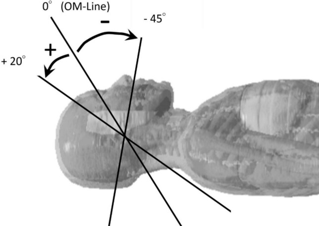
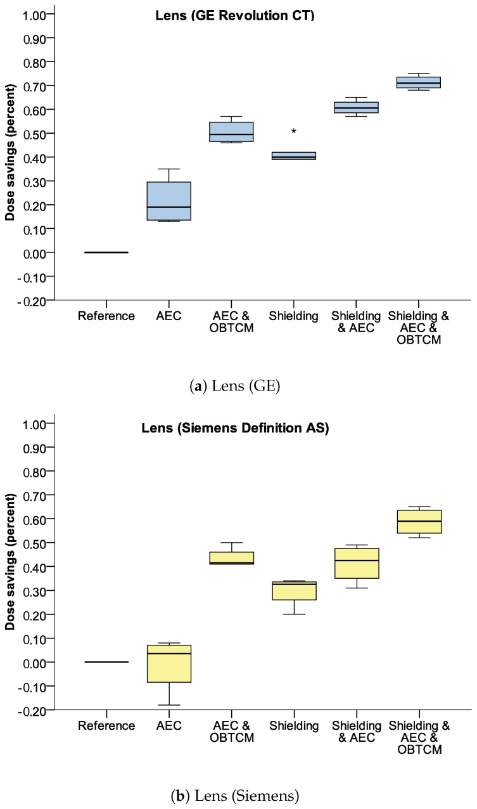
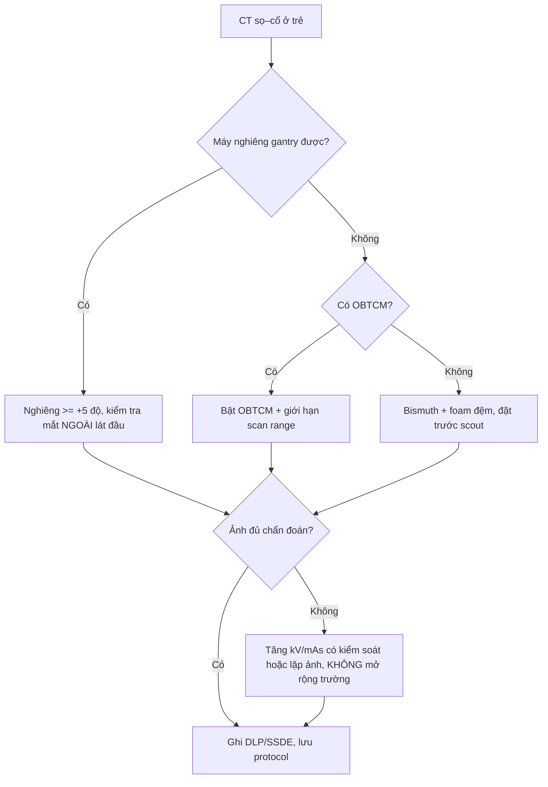

# 9420 — Bảo vệ thủy tinh thể & tuyến giáp trong CT sọ–cổ ở trẻ: nghiêng gantry, OBTCM, che chắn

**Tags:** `protocol:CT-so-co-nhi` `protocol:gantry-tilt` `protocol:OBTCM` `protocol:che-chan-bismuth` `vung:dau-co` `vung:mat` `anatomy:thuy-tinh-the`
**Mức chắc chắn (certainty):** tổng hợp y văn (literature synthesis) — số liệu từ phantom, mô phỏng Monte Carlo và nghiên cứu liều lâm sàng; **không** có RCT về kết cục ung thư/đục thủy tinh thể.

## 1. Tổng quan — vì sao thủy tinh thể và tuyến giáp là "cơ quan nguy cơ" chứ không phải "bệnh"

Đây là bài **vật lý–protocol**, không phải bài chẩn đoán bệnh. "Tổn thương" ở đây là **liều hấp thụ** (mGy) và nguy cơ tích lũy; "mẫu hình" là **phân bố liều theo hình học chùm tia**.

**TẠI SAO thủy tinh thể nhạy nhất:**

- **Vị trí hình học:** ở CT sọ, thủy tinh thể nằm **ngay trong trường chiếu** hoặc sát mép trường; chỉ cần **vài milimét** chùm tia chạm vào là liều tăng vọt. Mô phỏng Monte Carlo với chùm 2 mm cho thấy đường phân bố liều có **đỉnh nhọn rồi đuôi giảm chậm** — nghĩa là "cắt" được mắt ra khỏi trường thì liều rơi hàng chục lần, còn "chạm" một chút vẫn ăn liều đáng kể (PMC12950018).
- **Sinh học:** sợi **crystallin** trong thủy tinh thể không có mạch máu, không tái tạo; tổn thương protein → **đục thủy tinh thể (cataract)**, chủ yếu thể **dưới bao sau**. Trẻ có nhiều tế bào phân chia và **tuổi thọ còn dài** để biểu hiện muộn.
- **Ngưỡng:** ICRP xếp đục thủy tinh thể là hiệu ứng **có ngưỡng**, khoảng **0,5 Gy** cho thể phát hiện được khi phơi nhiễm cấp; bằng chứng dịch tễ gần đây ghi nhận nguy cơ **tăng ở mức < 100 mGy** (đoàn hệ nhân viên Fukushima, PMC13188973) — nên không có "ngưỡng an toàn" để chủ quan.

**TẠI SAO tuyến giáp đứng thứ hai:**

- Tuyến giáp **nằm sát trường chiếu sọ–cổ**; CT sọ ở người lớn cho liều tuyến giáp trung bình **2,66 ± 1,03 mGy**, liều hiệu dụng **1,6 ± 0,4 mSv** (PMC11177018). Với trẻ, cùng kV/mAs nhưng kích thước nhỏ hơn → **liều/đơn vị mô cao hơn**.
- Nang giáp tập trung iod, mô tuyến phân chia nhanh ở trẻ → nhạy với bức xạ; đây là lý do **ung thư tuyến giáp** là ung thư thứ phát được theo dõi sau xạ trị vùng cổ ở trẻ.
- Vấn đề thực hành: **trường chiếu bị kéo dài quá mức**. Trong 1.306 ca CT ngực, tuyến giáp **nằm trong trường 99,8%** và **toàn bộ tuyến bị chiếu ở 76,9%** (PMC10358389) — tức là "lỗi protocol" phổ biến hơn ta tưởng.

**Hai câu hỏi của mọi protocol CT sọ–cổ ở trẻ:**
1. **Có cắt được mắt ra khỏi trường chiếu không?** (nghiêng gantry, giới hạn scan range)
2. **Nếu không cắt được, giảm liều bằng cách nào mà không mất chất lượng chẩn đoán?** (OBTCM, kV, mAs, che chắn có kiểm soát)

## 2. "Gamut" kỹ thuật giảm liều theo hình học

Xếp theo **hiệu quả/độ phức tạp**, không theo hãng máy:

- **Nhóm A — thay đổi hình học (hiệu quả nhất):**
  - **Nghiêng gantry (gantry tilt):** nghiêng **+5° trở lên** so với đường ổ mắt–lỗ tai giảm liều thủy tinh thể tới **87%**; nghiêng xuống **−35°** cũng giảm mạnh vì chùm tia đi qua mô hấp thụ cao (PMC12950018).
  - **Giới hạn scan range:** bắt đầu từ **nền sọ**, không lấy thêm hốc mắt/cổ. Chỉ cần **đưa/không đưa nhãn cầu vào trường**, liều hiệu dụng của tuyến nước bọt–giáp–niêm mạc miệng lệch tới **1,5 lần** (PMC12950018).
- **Nhóm B — điều biến dòng ống theo cơ quan (OBTCM):**
  - Giảm dòng ở **cung trước** (nơi có mắt) và bù ở cung sau: liều thủy tinh thể **giảm tới 13%** ở phantom nhi, nhưng **nhiễu ảnh tăng có ý nghĩa** (PMC7476969).
  - Thế hệ mới dùng **topogram + AI** để dựng mô hình nhãn cầu 3D và cá thể hóa cung chiếu: giảm **~30%** liều thủy tinh thể mà không mất chất lượng (PMC13291186).
- **Nhóm C — che chắn tiếp xúc (bismuth/barium):**
  - Trên phantom đầu nhi: bismuth giảm **41,5%** (GE) và **29,75%** (Siemens); **+AEC** → **60,75% / 41,25%**; **+AEC+OBTCM** → **71,25% / 58,75%** (PMC10779489).
  - **Cái giá:** nhiễu vùng hốc mắt tăng; đặt **foam đệm 1–2 cm** giữa da và tấm chắn giảm artifact (PMC10779489).
- **Nhóm D — thông số chung:** giảm kVp (120→90), giảm mAs toàn cục (GLTC), tăng pitch, lặp ảnh (IR). Tất cả **đều tăng nhiễu**; nghiêng gantry vẫn là biện pháp hiệu quả nhất trong so sánh 5 kỹ thuật (PMC10445673).

> **Bối cảnh 2021–2026:** đồng thuận châu Âu (EFOMP/ESR/ESPR) **không khuyến cáo che chắn tiếp xúc thường quy**, vì lợi ích nhỏ và có thể **làm tăng liều** do AEC tăng dòng để bù suy giảm (PMC8695402). Báo cáo 2026 nhấn mạnh bằng chứng cho CT còn **yếu**, cần cá thể hóa thay vì cấm/cho tuyệt đối (PMC12963150).

## 3. Ma trận đối chiếu 5 kỹ thuật

| Kỹ thuật | Giảm liều thủy tinh thể | Chốt vào (dùng khi) | Chốt loại (không dùng khi) | Cạm bẫy |
|---|---|---|---|---|
| **Nghiêng gantry ≥ +5°** | Tới **87%** (PMC12950018) | Máy cho nghiêng, trẻ hợp tác, cần khảo sát sọ | Chấn thương sọ–mặt cần đánh giá trọn hốc mắt; máy không nghiêng được | Nghiêng mà **mắt vẫn trong trường** → lợi ích gần 0: 84,8% ca có nghiêng nhưng chỉ **1,8%** thật sự loại được mắt (PMC10077499) |
| **Giới hạn scan range** | Lớn (1,5× liều hiệu dụng nếu lấy cả mắt) | Luôn luôn, mọi ca | Không có — trừ khi chỉ định bắt buộc lấy hốc mắt | Cắt quá tay bỏ sót nền sọ/dịch não tủy; cần **topogram đánh dấu** |
| **OBTCM** | **13%** (phantom nhi), **~30%** với AI (PMC7476969, PMC13291186) | Máy có OBTCM; lặp lại nhiều lần | Cần chất lượng ảnh hố sau tối đa (nhiễu tăng) | Nhiễu tăng ở hố sau; không thay thế được việc cắt mắt khỏi trường |
| **Bismuth/barium** | **30–42%** đơn thuần; **59–71%** khi +AEC+OBTCM (PMC10779489) | Không nghiêng được, không có OBTCM, ca đặc biệt | Máy đang dùng AEC mạnh (nguy cơ tăng liều bù); cần ảnh hốc mắt chi tiết | Nhiễu + artifact; **phải có foam đệm**; đặt sai làm mất tác dụng |
| **Giảm kVp / GLTC** | Trung bình (tăng nhiễu) | Máy không nghiêng, không OBTCM (PMC10445673) | Trẻ nhỏ cần tương phản mô mềm cao; khảo sát mạch | Tăng nhiễu làm **giảm điểm chất lượng chủ quan**, dễ chụp lại → tăng liều ròng |

**Cột "Chốt loại" quan trọng ngang "Chốt vào":** mọi kỹ thuật đều **đánh đổi bằng nhiễu/artifact**, và **chụp lại vì ảnh kém** xóa sạch lợi ích liều.

## 4. Protocol & ngưỡng thực hành

**Checklist trước khi quét (in dán cạnh máy):**

1. **Xác định chỉ định**: sọ đơn thuần? sọ–mặt? cổ? — nếu chỉ sọ, **không** lấy cổ.
2. **Đặt topogram** với đầu ở tư thế trung tính, đánh dấu **đường OM**.
3. **Nghiêng gantry** sao cho **mắt nằm ngoài lát cắt đầu tiên**; kiểm tra trên **ảnh scout/lát đầu** chứ không tin vào con số nghiêng.
4. **Scan range**: từ **nền sọ** đến **đỉnh sọ**; không lấy thêm hốc mắt, không lấy C1–C2 nếu không cần.
5. **OBTCM: bật** nếu có; chấp nhận nhiễu tăng nhẹ.
6. **Che chắn**: chỉ khi **không nghiêng được + không có OBTCM**; dùng tấm bismuth **có foam đệm**, đặt **trước khi scout** để AEC tính đúng.
7. **KV/mAs**: chọn preset **theo cân nặng/tuổi** (không dùng preset người lớn), ưu tiên **IR**.
8. **Ghi DLP/CTDIvol** vào phiếu; tính **SSDE** (bài 937) — không dùng CTDIvol trần để so sánh giữa các máy.

**Ngưỡng/điểm cần nhớ:**

| Thông số | Ngưỡng | Ý nghĩa |
|---|---|---|
| Liều thủy tinh thể 1 ca sọ | **25,9 mGy** (17,8–49,2) khi mắt trong trường; **1,5 mGy** (0,4–1,9) khi loại được mắt | Chênh **~17 lần** chỉ nhờ hình học (PMC10077499) |
| Nghiêng gantry có lợi | **≥ +5°** | Giảm tới 87%; ít hơn thì không đáng kể |
| Liều tuyến giáp 1 ca sọ | **2,66 mGy**; ED **1,6 mSv** | Tăng theo số lần chụp và theo tuổi nhỏ (PMC11177018) |
| Ngưỡng đục thủy tinh thể | **~0,5 Gy** (ICRP); nguy cơ báo cáo ở **< 100 mGy** | Trẻ chụp lặp lại nhiều lần là nhóm tích lũy |
| Tuyến giáp trong CT ngực | **99,8%** ca có tuyến giáp trong trường; **76,9%** lấy trọn tuyến | Kéo dài trường là lỗi phổ biến (PMC10358389) |

## 5. Biến thể bình thường & cạm bẫy

- **"Có nghiêng" ≠ "đã bảo vệ"**: 84,8% ca có nghiêng gantry nhưng chỉ **1,8%** loại được thủy tinh thể khỏi trường; sau **đào tạo kỹ thuật viên**, tỷ lệ dùng nghiêng 98% và tỷ lệ thành công chỉ lên **11,8%** — tức là **kỹ năng đặt góc** mới là biến số, không phải bật/tắt (PMC10077499).
- **Bismuth + AEC**: tấm chắn làm chùm tia suy giảm, AEC **tăng dòng** để bù → liều có thể **không giảm** hoặc tăng ở vùng lân cận. Vì vậy hiệu quả thật chỉ đạt khi **kết hợp AEC + OBTCM** và **có foam** (PMC10779489).
- **Che chắn tuyến giáp**: đồng thuận châu Âu **không khuyến cáo thường quy**; với CT, bằng chứng còn yếu (PMC8695402, PMC12963150). Cách bảo vệ tuyến giáp **chắc chắn nhất** vẫn là **không kéo trường xuống cổ**.
- **Artifact hố sau**: nghiêng gantry và giảm kV làm tăng **artifact hố sau/thùy thái dương**; đừng đánh giá hố sau trên ảnh nghiêng nhiều mà không kiểm tra lại trên mặt phẳng chuẩn (PMC10445673).
- **Trẻ không hợp tác**: giữ cố định bằng **bọc/túi cát** thay vì tăng liều; an thần làm tăng rủi ro chung, không phải "giảm liều".
- **Máy không nghiêng được** (một số máy xoắn ốc): chuyển sang **GLTC** hoặc **giảm kVp** thay vì cố nghiêng (PMC10445673).
- **Cạm bẫy "liều thấp = an toàn"**: liều thủy tinh thể **1,5 mGy** vẫn cộng dồn qua nhiều lần chụp; trẻ có bệnh mạn (shunt, động kinh) là nhóm chụp lặp lại.

## 6. Tự lượng giá

**Câu 1.** Trẻ 3 tuổi chấn thương đầu nhẹ, cần CT sọ. Máy cho nghiêng gantry; bạn nghiêng **+5°** nhưng lát cắt đầu tiên vẫn đi qua nhãn cầu. Kết luận nào đúng?

Đáp án

**Lợi ích gần như bằng 0** — nghiêng phải **loại hẳn nhãn cầu khỏi trường** mới giảm liều (25,9 → 1,5 mGy, ~17 lần). Cần kiểm tra trên **lát cắt đầu**, chỉnh thêm góc/di chuyển trường; nếu vẫn không được thì bật OBTCM (giảm ~13–30%) chứ không "tin vào con số nghiêng".

**Câu 2.** Bạn đặt tấm bismuth lên mắt trẻ, máy đang bật AEC. Vì sao liều đo được **không giảm như mong đợi**?

Đáp án

Tấm chắn làm suy giảm chùm tia → **AEC tăng mAs** để giữ độ nhiễu, nên liều có thể tăng ở vùng khác và lợi ích ròng giảm. Chỉ hiệu quả rõ khi phối hợp **AEC + OBTCM** (71,25%/58,75%) và có **foam đệm**; đồng thuận 2021 cũng không khuyến cáo che chắn thường quy.

**Câu 3.** CT ngực ở trẻ: làm sao giảm liều tuyến giáp mà **không** dùng che chắn?

Đáp án

**Giới hạn trường chiếu**: bắt đầu từ **đỉnh phổi/carina** theo chỉ định, không lấy trọn cổ. Nghiên cứu 1.306 ca cho thấy tuyến giáp nằm trong trường **99,8%** và trọn tuyến **76,9%** — đây là lỗi protocol, không phải hạn chế kỹ thuật. Kèm preset theo cân nặng và IR.

---

*Không dùng để chẩn đoán độc lập khi chưa có người hướng dẫn. Bài tổng hợp từ y văn mở; số liệu phantom/mô phỏng không thay thế đo liều tại cơ sở.*
