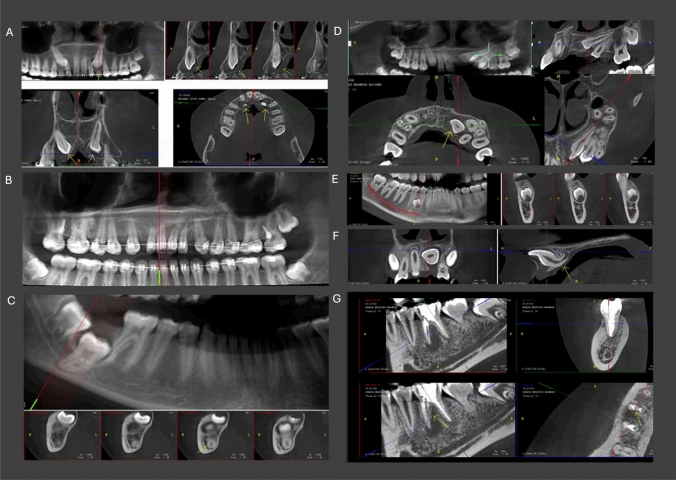
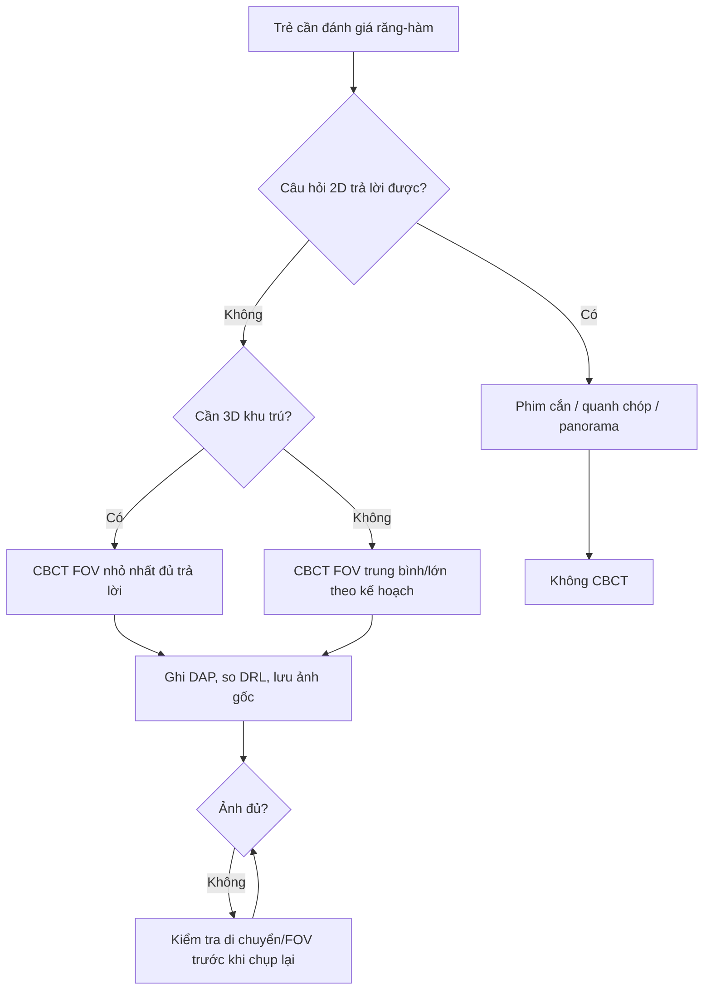

# 9421 — CBCT nón trong nha khoa & chỉnh nha ở trẻ: FOV, DRL và khi nào dùng phim 2D

**Tags:** `protocol:CBCT-nha-khoa` `protocol:FOV` `protocol:DRL` `protocol:panoramic` `vung:ham-mat` `vung:dau-co` `anatomy:rang-ham`
**Mức chắc chắn (certainty):** tổng hợp y văn — số liệu từ chương trình giám sát liều, mô phỏng Monte Carlo và khảo sát sử dụng CBCT nhi; **không** có thử nghiệm lâm sàng về kết cục ung thư.

## 1. Tổng quan — vì sao CBCT nhi là bài toán "liều theo FOV", không phải "liều theo máy"

**Vật lý:** CBCT dùng **chùm nón (cone beam)** quay quanh đầu, thu toàn bộ thể tích bằng **detector phẳng**. Khác CT xoắn ốc, CBCT không có **mAs theo chiều trục** mà phụ thuộc **kV, mAs, số khung hình, cung quay và kích thước FOV**. Hệ quả:

- **FOV càng lớn → thể tích chiếu xạ càng lớn** và càng nhiều cơ quan nguy cơ (thủy tinh thể, tuyến giáp, tuyến nước bọt) nằm trong chùm tia.
- **Trẻ nhỏ** có đầu nhỏ hơn → cùng kV/mAs, **liều/đơn vị mô cao hơn**, và các cơ quan nguy cơ **gần trường chiếu hơn** theo tỷ lệ cơ thể.

**Vì sao quan trọng:** CBCT nha khoa tăng rất nhanh, trong khi **DRL (diagnostic reference level)** cho CBCT nha khoa chỉ mới có ở một số nước, và **chỉ một quốc gia có DRL riêng cho trẻ** (PMC13584608). Hệ thống DRL hiện tại **không đồng nhất** về đơn vị (DAP là phổ biến) và cách phân nhóm (theo FOV hay theo chỉ định), khiến so sánh giữa các cơ sở gần như không thể (PMC13624500).

**Số liệu định lượng cần nhớ:**

| Bối cảnh | Liều | Nguồn |
|---|---|---|
| CBCT nha khoa, 5.163 ca, 2 máy | **ED 35,1–300 µSv** (Accuitomo 170) và **9,26–117 µSv** (Newtom VGI EVO); ED **giảm khi tuổi tăng** và **FOV nhỏ lại** | PMC9944015 |
| CBCT người lớn (340 ca) | ED trung bình **149,5 ± 56 µSv**; liều da đỉnh **39,29 mGy**; tuyến nước bọt **2,71 mGy**, ngoài lồng ngực **1,64**, **tuyến giáp 1,24**, **mắt 0,61 mGy**; DAP điển hình **1.000 mGy·cm²** | PMC9783302 |
| Panorama ở trẻ 15 tuổi (Monte Carlo) | Tuyến nước bọt/niêm mạc miệng **270–640 µGy**; khác biệt theo giới: nữ **+26–28%** hạch đầu, nam **+12–13%** hạch ngoài lồng ngực | PMC13546361 |
| CBCT nhi (260 ca ≤ 18 tuổi) | 53,1% ở **6–12 tuổi**; chỉ định: **răng ngầm 40%**, **nội nha 19,6%**, **chỉnh nha 15,8%** | PMC12532726 |

→ Một CBCT hàm mặt có thể **cao gấp hàng chục lần** panorama cùng vùng, và **FOV là biến số lớn nhất kiểm soát được**.

## 2. "Gamut" lựa chọn hình ảnh theo câu hỏi lâm sàng

- **Câu hỏi 2D trả lời được** (sâu răng, quanh chóp, mất xương ngang, theo dõi mọc răng, đánh giá sơ bộ chỉnh nha): **phim cắn / quanh chóp / panorama** — liều thấp hơn nhiều và đủ cho quyết định.
- **Cần 3D thật sự:** răng ngầm/ranh giới với ống thần kinh, nang–u hàm, chấn thương phức tạp, phân tích khớp thái dương–hàm, lập kế hoạch cấy ghép (trẻ hiếm), dị dạng sọ mặt.
- **FOV nhỏ (nhỏ hơn hàm)** cho một răng/vùng: liều thấp nhất, độ phân giải cao.
- **FOV trung bình** cho một hàm.
- **FOV lớn (11 × 10 cm trở lên)** cho kế hoạch phẫu thuật/đa vùng: liều cao nhất và **nhiều phát hiện ngoài vùng quan tâm** — 79,3% ca có phát hiện tình cờ, **89,6% nằm NGOÀI ROI** (PMC13664283).

Nguyên tắc SEDENTEXCT/ALARA: **"FOV nhỏ nhất đủ trả lời câu hỏi"**, không dùng FOV lớn "cho chắc".

## 3. Ma trận đối chiếu

| Phương thức | Liều tương đối | Chốt vào (dùng khi) | Chốt loại (không dùng khi) | Cạm bẫy |
|---|---|---|---|---|
| **Phim cắn / quanh chóp** | Thấp nhất | Sâu răng, quanh chóp, theo dõi răng sữa/vĩnh viễn | Cần 3D (răng ngầm, ống thần kinh) | Trẻ khó giữ phim → chụp lại; che chắn tuyến giáp **không** giải quyết được liều do chụp lại |
| **Panorama** | Thấp (µGy–chục µSv) | Đánh giá toàn cảnh mọc răng, chỉnh nha sơ bộ, sàng lọc | Cần chi tiết 3D, đo khoảng cách tới ống thần kinh | Méo phóng đại; **không** dùng để đo chính xác; phát hiện ngoài ROI ít hơn CBCT nhưng vẫn có |
| **CBCT FOV nhỏ** | Trung bình thấp | Một răng/vùng, nội nha phức tạp, răng ngầm khu trú | Cần đánh giá đa vùng | FOV nhỏ vẫn có thể "cắt cụt" tổn thương ở mép |
| **CBCT FOV lớn** | Cao nhất trong nhóm nha khoa | Kế hoạch phẫu thuật hàm mặt, chấn thương, dị dạng | Chỉ định 2D đã đủ | **79,3% có phát hiện tình cờ, 89,6% ngoài ROI**; tăng tuổi và mất răng làm tăng phát hiện có ý nghĩa (OR 1,11; IRR 1,9–2,2) (PMC13664283) |
| **CT/MDCT hàm mặt** | Cao hơn CBCT | Chấn thương nặng, mô mềm, mạch máu | Chỉ định nha khoa thông thường | Liều cao hơn nhiều; chỉ dùng khi cần mô mềm/mạch |

**Cột Chốt loại quan trọng:** phần lớn chỉ định chỉnh nha ở trẻ **không cần CBCT**; panorama + ảnh trong miệng + mô hình số thường đủ. CBCT chỉ thêm giá trị khi câu hỏi là **không gian 3D** (răng ngầm, độ dày xương, khớp).

## 4. Protocol & ngưỡng

**Checklist trước khi chỉ định CBCT cho trẻ:**

1. **Câu hỏi lâm sàng là gì?** Nếu trả lời được bằng 2D → **không CBCT**.
2. **Chọn FOV theo vùng**, không theo "gói máy": FOV nhỏ cho một răng, trung bình cho một hàm, lớn chỉ khi kế hoạch phẫu thuật đa vùng.
3. **Chọn chế độ**: độ phân giải cao (voxel nhỏ) chỉ khi cần chi tiết (nội nha, răng ngầm sát ống); chế độ chuẩn cho phần còn lại.
4. **Cố định đầu** đúng tư thế, tránh **di chuyển** (gây nhòe → chụp lại).
5. **Không che chắn tuyến giáp thường quy**: nghiên cứu tấm chắn bismuth trong panorama **không cho khác biệt có ý nghĩa** (PMC12774883); cách giảm liều hiệu quả là **giảm FOV và số lần chụp**.
6. **Ghi DAP** (mGy·cm²) vào phiếu; so với **DRL địa phương** nếu có.
7. **Trẻ < 6 tuổi / không hợp tác**: cân nhắc hoãn hoặc dùng 2D; an thần không làm giảm liều.

**Ngưỡng & con số tham chiếu:**

| Thông số | Giá trị | Ý nghĩa |
|---|---|---|
| ED CBCT nha khoa | **9,26–300 µSv** tùy máy/FOV/tuổi | FOV và tuổi là biến số chính (PMC9944015) |
| DAP điển hình (người lớn) | **1.000 mGy·cm²** | DRL tham chiếu; trẻ phải **thấp hơn** |
| Liều tuyến giáp CBCT | **1,24 mGy**; mắt **0,61 mGy** | Tuyến giáp cao gấp đôi mắt (PMC9783302) |
| Panorama 15 tuổi | **270–640 µGy** tuyến nước bọt/niêm mạc | Dùng làm "mốc dưới" khi so sánh |
| Phát hiện ngoài ROI (FOV lớn) | **79,3% ca**, **89,6% ngoài ROI** | Lý do phải chọn FOV nhỏ (PMC13664283) |

## 5. Biến thể bình thường & cạm bẫy

- **"FOV lớn cho chắc"**: FOV lớn không làm chẩn đoán chắc hơn mà **tăng liều + tăng phát hiện ngoài ROI** (79,3% ca; 89,6% ngoài ROI). Nhiều phát hiện này **không cần xử trí**, nhưng tạo lo lắng và xét nghiệm tiếp.
- **Di chuyển bệnh nhi**: nhòe do chuyển động là nguyên nhân **chụp lại** phổ biến nhất — mỗi lần lặp là **gấp đôi liều**. Cố định đầu và giải thích trước quan trọng hơn mọi thông số.
- **Che chắn tuyến giáp**: tấm chắn bismuth trong panorama **không khác biệt có ý nghĩa**; đừng dùng để "yên tâm".
- **DRL không đồng nhất**: cùng một ca, DAP của máy A không so được với máy B nếu khác cách đo/chuẩn hóa (PMC13624500/PMC13584608). Muốn so sánh phải **cùng đơn vị và cùng phân nhóm tuổi/FOV**.
- **Tuổi nhỏ ≠ liều nhỏ**: ED **giảm khi tuổi tăng** trong cùng protocol (PMC9944015) — trẻ nhỏ nhận liều cao hơn, nên DRL **phải tách nhóm tuổi**.
- **Panorama không thay thế CBCT và ngược lại**: panorama méo, CBCT liều cao; chọn theo câu hỏi, không theo "máy mới hơn".

## 6. Tự lượng giá

**Câu 1.** Bé 9 tuổi răng cửa ngầm, bác sĩ chỉnh nha yêu cầu "CBCT toàn hàm cho chắc". Chọn nào đúng?

Đáp án

**CBCT FOV nhỏ, khu trú vùng răng ngầm** (đủ xác định vị trí, độ sâu, quan hệ với ống thần kinh/chân răng bên cạnh). FOV lớn: ED cao hơn, **79,3% ca có phát hiện ngoài ROI** mà phần lớn không cần xử trí. Câu hỏi "răng ngầm ở đâu" không cần cả hàm.

**Câu 2.** Vì sao cùng một protocol, ED của trẻ 7 tuổi lại cao hơn người 16 tuổi?

Đáp án

Đầu nhỏ hơn → **cùng chùm tia nhưng ít mô hấp thụ hơn, cơ quan nguy cấp nằm gần trường hơn**, và hệ số chuyển đổi ED theo tuổi khác. Dữ liệu 5.163 ca cho thấy ED **giảm khi tuổi tăng** trong cùng chế độ (PMC9944015) — nên DRL phải **tách nhóm tuổi**, không dùng một ngưỡng chung.

**Câu 3.** Có nên đặt tấm chắn bismuth lên cổ trẻ khi chụp panorama/CBCT?

Đáp án

**Không thường quy.** Nghiên cứu tấm chắn bismuth trong panorama **không thấy khác biệt có ý nghĩa** (PMC12774883); đồng thuận châu Âu cũng không khuyến cáo che chắn tiếp xúc. Giảm liều thật đến từ **chọn FOV nhỏ, đúng chỉ định, tránh chụp lại**.

---

*Không dùng để chẩn đoán độc lập khi chưa có người hướng dẫn. Số liệu liều phụ thuộc máy và protocol địa phương; cần DRL riêng của cơ sở.*
