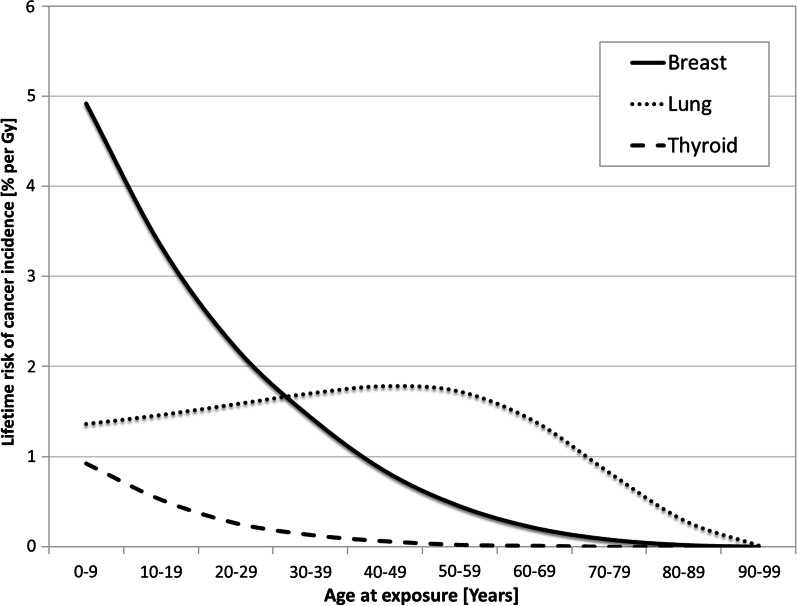
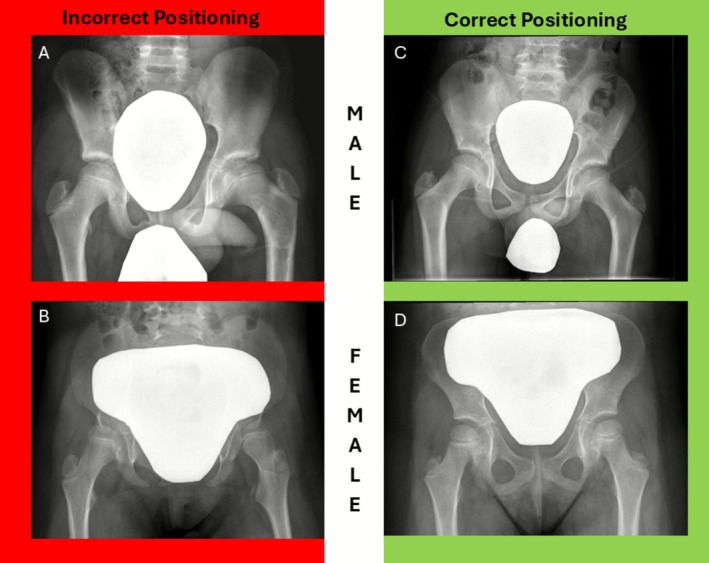
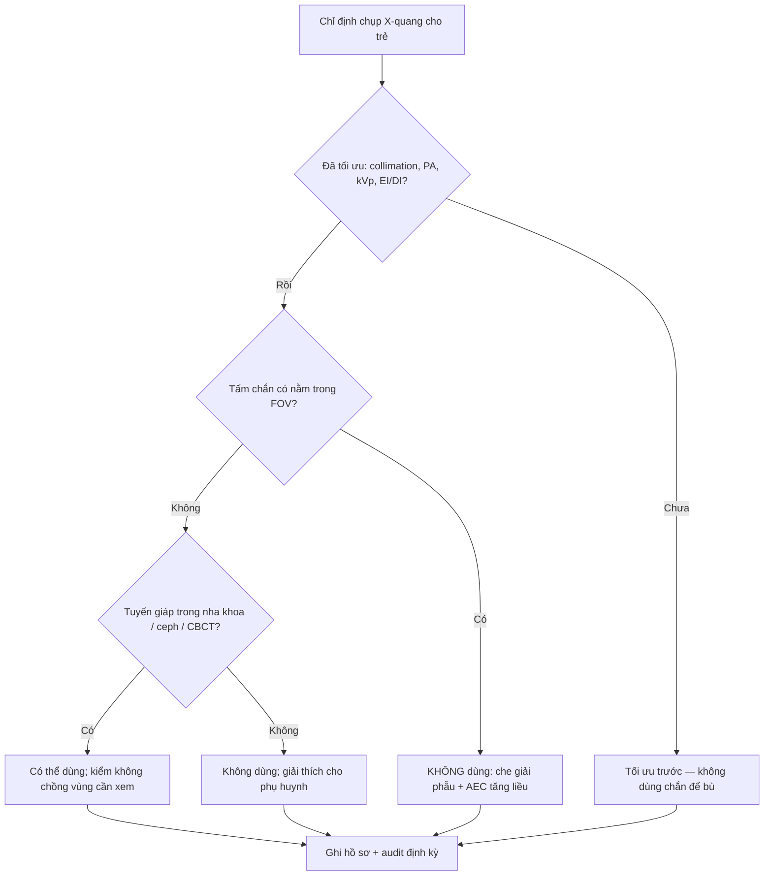

# 9422 — Bỏ che chắn chì trong X-quang trẻ / Discontinuing patient contact shielding in paediatric radiography

**Tags:** `protocol:bo-che-chan` `protocol:AEC` `protocol:DRL` `protocol:X-quang-tre` `protocol:do-lieu` `vung:toan-than` `anatomy:tuyen-sinh-duc`
**Mức chắc chắn (certainty):** tổng hợp y văn (literature synthesis) — khuyến cáo lấy từ **đồng thuận châu Âu 2021** của 7 hội (Hiles P et al., *Insights Imaging* 2021, PMC8695402), **khảo sát châu Âu 2023** (Granata C et al., PMC10279619), **nghiên cứu triển khai 2026** tại bệnh viện nhi (Ryan E et al., PMC13121575), và các tổng quan 2023–2026 về chắn bismuth/CT. Đây là **khuyến cáo dựa trên bằng chứng quan sát và đồng thuận chuyên gia**, không có thử nghiệm lâm sàng về kết cục ung thư.

> **Câu chốt của bài:** với X-quang thường quy ở trẻ, **tấm chắn chì tiếp xúc thường không còn được khuyến cáo** — không phải vì "bức xạ vô hại", mà vì **lợi ích tuyệt đối rất nhỏ** trong khi **tác hại thì thật**: che mất giải phẫu phải xem → **chụp lại** (gấp đôi liều), và đặt tấm chắn lên **buồng đo AEC** → máy **tăng mAs** → liều **tăng chứ không giảm**. Ngoại lệ hẹp còn lại là **tuyến giáp trong nha khoa/ceph/CBCT** (và một số ca đặc biệt có MPE).

## 1. Tổng quan — vì sao "che chắn" đã đổi dấu từ lợi sang hại

- **Vật lý cũ (lý do tấm chắn ra đời):** chì có **Z rất cao**, hấp thụ quang điện mạnh (≈ Z³/E³) nên chặn được chùm tia sơ cấp. Thập kỷ 1950–1990, liều một phim cao hơn nhiều và nỗi sợ **hiệu ứng di truyền** rất lớn → chắn tuyến sinh dục thành "chuẩn mực".
- **Vật lý mới (vì sao lợi ích teo lại):**
  - **Detector số (DR) có DQE cao** → ảnh chẩn đoán được ở liều thấp hơn hẳn phim/screen; phần lớn liều còn lại nằm **trong vùng đang chụp**, không thể che.
  - **Tán xạ chủ yếu là tán xạ trong cơ thể (internal scatter)** — tấm chắn đặt ngoài da **không chặn được** tán xạ phát ra từ trong mô.
  - **AEC (automatic exposure control)** đo tín hiệu tại detector rồi điều chỉnh mAs. Nếu tấm chắn **nằm trên buồng đo**, tín hiệu giảm → máy tưởng "thiếu liều" → **tăng mAs** → liều vào mô trong trường tăng. Đây là cơ chế **tăng liều do chắn**, không phải giảm.
  - **Beam hardening/streak** do chì làm giảm chất lượng ảnh → dễ **chụp lại**; một lần lặp lại **nhân đôi** liều của cả lần khám.
  - **DR có dải động rộng** → dễ **"dose creep"**: tăng mAs mà ảnh vẫn "đẹp", nên phải audit **EI/DI** thay vì tin mắt.
- **Dịch chuyển sinh học–dịch tễ:** ICRP 103 **giảm trọng số mô tuyến sinh dục từ 0,2 xuống 0,08**; hiệu ứng di truyền ở mức liều chẩn đoán **chưa được chứng minh ở người**.
- **Ngưỡng định lượng cốt lõi:**

| Đại lượng | Con số | Ý nghĩa | Nguồn |
|---|---|---|---|
| Giảm liều cơ quan nhờ chắn (các nghiên cứu cũ) | **30–95%** | Con số **tương đối** nghe rất lớn | PMC8695402 |
| Giảm liều tinh hoàn khi chắn ngoài FOV trong CT bụng | **58–95%** | Nhưng **giảm nguy cơ tuyệt đối ~0,5/10.000** | PMC8695402 |
| Trọng số mô tuyến sinh dục (ICRP 103) | **0,2 → 0,08** | Giảm hơn một nửa "giá trị" bảo vệ | PMC8695402 |
| Nguy cơ ung thư vú trọn đời ở bé gái phơi nhiễm 0–9 tuổi | **~4,9%/Gy** | Trẻ nhỏ nhạy nhất; giảm dần theo tuổi | PMC8695402, Fig. 1 |
| Nguy cơ phổi / giáp cùng lứa | **~1,3% / ~0,9% mỗi Gy** | Cơ quan "nhạy" thay đổi theo tuổi | PMC8695402, Fig. 1 |
| Trung tâm châu Âu **vẫn dùng chắn** khi chụp trẻ | **57,5%** (225 trung tâm, 35 nước) | Khoảng trống thực hành | PMC10279619 |
| Tỉ lệ chắn trước can thiệp (bệnh viện nhi) | **45% (nam) / 39% (nữ)** | Mức nền để audit | PMC13121575 |
| Sau khi bỏ chắn: phụ huynh thắc mắc | **0,4% (31/7.581)**; yêu cầu chắn **11 ca trong 5 tháng rồi 0** | "Sợ phản ứng" là rào cản tưởng tượng | PMC13121575 |

*Vì sao trẻ em là nhóm cần tối ưu liều nhất: ở 0–9 tuổi, **vú ~4,9%/Gy**, trong khi tuổi càng lớn nguy cơ càng giảm. Đây là lý do phải tối ưu **collimation, projection, kVp** — chứ không phải đặt chì lên bụng. Hình từ *Insights into Imaging* 2021 (PMC8695402), Fig. 1, CC BY 4.0.*

## 2. Mẫu hình + "gamut" theo cơ quan và modality

Đồng thuận châu Âu 2021 chia khuyến cáo theo **cơ quan – modality – trong/ngoài FOV**. Ba mức: **"nên dùng" / "có thể dùng" / "không khuyến cáo"**.

| Cơ quan | Modality | Trong/ngoài FOV | Khuyến cáo 2021 |
|---|---|---|---|
| **Tuyến sinh dục** (nam và nữ) | Mọi X-quang | Cả hai | **Không khuyến cáo** |
| **Tuyến giáp** | Mọi X-quang (trừ ceph) | Trong FOV | **Không khuyến cáo** |
| **Tuyến giáp** | Cephalometric | Trong FOV | **Có thể dùng** |
| **Tuyến giáp** | X-quang, mammography, fluoroscopy, CT | Ngoài FOV | **Không khuyến cáo** |
| **Tuyến giáp** | Nha khoa trong miệng + ceph | Ngoài FOV | **Có thể dùng** |
| **Tuyến giáp** | CBCT | Ngoài FOV | **Có thể dùng** |
| **Vú** | Mọi X-quang | Cả hai | **Không khuyến cáo** |
| **Thủy tinh thể** | Mọi X-quang | Cả hai | **Không khuyến cáo** |
| **Thai/nhi** | Mọi X-quang | Trong FOV | **Không khuyến cáo** |
| **Thai/nhi** | X-quang, mammography, fluoroscopy, nha khoa, CT | Ngoài FOV | **Không khuyến cáo** |

- **Vì sao nha khoa là ngoại lệ:** tuyến giáp **rất gần FOV** và tỉ lệ bệnh nhi trong nha khoa cao; collar có thể chồng lấn vùng cần xem (ceph) nên phải cân nhắc — nếu dùng, **không để collar vào vùng giải phẫu cần đánh giá** (PMC8695402).
- **Vì sao "ngoài FOV" gần như vô ích:** liều ngoài trường chủ yếu là **tán xạ nội tại**; chắn ngoài da chỉ chặn phần rất nhỏ, trong khi có thể **chạm vùng quét (overscan)** của CT xoắn → **vệt giả** trên ảnh (PMC8695402).
- **Nhóm đặc biệt:** thai phụ, trẻ **chụp lặp lại nhiều lần**, can thiệp mạch máu phức tạp — nếu cân nhắc chắn, phải **MPE (medical physics expert)** tham gia và **ghi vào protocol trước khi dùng**, không quyết tại chỗ.

## 3. Bảng so sánh phân biệt (ma trận đối chiếu)

| Tình huống | Hiệu quả thật / hình ảnh | Chốt vào (rule-in: được dùng) | Chốt loại (rule-out: không dùng) | Gợi ý xác nhận |
|---|---|---|---|---|
| **Chắn tuyến sinh dục trong X-quang chậu trẻ** | Giảm liều tuyến sinh dục **tương đối**, nhưng **nguy cơ tuyệt đối rất nhỏ**; đặt sai **che xương chậu/khung chậu** | Gần như **không ca nào** trong X-quang thường quy | **Mọi X-quang chậu trẻ** — đặc biệt bé gái (khó che đúng buồng trứng) | Ảnh A–D: đặt sai che cả khung chậu; **không dùng** là chuẩn |
| **Cổ áo tuyến giáp trong X-quang ngực/CT ngực** | Giáp nằm **ngoài FOV**; giảm liều rất ít; collar có thể **vào FOV** và che đỉnh phổi/cột sống cổ | Chỉ **nha khoa/ceph/CBCT** ngoài FOV | **X-quang ngực, CT ngực, fluoroscopy** | Kiểm collar có chồng lên vùng cần xem không |
| **Chắn vú trong CT ngực** | Ở người > 30 tuổi **phổi** mới là cơ quan nhạy nhất; chắn vú có thể **tăng liều phổi** | Không có chỉ định thường quy | **CT ngực mọi lứa tuổi** | So sánh liều phổi – vú theo tuổi (Fig. 1) |
| **Bismuth che mắt trong CT sọ** | Giảm liều thủy tinh thể **29,8–41,5%**; thêm AEC **41,3–60,8%**; thêm OBTCM **58,8–71,3%** — nhưng **tăng nhiễu hốc mắt** | Ca **đặc biệt** (chụp lặp lại nhiều, có MPE), có **foam standoff** | **Thường quy** — không có trong khuyến cáo châu Âu | Đo liều TLD trên phantom; đánh giá nhiễu |
| **Chắn thai trong CT bụng/chậu** | Liều thai chủ yếu do **tán xạ nội tại của mẹ**; chắn ngoài da kém hiệu quả, dễ **chạm AEC/overscan** | Ca cá biệt theo **quy trình bằng văn bản** | **Mặc định mọi X-quang/CT** | Hỏi – giải thích – ghi hồ sơ nếu vẫn dùng |
| **Chắn "để trấn an" phụ huynh** | Không giảm nguy cơ thực; **tăng cảm giác sợ** và **mâu thuẫn thông điệp** | Không | **Mọi trường hợp chỉ vì tâm lý** | Giải thích bằng số: 0,4% phụ huynh thắc mắc khi bỏ chắn |

*Cùng một tấm chắn, đặt sai (A–B) che **toàn bộ khung chậu**; đặt "đúng" (C–D) vẫn là một thao tác thủ công dễ sai. Đây là lý do thực hành: **bỏ chắn** an toàn hơn **cố đặt đúng**. Hình từ *J Med Radiat Sci* 2026 (PMC13121575), Fig. 1, CC BY-NC-ND 4.0 — nguyên bản, không crop/ghép.*

## 4. Protocol — bỏ chắn có kế hoạch, không phải "tháo ra rồi thôi"

- **Bước 1 — Chứng cứ & phạm vi:** chốt danh mục bỏ chắn theo bảng mục 2; **giữ ngoại lệ** (nha khoa/CBCT/ceph, ca đặc biệt có MPE). Kiểm tra **luật/quy định địa phương** — một số nước vẫn bắt buộc chắn tuyến sinh dục; khi đó phải sửa quy định hoặc ghi rõ ngoại lệ, **không tự ý vi phạm**.
- **Bước 2 — Kỹ thuật thay thế (quan trọng hơn tấm chắn):**
  - **Collimation** đúng vùng cần xem; **PA** thay AP cho ngực/cột sống/sọ khi được.
  - **kVp/mAs theo cân nặng**, không theo "thói quen"; bỏ **lưới (grid)** ở trẻ nhỏ khi phù hợp.
  - **Fluoroscopy xung (pulsed)**, **last-image hold**, giảm thời gian chiếu.
  - **Audit EI/DI** và **DRL** theo tuổi/cân nặng; theo dõi **tỉ lệ chụp lại**.
- **Bước 3 — Con người:** đào tạo **tất cả** kỹ thuật viên + bác sĩ; dùng mô hình **COM-B/TDF** (capability – opportunity – motivation → behaviour) thay vì chỉ "dán thông báo". Kịch bản trả lời phụ huynh: nêu **lợi ích nhỏ – tác hại thật – kỹ thuật thay thế**.
- **Bước 4 — Đo kết quả:** tỉ lệ chắn trước/sau (mốc tham chiếu **45%/39%**), số ca phải chụp lại, số yêu cầu chắn, khiếu nại. Trong nghiên cứu triển khai: **7.581 bệnh nhi**, chỉ **0,4%** thắc mắc, **11** yêu cầu chắn trong **5 tháng** rồi **0** (PMC13121575).
- **Bước 5 — Ghi hồ sơ:** nếu vẫn dùng chắn, ghi **lý do, vị trí, người quyết định, tư vấn MPE**; nếu không dùng, ghi **"no contact shielding per protocol"** để tránh tranh cãi.

## 5. Biến thể bình thường và cạm bẫy

- **"Bỏ chắn" ≠ "bỏ bảo vệ":** biến số lớn nhất vẫn là **collimation và số lần chụp lại**, không phải tấm chì. Bỏ chắn mà không audit EI/DI thì dễ **dose creep**.
- **Chắn đặt lên buồng AEC:** đây là cạm bẫy **làm tăng liều** hay bị bỏ qua; đặc biệt ở **bàn chụp có 3 buồng đo** — che 1–2 buồng làm máy tăng mAs.
- **CT xoắn và "overscan":** tấm chắn đặt sát vùng quét có thể rơi vào **phần chiếu thêm để tái tạo** → vệt giả, phải quét lại.
- **Bismuth trong CT sọ:** có **giảm liều thủy tinh thể thật** (29,8–41,5%) nhưng **tăng nhiễu hốc mắt** và cần **foam standoff**; đây là **ngoại lệ có điều kiện**, không phải "bằng chứng để quay lại dùng thường quy". Bằng chứng CT còn **không đồng nhất** (PMC12963150, PMC10779489).
- **Nha khoa/CBCT:** collar tuyến giáp **có thể dùng**, nhưng nếu **chồng lên vùng cần xem** (ceph, góc hàm) thì phải bỏ; không có "một cỡ cho mọi ca".
- **Thai phụ:** chắn bụng trong một phim **ngoài vùng chậu** chỉ để "trấn an" là sai; nếu vẫn làm, phải **không chạm AEC** và **không vào vùng quét CT**.
- **Phụ huynh yêu cầu chắn:** giải thích bằng **số liệu tuyệt đối**, không bằng "an toàn tuyệt đối"; đừng hứa "không có nguy cơ".
- **Luật địa phương:** ở nơi quy định còn bắt buộc chắn, ghi rõ **xung đột giữa khuyến cáo và luật**; quyết định thuộc **cơ sở + MPE**, không phải kỹ thuật viên đơn lẻ.

## 6. Tự lượng giá — Blind Quiz

**Ca 1 — Bốn ảnh chậu của trẻ nam/nữ, có/không có tấm chắn tuyến sinh dục. Nhìn ảnh, chọn vị trí "đúng".**

- Gợi ý: ảnh A–B do một kỹ thuật viên khác thực hiện; ảnh C–D theo quy trình chuẩn.
- Câu hỏi: (1) Vì sao A–B bị coi là "sai"? (2) Nếu đây là phim chậu của trẻ 4 tuổi, bạn có dùng chắn không? (3) Hai hậu quả có thể xảy ra khi đặt sai?

<b>Bấm để hiện đáp án</b>

- **Findings:** A–B tấm chắn **quá lớn**, che gần hết **khung chậu/xương cùng** — vùng cần đánh giá; C–D tấm chắn nhỏ, chỉ trên vùng tuyến sinh dục.
- **Trả lời:** (1) Sai vì **che giải phẫu** và có thể **chạm AEC** → phải chụp lại; (2) **Không** — X-quang chậu trẻ thuộc nhóm **"không khuyến cáo chắn"**; (3) **chụp lại (tăng liều)** và **bỏ sót tổn thương** (gãy khung chậu, bệnh lý xương).
- **Điểm cần nhớ:** ngay cả "đúng" (C–D) vẫn là thao tác thủ công **dễ sai** — lý do thực hành là **bỏ chắn** và tối ưu kỹ thuật.
- **Nguồn:** Ryan E et al., *J Med Radiat Sci* 2026 (PMC13121575), Fig. 1, CC BY-NC-ND 4.0; khuyến cáo: PMC8695402.

**Ca 2 — Biểu đồ nguy cơ trọn đời của nữ theo tuổi phơi nhiễm.**

- Câu hỏi: (1) Ở 0–9 tuổi, cơ quan nào có nguy cơ cao nhất? (2) Vì sao nguy cơ giảm khi tuổi tăng? (3) Điều này thay đổi cách bạn tối ưu liều ở trẻ thế nào?

<b>Bấm để hiện đáp án</b>

- **Trả lời:** (1) **Vú** (~4,9%/Gy), rồi **phổi** (~1,3%), **giáp** (~0,9%); (2) vì **số năm sống còn lại** để ung thư biểu hiện giảm dần, và mô tuyến vú chưa biệt hoá ở trẻ; (3) ưu tiên **collimation + PA + kVp theo cân nặng**, đặc biệt với **ngực và cột sống** — không dựa vào tấm chắn.
- **Cạm bẫy:** biểu đồ là **nguy cơ mỗi Gy**, không phải liều của một lần chụp; đừng dùng để nói "một phim nguy hiểm".
- **Nguồn:** Hiles P et al., *Insights into Imaging* 2021 (PMC8695402), Fig. 1, CC BY 4.0.

**Ca 3 — Kỹ thuật viên đặt tấm chì lên bụng một bé gái 6 tuổi cho phim chậu; sau đó máy báo tăng mAs và ảnh bị lặp lại vì mất chi tiết khung chậu.**

- Câu hỏi: hai cơ chế nào giải thích **liều tăng**? Xử trí đúng?

<b>Bấm để hiện đáp án</b>

- **Cơ chế 1 — AEC:** tấm chắn trên buồng đo làm tín hiệu giảm → máy tăng mAs → liều vào mô trong trường **tăng**.
- **Cơ chế 2 — chụp lại:** chì che khung chậu → ảnh không đủ chẩn đoán → **lặp lại** → liều cả lần khám **gấp đôi**.
- **Xử trí:** **bỏ tấm chắn**, collimate lại đúng khung chậu, chụp theo protocol trẻ; **ghi nhận sự cố** và **audit EI/DI**; giải thích cho phụ huynh rằng bỏ chắn là **theo khuyến cáo**, không phải "cẩu thả".
- **Nguồn:** PMC8695402 (cơ chế AEC, artifact); PMC13121575 (thực hành bỏ chắn).

## Bài liên quan chéo
- [9424 – Chụp lại trong X-quang trẻ: mỗi lần lặp **+100% liều**, mục tiêu **5%/7%** (nhi), **LRRL 10,6%**, **93,1%** ảnh bị từ chối vẫn đủ chẩn đoán](../9424-chup-lai-xquang-tre-ti-le-nguyen-nhan-giam/lesson.md) — hệ quả trực tiếp của chắn che mất giải phẫu
- [9421 – CBCT nón trong nha khoa & chỉnh nha ở trẻ](../9421-cbct-non-nha-khoa-chinh-nha-tre/lesson.md) — ngoại lệ tuyến giáp, FOV, DRL
- [9420 – Che chắn thủy tinh thể trong CT trẻ](../9420-bao-ve-thuy-tinh-the-tuyen-giap-ct-tre/lesson.md) — bằng chứng CT và bismuth
- [937 – Liều CT trẻ: SSDE và DRL](../937-lieu-ct-tre-ssde-drl/lesson.md) — audit liều, EI/DI
- [935 – Tối ưu liều can thiệp nhi: DRL](../935-toi-uu-lieu-can-thiep-nhi-drl/lesson.md) — fluoroscopy xung, last-image hold
- [932 – An toàn bức xạ CT/DSA](../932-an-toan-buc-xa-ct-dsa/lesson.md) — nguyên lý ALARA

## Ảnh
- `9422_dat-chan-sai-vi-tri_XR_PMC13121575-Fig1.jpg`, `9422_nguy-co-theo-tuoi_Bieu-do_PMC8695402-Fig1.jpg` — nguồn + giấy phép từng ảnh: `images/CREDITS.md`.
- Ảnh Fig. 1 (PMC13121575) là **CC BY-NC-ND** — giữ nguyên bản, không crop/ghép; ảnh biểu đồ (PMC8695402) là **CC BY 4.0**.

> Không dùng để chẩn đoán độc lập khi chưa có người hướng dẫn.
