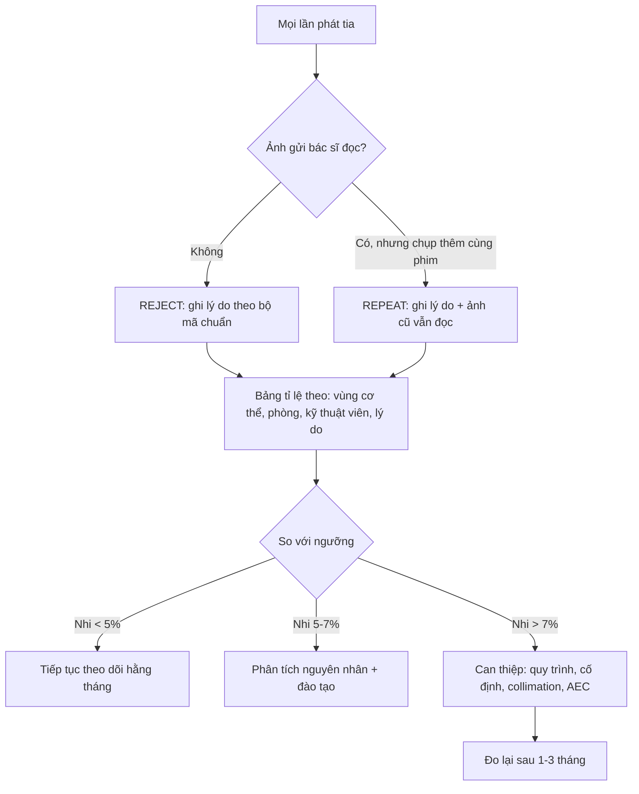
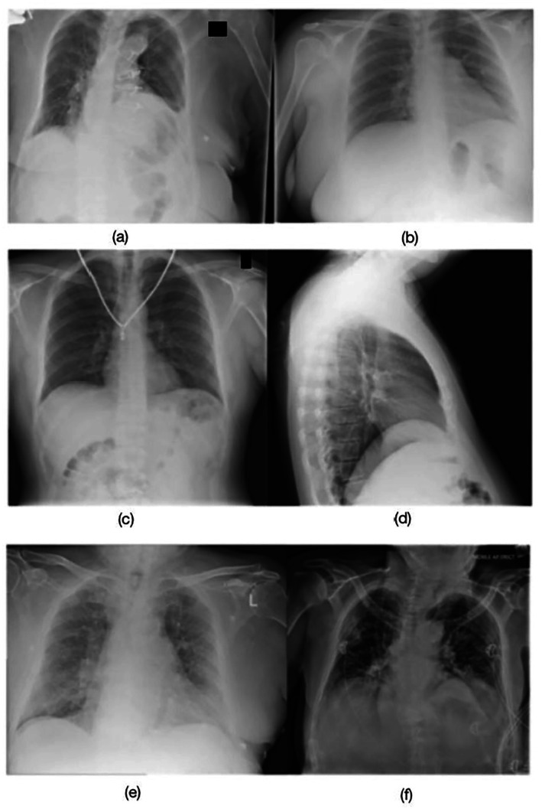
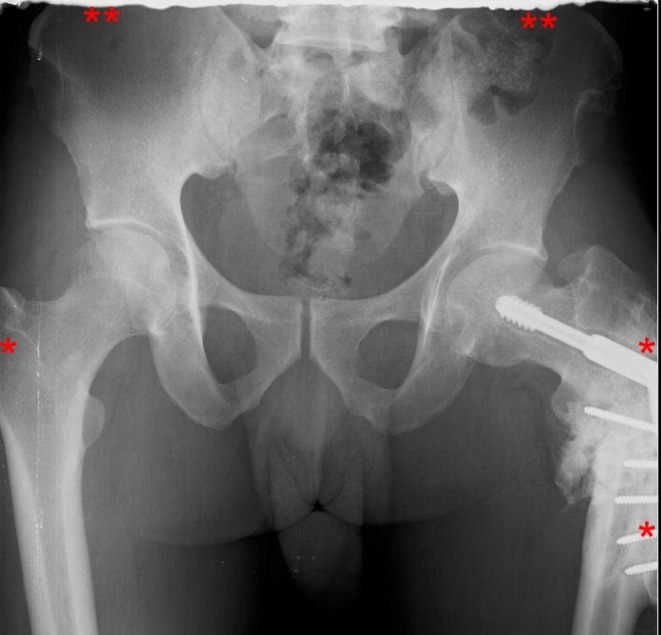
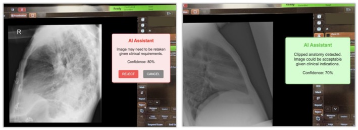

# 9424 — Chụp lại trong X-quang trẻ: mỗi lần lặp gấp đôi liều, ngưỡng nào là "bình thường" và cách giảm / Repeat and reject analysis in paediatric radiography

**Tags:** `protocol:chup-lai` `protocol:reject-analysis` `protocol:DRL` `protocol:LRRL` `protocol:X-quang-tre` `protocol:co-dinh-tre` `protocol:AEC` `vung:toan-than` `score:reject-rate` `incidentaloma:khong`

**Mức chắc chắn (certainty):** tổng hợp y văn (literature synthesis) — ghép **báo cáo AAPM TG-305** (*J Appl Clin Med Phys* 2023, **PMC10161059**, CC BY 4.0), **phân tích 2.031.713 ảnh / 172.495 ảnh bị từ chối tại 44 hệ thống, 11 bệnh viện** (*J Med Radiat Sci* 2024, **PMC11569408**, CC BY-NC-ND 4.0), **nghiên cứu 107.277 phim DR + 20.659 CT** (**PMC10742225**, CC BY 4.0), **audit 47.300 phim có tách nhóm trẻ** (**PMC12302114**, CC BY 3.0), **5.889 phim CR** (**PMC12950496**, CC BY 4.0) và **10.000 phim ngực dạy AI** (**PMC12950515**, CC BY 4.0). Nhóm **không có bệnh nhân của mình**.

> **Câu chốt:** một **lần chụp lại không phải "chụp thêm cho chắc"** — nó là **một suất liều thứ hai lên đúng vùng cơ thể đó**, và ở trẻ **mô đang phân chia + tuổi thọ còn dài** nên cùng một mSv có **nguy cơ trọn đời cao hơn**. Vì vậy đơn vị đo chất lượng không phải "ảnh đẹp" mà là **tỉ lệ chụp lại (reject/repeat rate)** đo được, có **ngưỡng tham chiếu tại chỗ (local reject reference level)**, và **chỉ chụp lại khi ảnh không trả lời được câu hỏi lâm sàng** — không phải khi ảnh chưa đẹp.

## 1. Tổng quan – vì sao "chụp lại" là biến số liều quan trọng nhất còn lại

### 1.1 Định nghĩa tách rời: reject ≠ repeat

- **Ảnh bị từ chối (reject):** ảnh **không được gửi cho bác sĩ đọc**, dù đã phát tia → **liều đã tiêu, không có giá trị chẩn đoán**. Đây là định nghĩa của **AAPM TG-305** (PMC10161059).
- **Ảnh chụp lại (repeat):** ảnh **được chụp thêm** cho cùng một phim/chuỗi, **vượt số ảnh dự kiến**; ảnh cũ **vẫn vào PACS** và **vẫn được đọc**. Repeat có thể **hợp lý** (bệnh nhân lớn hơn detector, cần 2 phim để đủ phổi) hoặc **do lỗi kỹ thuật**.
- **Hệ quả đo lường:** một khoa chỉ báo "reject 5%" có thể vẫn **chụp lại 15%** nếu ảnh lỗi vẫn được gửi đi đọc. **Phải ghi cả hai**, và **ghi lý do** — đây là điểm AAPM TG-305 nhấn mạnh.

### 1.2 Vật lý: mỗi lần lặp là +100% liều của phim đó

- Liều một phim tỉ lệ với **mAs** (và kVp theo hàm mũ): **D ∝ mAs × kVpⁿ**. Chụp lại **cùng phim, cùng thông số** → **D_tổng = 2 × D_phim**; chụp lại 3 lần → **3 ×**.
- **AEC (automatic exposure control) không bảo vệ khỏi chụp lại:** AEC chỉ điều chỉnh **một lần phát tia**; nếu ảnh hỏng vì **tư thế, cắt cụt giải phẫu, cử động**, lần chụp lại vẫn **phát tia đủ liều như lần đầu**.
- **Liều hiệu dụng của phần bị từ chối không biến mất:** trong nghiên cứu 107.277 phim DR, **8.904 ảnh bị từ chối** mang **377,3 mSv** liều hiệu dụng cộng dồn — trung bình **≈ 0,042 mSv cho mỗi ảnh bị từ chối** (PMC10742225). Đây là con số dùng để **quy đổi tỉ lệ % ra mSv** khi báo cáo.
- **Ảnh "gần đúng" vẫn có thể dùng:** 93,1% phim ngực bị từ chối và **77,9%** phim cơ xương bị từ chối **vẫn đủ thông tin chẩn đoán** (Rosenkrantz, dẫn trong PMC10161059) — nghĩa là **phần lớn liều "thừa" đến từ tiêu chuẩn từ chối quá chặt**, không từ máy.

### 1.3 Vì sao trẻ là nhóm riêng

- **Mô trẻ nhạy cảm hơn**: nhiều tế bào đang phân chia, **tuổi thọ còn dài** để biểu hiện tổn thương muộn → cùng một liều, **nguy cơ trọn đời cao hơn người lớn**. Vì vậy các hội đặt **ngưỡng chặt hơn cho khoa nhi**.
- **Hợp tác kém, kích thước nhỏ:** trẻ **không nín thở được**, dễ cử động, **không hiểu lệnh**; detector/trường chiếu lớn hơn cơ thể → dễ **cắt cụt giải phẫu** hoặc **lệch trung tâm**.
- **Số liệu thực địa cho thấy trẻ bị từ chối nhiều hơn:** trong audit 47.300 phim, trẻ chiếm **18,1% khối lượng** nhưng **30,5% tổng số ảnh bị từ chối** → suy ra **≈ 18,6%** phim trẻ bị từ chối so với **≈ 9,3%** ở người lớn (PMC12302114). Đây là **tính lại từ số công bố**, không phải tỉ lệ chuẩn quốc tế.
- **Nguyên nhân ở trẻ nghiêng về tư thế/cử động**, không phải "kỹ thuật phát tia": trong audit trên, **dị vật/artifact 26,2%**, **cử động 18,8%**, **tư thế 14%**, **cắt cụt/collimation 11,7%** (PMC12302114). Ở nghiên cứu 44 hệ thống người lớn, **tư thế chiếm 76%** và **cử động 7,5%** (PMC11569408).

### 1.4 Ngưỡng định lượng nằm lòng

| Đại lượng | Số liệu | Nguồn |
|---|---|---|
| Mục tiêu chung (AAPM TG-151) | **8%**; **5%** là ngưỡng dưới, **10%** là ngưỡng trên cần điều tra | PMC10161059 |
| Mục tiêu **khoa nhi** (AAPM TG-151) | **5%**; **7%** là ngưỡng trên cần điều tra | PMC10161059 |
| Khoảng tỉ lệ đã công bố (DR) | **1,2–17%**; phim–màn hình cũ **~11%**; DR **11–13%** ở nhiều cơ sở | PMC11569408, PMC10161059 |
| Trung vị đa trung tâm | **9,1%** (2.031.713 ảnh); **LRRL = 10,6%** (bách phân vị 75) | PMC11569408 |
| Tỉ lệ DR / CT | **8,3% / 2,5%**; liều hiệu dụng cộng dồn **377,3 / 1.267,4 mSv** | PMC10742225 |
| Tỉ lệ CR tại khoa X-quang | **16,5%** (974/5.889); sọ/xoang **34,9%**, khung chậu **29,9%**, bụng **26,9%** | PMC12950496 |
| Nguyên nhân hàng đầu | **Tư thế 61–76%**; **cắt cụt giải phẫu 21–40,5%**; **cử động 2,9–18,8%** | PMC11569408, PMC10742225, PMC12950496 |
| Vùng bị từ chối nhiều nhất | **Đầu gối 18,1%**, **khung chậu 17,2%** (tương đối); **ngực 2,1%** (tuyệt đối) | PMC11569408 |
| Ảnh từ chối nhưng vẫn đủ chẩn đoán | **93,1%** phim ngực; **77,9%** phim cơ xương | PMC10161059 |
| AI phân loại ảnh dưới chuẩn | **DenseNet121 AUROC 0,97**; **YOLOv8 0,95** (10.000 phim ngực, **có ca nhi**) | PMC12950515 |

> **Đừng so sánh sai:** "9,1%" của PMC11569408 là **trung vị người lớn, hệ thống cố định**; "16,5%" của PMC12950496 là **CR ở nước thu nhập trung bình**; "18,6%" ở trẻ là **số suy ra từ một audit**. Mỗi con số chỉ dùng để **so với chính khoa mình theo cùng định nghĩa**.

## 2. Mẫu hình nguyên nhân + cách định vị (Gamut)

- **Nhóm 1 — tư thế/định vị (positioning):** xoay bệnh nhân, lệch trung tâm, không thẳng trục, tay che phổi, **vai che đỉnh phổi**. Đây là **nguyên nhân số 1** ở mọi loại khoa (61–76%).
- **Nhóm 2 — cử động (motion):** nhòe do **thở, khóc, co giật, run**; trẻ **< 3 tuổi** và **trẻ đau/sợ** là nhóm cao nhất. Trên ảnh: **bờ xương mờ đôi**, **mạch máu nhòe**, **không cắt cụt** nhưng **không đọc được chi tiết**.
- **Nhóm 3 — cắt cụt giải phẫu / collimation:** **mất đỉnh phổi**, **mất mỏm cùng vai**, **mất mấu chuyển lớn**, **mất 1/3 trên xương đùi**. Phân biệt với **che chắn chì** (bài 9422) cũng có thể che mất giải phẫu.
- **Nhóm 4 — artifact:** **quần áo, khuy, dây chuyền, khóa kéo**, **băng dính**, **điện cực**, **vật kim loại trong túi**; **artifact bóng ma của tấm CR** (ghosting do xóa tấm chưa hết); **lưới (grid) sai hướng**; **dấu tay**.
- **Nhóm 5 — phơi sáng (exposure):** **thiếu sáng** (nhiễu, mất chi tiết sau) hoặc **quá sáng** (bão hòa); lưu ý **ảnh thiếu sáng nhưng đủ giải phẫu có thể chấp nhận** (xem mục 5).
- **Nhóm 6 — thiết bị/hệ thống:** **lỗi detector**, **lỗi PACS**, **mất ảnh**, **sai nhãn (labeling)**, **sai bên (R/L)**. Nhóm này **không phải lỗi kỹ thuật viên** nhưng vẫn tính vào tỉ lệ từ chối.
- **Nhóm 7 — yêu cầu lâm sàng:** bác sĩ **yêu cầu thêm phim** (thêm bình diện, thêm vùng) — **không phải reject**, phải **tách khỏi** báo cáo chất lượng.

**Mnemonic "POSITION" khi soi một ảnh bị từ chối:** **P**ositioning, **O**rientation/marker, **S**hielding/collimation, **I**nspiration/motion, **T**echnique/exposure, **I**dentification, **O**verlap, **N**eed (câu hỏi lâm sàng có trả lời được không).

## 3. Bảng so sánh phân biệt (ma trận đối chiếu)

| Nguyên nhân (entity) | Hình ảnh điển hình | Chốt vào (rule-in) | Chốt loại (rule-out) | Gợi ý xác nhận |
|---|---|---|---|---|
| **Xoay / lệch tư thế** | **Xương ức lệch khỏi đường giữa**; **đầu trong xương đòn không đối xứng**; bờ sườn chồng | **Đối xứng hai bên sai + trục xương chuẩn lệch** | Đối xứng tốt, chỉ **thiếu sáng** → không phải lỗi tư thế | Đo khoảng cách đầu xương đòn–gai sau; so 2 bên |
| **Cử động** | **Bờ xương mờ đôi**, mạch máu nhòe, **nhiễu dạng vệt**; giải phẫu vẫn đủ | **Nhòe lặp lại ở ≥ 2 cấu trúc + không cắt cụt** | Nhòe một vùng do **vật lạ di động** → artifact | Hỏi động tác; chụp lại **ngắn thời gian phát tia** hơn |
| **Cắt cụt giải phẫu** | **Mất đỉnh phổi / mỏm cùng vai / mấu chuyển / 1/3 trên xương đùi**; bờ ảnh cắt vào xương | **Mất mốc giải phẫu bắt buộc của phim** | Đủ mốc, chỉ **bờ mềm mô** bị cắt → có thể chấp nhận | Đối chiếu **danh mục mốc giải phẫu** của phim |
| **Artifact quần áo/trang sức** | **Đường cản quang hình khuy, dây, khóa**; bóng lạ ngoài cơ thể | **Vật lạ ngoài cơ thể + không trùng giải phẫu** | **Tổn thương trong xương** trùng vị trí → không phải artifact | Hỏi/tháo vật; chụp lại **sau khi tháo** |
| **Ghosting tấm CR** | **Dải/vệt chéo mờ** trên vùng phổi, **không theo giải phẫu** | **Vệt thẳng, lặp lại giữa các phim cùng tấm** | Đường mờ theo **khe/đường giải phẫu** → bệnh lý | Kiểm tra **lịch xóa tấm**, chạy QC |
| **Thiếu sáng** | **Nhiễu hạt**, mất chi tiết sau, **không bão hòa** | **Giải phẫu đủ + chi tiết cần thiết còn đọc được** → **chấp nhận** | **Mất chi tiết sau tim/phổi** → phải chụp lại | So với **mức nhiễu chấp nhận** của khoa |
| **Sai nhãn / sai bên** | **Marker R/L sai**, tên/ngày sai, **hai bệnh nhân lẫn** | **Sai định danh hoặc sai bên** | Marker đúng, chỉ **mờ** → không phải lỗi nhãn | Đối chiếu **worklist + marker** |
| **Lỗi thiết bị/PACS** | **Ảnh trắng/đen hoàn toàn**, mất một phần, **không lên PACS** | **Lỗi tái lặp trên cùng hệ thống** | Ảnh đủ và lên PACS → không phải lỗi hệ thống | Log kỹ thuật, **báo vật lý y khoa** |
| **Yêu cầu thêm của bác sĩ** | Phim **đúng kỹ thuật**, chỉ thiếu bình diện | **Chỉ định lâm sàng thay đổi** | **Không có lỗi kỹ thuật** → không tính reject | Ghi riêng **"clinical repeat"** |

## 4. Protocol: đo, ngưỡng và can thiệp

### 4.1 Quy trình reject analysis chuẩn hóa (AAPM TG-305)

- **Bộ dữ liệu tối thiểu (TG-305):** mã bệnh nhân ẩn danh, **ngày/giờ**, **thiết bị/phòng**, **vùng cơ thể + bình diện**, **lý do từ chối theo bộ mã**, **người thực hiện**, **ảnh gốc**. Không có các trường này thì **không thể so sánh giữa các lượt**.
- **Ngưỡng tham chiếu tại chỗ (LRRL):** lấy **bách phân vị 75** của tỉ lệ từng phòng trong khoa (cách làm DRL); nghiên cứu 44 hệ thống cho **LRRL 10,6%** với trung vị **9,1%** (PMC11569408). Khoa nhi nên đặt **mục tiêu 5%**, **ngưỡng điều tra 7%** (AAPM TG-151).
- **Tần suất:** báo cáo **hằng tháng**, họp **hằng quý** với bác sĩ; **so sánh cùng vùng cơ thể**, không so tổng khoa (vì tỉ lệ phụ thuộc **cơ cấu phim**: khung chậu/đầu gối cao hơn ngực).
- **Đọc lại ảnh bị từ chối:** chọn ngẫu nhiên **20–30 ảnh/quý**, bác sĩ đánh giá **có đủ chẩn đoán không** — đây là cách phát hiện **từ chối quá tay** (93,1% phim ngực từ chối vẫn đọc được).

### 4.2 Giảm chụp lại ở trẻ — can thiệp theo bằng chứng

| Can thiệp | Cách làm | Chỉ số theo dõi |
|---|---|---|
| **Cố định không xâm lấn** | Người nhà giữ đúng hướng dẫn, **túi cát nhỏ**, đai mềm; tránh giữ tay che phổi | Tỉ lệ reject do cử động/tư thế |
| **Giảm lo sợ** | Giải thích bằng lời trẻ hiểu, **đồ chơi/ánh sáng**, cho trẻ cầm vật; **không doạ** | Tỉ lệ reject ở nhóm 1–5 tuổi |
| **Collimation đúng** | Đặt **trường chiếu theo vùng quan tâm**, luôn gồm **mốc giải phẫu bắt buộc** | Tỉ lệ **cắt cụt** |
| **AEC đúng buồng đo** | Chọn **buồng đo theo vùng**, không đặt **chì/vật cản** lên buồng đo (bài 9422) | mAs trung bình, DAP |
| **Thông số theo cân nặng/tuổi** | **kVp/mAs theo bảng**, không dùng thông số người lớn | **DRL** theo nhóm tuổi (bài 935/937) |
| **Đào tạo + phản hồi** | Thảo luận **ảnh lỗi cụ thể** hằng tuần; **không gắn KPI cá nhân** gây giấu lỗi | Tỉ lệ reject theo kỹ thuật viên (ẩn danh) |
| **AI hỗ trợ tại console** | Mô hình **DenseNet121/YOLOv8** báo "cần chụp lại / có thể chấp nhận" (AUROC **0,97/0,95**) | Số lần chụp lại được ngăn |

### 4.3 Cách tính và báo cáo

- **Tỉ lệ reject (%)** = số ảnh bị từ chối / **tổng số ảnh phát tia** × 100 (dùng **ảnh**, không dùng bệnh nhân — nếu dùng bệnh nhân sẽ **thấp giả**).
- **Tỉ lệ repeat (%)** = số ảnh chụp thêm / **số ảnh dự kiến** × 100.
- **Liều "thừa"** = tỉ lệ reject × **liều trung bình mỗi ảnh** (ví dụ **0,042 mSv**/ảnh DR bị từ chối trong PMC10742225) → quy ra **mSv/năm** để thuyết phục ban lãnh đạo.
- **Luôn ghi rõ mẫu số** và **định nghĩa** — đây là lỗi so sánh phổ biến nhất giữa các bài báo.

## 5. Biến thể bình thường và cạm bẫy

- **Từ chối quá tay (over-rejection):** 93,1% phim ngực và 77,9% phim cơ xương bị từ chối **vẫn đủ chẩn đoán**. Tiêu chuẩn "ảnh hoàn hảo" **không phải** tiêu chuẩn lâm sàng.
- **"Chụp thêm cho chắc":** trong DR, **rào cản tâm lý thấp** vì không tốn phim; đây là giả thuyết được nêu trong PMC10161059 cho tỉ lệ DR cao hơn CR. Cần **quy trình nói rõ khi nào được chụp lại**.
- **Tỉ lệ thấp giả do không ghi nhận:** nếu **không log** ảnh bị từ chối (hoặc log thiếu lý do), "3%" trên báo cáo **không có nghĩa**. TG-305 yêu cầu **dữ liệu thô**, không chỉ số tổng.
- **Nhầm artifact với bệnh lý:** dải mờ do **ghosting tấm CR** có thể bị đọc thành **dày mô kẽ/khe phổi**; ngược lại **đường bờ xương** có thể bị coi là artifact. **Xem lại toàn bộ chuỗi ảnh** trước khi kết luận.
- **Chụp lại vì che chắn:** tấm chì đặt sai **che mất giải phẫu** → phải chụp lại; đây là lý do **bỏ chắn thường quy** (bài 9422) **gián tiếp giảm** chụp lại.
- **So sánh giữa các hãng:** bộ mã lý do khác nhau → **không so trực tiếp** tỉ lệ giữa hai hệ thống nếu chưa **chuẩn hóa mã**.
- **Ảnh "xấu" nhưng trả lời được câu hỏi:** ví dụ phim ngực **thiếu sáng nhẹ nhưng đủ mọi giải phẫu** — chấp nhận; còn ảnh **đẹp nhưng mất đỉnh phổi** — **phải chụp lại** vì mất mốc chẩn đoán.
- **Trẻ có ống/truyền/dụng cụ:** **không tháo** được thì ghi **artifact đã biết**, không mặc định chụp lại nếu ảnh vẫn đọc được.

## 6. Tự lượng giá — Blind Quiz

**Ca 1 — Sáu ảnh ngực của 6 lần chụp khác nhau. Ảnh nào phải chụp lại, ảnh nào chấp nhận được?**

- Gợi ý: đây là bộ ảnh dùng để huấn luyện mô hình phân loại **ảnh tối ưu / dưới chuẩn**, có cả **ca nhi**.
- Câu hỏi: (1) Mô tả lỗi ở (a)–(d). (2) Vì sao (e) **không cần chụp lại** dù phơi sáng chưa đẹp? (3) Nguyên tắc chung để quyết định?

<b>Bấm để hiện đáp án (findings + chẩn đoán)</b>

- **Lỗi:** (a) **mất đỉnh phổi phải**; (b) **nhòe do cử động + mất đỉnh phổi**; (c) **dây chuyền/dụng cụ tạo artifact**; (d) **xoay bệnh nhân + mất đáy phổi**.
- **(e) chấp nhận:** phơi sáng **hơi thiếu** nhưng **toàn bộ giải phẫu cần thiết có đủ** — theo nguyên tắc "đủ để trả lời câu hỏi lâm sàng".
- **Nguyên tắc:** chụp lại khi **mất mốc giải phẫu bắt buộc**, **artifact che vùng quan tâm**, **nhòe không đọc được**, **sai nhãn/bên**; **không** chụp lại chỉ vì ảnh chưa "đẹp".
- Nguồn ảnh: Liu EH, Carrion D, Badawy MK. *J Med Radiat Sci* 2026;73:60–68 (**PMC12950515**), Fig. 2; **CC BY 4.0** — nguyên bản, không crop/ghép.

**Ca 2 — Phim khung chậu: có nên chụp lại?**

- Gợi ý: bệnh nhân có **dụng cụ kết xương** vùng chậu–đùi; ảnh dùng để mô tả lỗi **cắt cụt giải phẫu**.
- Câu hỏi: Mốc nào bị mất? Vì sao ảnh này **không đủ** cho đánh giá khung chậu–háng, dù xương chậu giữa nhìn rõ?

<b>Bấm để hiện đáp án</b>

- **Mất:** **bờ trên mào chậu hai bên**, **hai mấu chuyển lớn**, **1/3 trên xương đùi trái** (dấu *).
- **Vì sao không đủ:** không đánh giá được **toàn bộ khung chậu + khớp háng + ổ cối**; với dụng cụ kết xương, cần thấy **toàn bộ chuôi/ốc vít và mốc xương** để phát hiện lỏng/không liền.
- **Kết luận:** **phải chụp lại** với **collimation rộng hơn** và **định vị lại** — đây là lỗi **cắt cụt**, không phải lỗi phơi sáng.
- Nguồn ảnh: Ofori-Manteaw B, Amevorwoshie PE. *J Med Radiat Sci* 2026;73:87–95 (**PMC12950496**), Fig. 3; **CC BY 4.0** — nguyên bản, không crop/ghép.

**Ca 3 — Màn hình console hiện hai gợi ý khác nhau cho hai ảnh.**

- Câu hỏi: (1) AI đưa ra hai quyết định gì? (2) Vì sao **cùng một mô hình** lại có thể "chấp nhận" ảnh trông chưa đẹp? (3) AI **không** thay thế được bước nào?

<b>Bấm để hiện đáp án</b>

- **Hai quyết định:** trái — **"cần chụp lại"** (kèm **độ tin cậy 80%**); phải — **"có thể chấp nhận theo chỉ định lâm sàng"** (độ tin cậy **70%**), dù **bị cắt cụt giải phẫu**.
- **Vì sao:** chất lượng ảnh **phụ thuộc câu hỏi lâm sàng**; cùng một khuyết điểm (cắt cụt nhẹ) có thể **không ảnh hưởng** nếu bác sĩ chỉ cần đánh giá một vùng khác.
- **AI không thay thế:** **quyết định lâm sàng của bác sĩ/kỹ thuật viên** và **trách nhiệm giải thích cho gia đình**; AI chỉ là **phản hồi tức thì** để giảm chụp lại.
- Nguồn ảnh: **PMC12950515**, Fig. 8; **CC BY 4.0** — nguyên bản, không crop/ghép.

## Bài liên quan chéo
- [9422 – Bỏ che chắn chì trong X-quang trẻ](../9422-bo-che-chan-chi-xquang-tre/lesson.md)
- [937 – Liều CT ở trẻ: SSDE & DRL](../937-lieu-ct-tre-ssde-drl/lesson.md)
- [935 – Tối ưu liều can thiệp nhi & DRL](../935-toi-uu-lieu-can-thiep-nhi-drl/lesson.md)
- [9420 – Bảo vệ thủy tinh thể khi CT ở trẻ](../9420-bao-ve-thuy-tinh-the-tuyen-giap-ct-tre/lesson.md)
- [9421 – CBCT nha khoa & chỉnh nha ở trẻ](../9421-cbct-non-nha-khoa-chinh-nha-tre/lesson.md)

> **Không dùng để chẩn đoán độc lập khi chưa có người hướng dẫn.**
