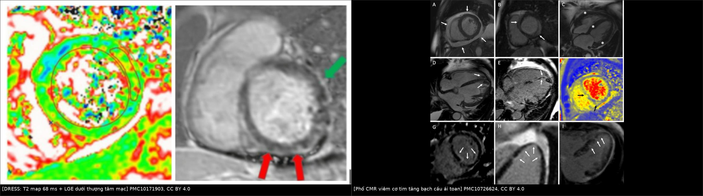
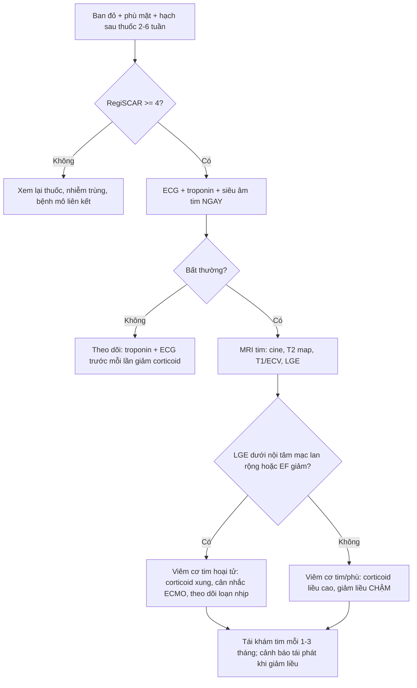
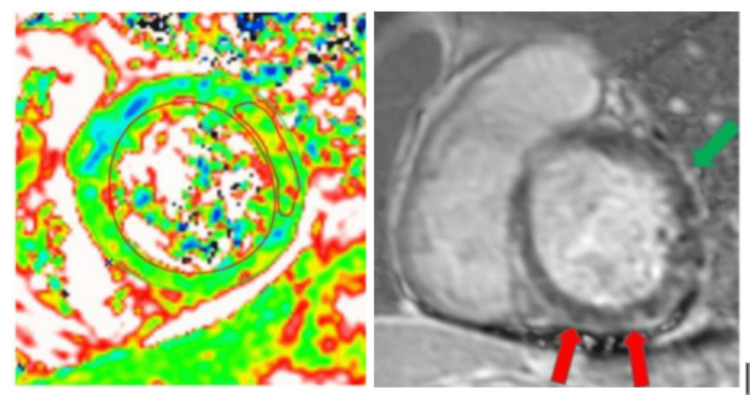
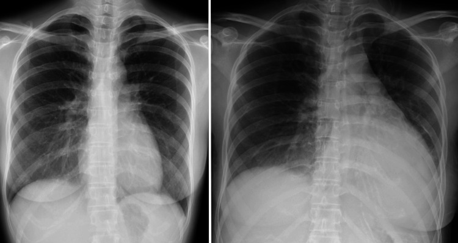
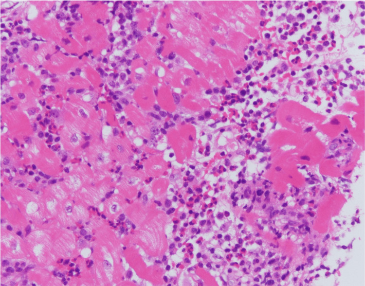

# 943 — Viêm cơ tim do DRESS: khi ban đỏ chỉ là phần nổi của tảng băng / DRESS-associated myocarditis

**Tags:** `pattern:LGE-cotim` `pattern:phu-co` `pattern:tran-dich-mang-tim` `vung:cotim` `score:Lake-Louise` `score:RegiSCAR` `protocol:MRI-tim` `protocol:tiem-can-quang`
**Mức chắc chắn (certainty):** tổng hợp y văn (literature synthesis) — biên từ tổng quan hệ thống **42 ca** tổn thương tim trong DRESS (PMC8836915, CC BY 4.0), loạt **15 ca viêm cơ tim tăng bạch cầu ái toan (eosinophilic myocarditis, EM) có mô bệnh học** được chụp MRI tim (PMC10726624, CC BY 4.0), ca tử vong do ngộ độc phenobarbital (PMC11289355, CC BY 4.0) và ca viêm màng ngoài tim–cơ tim sau thuốc chống lao (PMC10171903, CC BY 4.0). Số liệu lấy từ toàn văn/bảng, không viết từ abstract gián tiếp.

## 1. Tổng quan — vì sao một phản ứng thuốc lại giết bằng cơ tim

### 1.1. Cơ chế: tế bào T → bạch cầu ái toan → men độc → cơ tim hoại tử

- DRESS (drug reaction with eosinophilia and systemic symptoms) là **quá mẫn muộn typ IVb**: tế bào T nhớ thuốc (hapten hoặc p-i concept) tăng sinh, tiết **IL-5** → huy động và hoạt hóa **bạch cầu ái toan**; đồng thời tái hoạt **HHV-6** khuếch đại phản ứng (PMC11289355). Đây là lý do DRESS **không phải "dị ứng i-ốt"** và không xuất hiện trong vài phút như phản ứng tức thời ([936](../936-phan-ung-da-muon-nang-sau-can-quang/lesson.md)).
- Bạch cầu ái toan đổ vào cơ tim và **thoái hạt (degranulation)**, giải phóng các protein cation: **MBP (major basic protein), ECP (eosinophil cationic protein), EDN (eosinophil-derived neurotoxin), EPO (eosinophil peroxidase)**. Các protein này **phá màng tế bào cơ tim** → hoại tử và apoptosis, không phụ thuộc tắc mạch vành (PMC11289355). Đây là điểm mấu chốt: tổn thương **không theo lãnh thổ vành**.
- Hai thể mô bệnh quyết định tiên lượng:
  - **AHM (acute hypersensitivity myocarditis)** — thâm nhiễm kẽ, ít hoại tử, thường **lui khi ngừng thuốc**.
  - **ANEM (acute necrotizing eosinophilic myocarditis)** — hoại tử cơ tim lan rộng, **tử vong ~50%** dù điều trị (PMC11289355); trên MRI tim thể này có **khối LGE lớn gấp đôi** (32,1% vs 14,5% khối lượng thất trái) và nhiều đoạn tổn thương hơn (**15 ± 2 vs 9 ± 3** trong 17 đoạn) (PMC10726624). **TẠI SAO:** hoại tử càng rộng → khoang ngoại bào càng lớn → càng nhiều gadolinium ứ lại → LGE càng đậm và lan; đồng thời cơ tim mất co bóp → EF giảm, thành dày giả do phù.

### 1.2. Vì sao hình ảnh trông như vậy — vật lý của phù và LGE

- **T2 tăng (edema):** phù làm tăng nước tự do ngoại bào → thời gian **T2 kéo dài** → tín hiệu sáng trên T2W/T2-STIR và **T2 mapping tăng**. Trong ca DRESS có viêm màng ngoài tim–cơ tim, **T2 mapping tại vùng tổn thương = 68 ms** (bình thường **< 60 ms**) (PMC10171903). Trong loạt 15 ca EM, T2 map vùng vách đạt **70–80 ms** (PMC10726624).
- **LGE (late gadolinium enhancement):** gadolinium rút ngắn T1 của mô; bình thường nó bị đẩy ra khỏi tế bào sống, nhưng **hoại tử/xơ làm tăng thể tích ngoại bào** → gadolinium ứ lại → trên ảnh inversion-recovery, vùng tổn thương **sáng hơn cơ tim lành** (dù cơ tim lành bị "null" thành đen). Vì vậy LGE là dấu của **mất tế bào**, không phải của phù cấp.
- **Phân bố:** EM cho LGE **đa ổ, luôn có thành phần dưới nội tâm mạc**, nhưng có thể lan giữa thành/dưới thượng tâm mạc hoặc xuyên thành — **khác nhồi máu** (dưới nội tâm mạc/xuyên thành **theo một lãnh thổ vành** và tương ứng vùng giảm tưới máu) (PMC10726624).
- **T1/ECV:** khi không thấy LGE, tổn thương vẫn có thể lộ ra bằng **native T1 1150–1200 ms** và **ECV 30–40%** — tức là phù/tăng khoang ngoại bào lan tỏa (PMC10726624). Đây là lý do **không được loại trừ viêm cơ tim chỉ vì không có LGE**.

### 1.3. Con số phải nhớ

| Chỉ số | Số liệu | Nguồn |
|---|---|---|
| Nguy cơ DRESS | **1/1.000 – 1/10.000** lần phơi nhiễm thuốc; **~90%** có tổn thương tạng | PMC11289355 |
| Tổn thương tim trong DRESS | **4–21%** | PMC11289355 |
| Thời điểm tim bị ảnh hưởng | **69%** ngay lúc chẩn đoán; **29%** xuất hiện muộn, cách **13–371 ngày** (trung bình 70,1 ± 63; **trung vị 55 ngày**) | PMC8836915 |
| Triệu chứng tim | khó thở **54,8%**, sốc/tụt huyết áp **42,9%**, đau ngực **38,1%**, nhịp nhanh **33,4%** | PMC8836915 |
| ECG bất thường | **71,4%** (nhịp nhanh xoang 33,4%; ST chênh lên 26,2%; T đảo 11,9%; block nhánh 19%) | PMC8836915 |
| Siêu âm | EF **< 50%: 45,2%**; tràn dịch màng ngoài tim **40,5%**; rối loạn vận động vùng **26,2%** | PMC8836915 |
| Troponin tăng | **57%** (24/42); **35,7%** ca không được đo troponin | PMC8836915 |
| Tử vong | **45% (19/42)**; tử vong có thời gian tiềm tàng ngắn hơn (26,7 ± 18 vs 40,7 ± 23 ngày, p < 0,05) và tuổi **> 65** | PMC8836915 |
| MRI tim ở viêm cơ tim tăng bạch cầu ái toan (n = 15) | phù cơ tim **100%**; LGE **93%**; EF **< 50%: 73%**, **< 30%: 13%**; tràn dịch **53%**; LV không giãn **40%**; huyết khối trong thất **2 ca** | PMC10726624 |
| Mức độ nặng | **48%** cần trợ tuần hoàn (inotrope/ECMO); **30%** tử vong do tim, ghép tim hoặc loạn nhịp thất nguy hiểm | PMC10726624 |
| Thể hoại tử (ANEM) | tử vong **~50%**; LGE mass **32,1 ± 16,6%** vs **14,5 ± 7,7%** (p = 0,050) | PMC11289355, PMC10726624 |

- **Điểm cần phản biện:** tổng quan 42 ca là **tổng hợp ca báo cáo**, chọn lọc ca nặng đã được công bố → **45% tử vong là con số của thể có triệu chứng**, không phải của mọi bệnh nhân DRESS. Ngược lại, loạt MRI 15 ca có **troponin tăng 100%** vì đây là các ca được chỉ định chụp; không dùng hai con số này để ước lượng tỷ lệ chung.

## 2. Mẫu hình + chẩn đoán phân biệt theo thời điểm và theo kiểu hình (Gamut)

### 2.1. Gamut theo thời điểm — câu hỏi đầu tiên là "tim xuất hiện lúc nào so với ban?"

- **Cùng lúc với ban (69%):** sốc nhiễm khuẩn/nhiễm khuẩn huyết, phản ứng thuốc tức thời, bệnh nền (bệnh mạch vành cấp, bệnh cơ tim).
- **Muộn 2 tuần – 12 tháng (29%, tới 371 ngày):** viêm cơ tim do DRESS, **viêm cơ tim do thuốc khác**, bệnh cơ tim do stress, bệnh cơ tim chu sản (nếu thai kỳ), thiếu máu cơ tim do thiếu máu nặng/nhiễm trùng.
- **Sau khi giảm corticoid:** **tái phát viêm cơ tim do DRESS** — đây là bẫy kinh điển; ca tử vong tái phát đúng lúc prednisolone giảm còn **25 mg/ngày**, 8 tháng sau khởi phát (PMC11289355).

### 2.2. Gamut theo kiểu hình trên MRI tim

- **Phù + LGE dưới nội tâm mạc đa ổ (kèm hoại tử):** ANEM — tiên lượng xấu nhất.
- **Phù + LGE giữa thành/dưới thượng tâm mạc:** AHM, viêm cơ tim do virus/thuốc khác, sarcoid — cần bối cảnh.
- **Phù lan tỏa + tràn dịch màng ngoài tim + thành dày giả:** viêm màng ngoài tim–cơ tim; phân biệt với **bệnh cơ tim thâm nhiễm** (amyloid) bằng T1/ECV và độ dày thật.
- **Giảm EF không LGE:** bệnh cơ tim do stress, nhiễm khuẩn huyết, thiếu máu; phải loại trừ bằng men tim + T1/T2 mapping.

## 3. Bảng so sánh phân biệt (ma trận đối chiếu)

| Thực thể (entity) | Hình ảnh điển hình | Chốt vào (rule-in) | Chốt loại (rule-out) | Gợi ý xác nhận |
|---|---|---|---|---|
| **Viêm cơ tim DRESS (AHM)** | Phù cơ tim (T2/STIR, T2 map tăng), LGE giữa thành/dưới thượng tâm mạc, tràn dịch màng ngoài tim; tim **không giãn**, EF giảm vừa | **Ban + phù mặt + hạch + tăng bạch cầu ái toan trong 2–6 tuần sau thuốc**, men tim tăng, LGE không theo lãnh thổ | Men tim và ECG **bình thường lúc đầu không loại trừ** (ca tử vong có troponin bình thường ở giai đoạn DRESS) | RegiSCAR ≥ 4; MRI tim; ngừng thuốc |
| **ANEM (hoại tử)** | LGE **dưới nội tâm mạc lan rộng ≥ 4 đoạn liền kề** (54% ca có LGE), LGE mass **23 ± 15%** khối lượng thất trái; có thể huyết khối trong thất | **LGE dưới nội tâm mạc nhiều đoạn + EF giảm nhanh + sốc** | LGE khu trú một vùng theo vành → nhồi máu | Sinh thiết cơ tim (eosinophil + hoại tử) |
| **Nhồi máu cơ tim cấp** | LGE **dưới nội tâm mạc hoặc xuyên thành theo đúng lãnh thổ** một nhánh vành, khớp vùng giảm tưới máu | **LGE theo lãnh thổ + tắc vành trên chụp mạch** | LGE đa ổ nhiều lãnh thổ + mạch vành sạch → không phải nhồi máu | Chụp vành (ca DRESS điển hình có vành **bình thường**) |
| **Viêm cơ tim do virus/thuốc khác** | Phù + LGE giữa thành/dưới thượng tâm mạc, thường ở vách/bên; tiền sử nhiễm virus | **Bối cảnh nhiễm virus ± PCR**, không có ban DRESS | Có ban DRESS + tăng bạch cầu ái toan + tổn thương gan → nghi DRESS | Hỏi thuốc 2–6 tuần trước; RegiSCAR |
| **Viêm cơ tim tăng bạch cầu ái toan không do thuốc (HES, EGPA, ký sinh trùng)** | Cùng phổ MRI với ANEM | **Bạch cầu ái toan > 1,5 × 10⁹/L kéo dài, tổn thương đa tạng, không có thuốc khởi phát** | Có thuốc khởi phát trong 2–6 tuần + ban + hạch → DRESS | ELISA ký sinh trùng, ANCA, sinh thiết |
| **Viêm màng ngoài tim đơn thuần** | Dày màng ngoài tim, tràn dịch, LGE màng ngoài tim; **cơ tim không LGE** | Tràn dịch + LGE màng ngoài tim, men tim bình thường | Men tim tăng + LGE cơ tim → đã có viêm cơ tim | MRI tim |

*Trái: ca DRESS sau thuốc chống lao — T2 map **68 ms** (bình thường < 60) và LGE dưới thượng tâm mạc vòng quanh + màng ngoài tim (PMC10171903). Phải: phổ MRI của 15 ca EM có mô bệnh — tràn dịch, LGE dưới nội tâm mạc/giữa thành, huyết khối đỉnh thất, T2 map 70–80 ms (PMC10726624). Cả hai ảnh CC BY 4.0; ghép letterbox bằng `tools/make_composite.py`.*

### 3.1. Đọc LGE cho đúng: ba câu hỏi

1. **Có theo lãnh thổ vành không?** Có → nhồi máu. Không, đa ổ → viêm.
2. **Lớp nào?** Dưới nội tâm mạc lan rộng → thể hoại tử (nặng); giữa thành/dưới thượng tâm mạc → thể "myocarditis-like".
3. **Có phù đi kèm không?** LGE + phù cùng vùng = tổn thương **hoạt động**; LGE đơn độc + thành mỏng = **sẹo cũ**.

## 4. Protocol chụp + hệ phân độ/điểm chuẩn hóa

### 4.1. Ai cần tầm soát tim, và tầm soát bằng gì

- **Mọi bệnh nhân DRESS** (RegiSCAR ≥ 4 hoặc thể chắc chắn): **ECG 12 chuyển đạo + troponin (hs-cTnT/hs-cTnI) + siêu âm tim** ngay khi nhập viện, kể cả khi không có triệu chứng — vì **69%** tổn thương tim đã có lúc chẩn đoán và bệnh nhân có thể chỉ "mệt".
- **Lặp troponin/ECG trước mỗi lần giảm liều corticoid** và khi có triệu chứng mới: tái phát xảy ra đúng lúc giảm liều (ca tử vong: tái phát ở **25 mg/ngày**, 8 tháng sau khởi phát).
- **MRI tim** khi troponin tăng, ECG bất thường, EF giảm, hoặc nghi ngờ mà siêu âm không giải thích được. Trong loạt 15 ca, MRI được chụp **trung vị 1 ngày** sau nhập viện (khoảng 1–7 ngày), với **0,15 mmol/kg gadolinium**, ảnh LGE sau **10–15 phút**, TI **240–360 ms**, cine lát **6–8 mm**, khoảng cách lát **20%** (PMC10726624).

### 4.2. Trình tự chuỗi xung tối thiểu (đủ để không bỏ sót)

1. **Cine** (SSFP) 2-, 3-, 4-buồng + chuỗi ngắn trục: đo EF, thể tích, độ dày thành, tràn dịch.
2. **T2W STIR/T2 mapping**: phù cơ tim — dấu của tổn thương **hoạt động**. T2 map **> 60 ms** tại vùng nghi ngờ là bất thường trong ca được nêu.
3. **T1 mapping native + ECV** (nếu có): phát hiện tổn thương lan tỏa khi **không có LGE** (ca không LGE có native T1 **1150–1200 ms**, ECV **30–40%**).
4. **LGE** sau tiêm 10–15 phút: bản đồ 17 đoạn, ghi rõ **số đoạn**, **lớp**, **khối lượng LGE (% khối lượng thất trái)** — vì con số này phân biệt thể hoại tử.

### 4.3. Phân độ và ngưỡng hành động

- **Chẩn đoán DRESS:** thang **RegiSCAR** (điểm < 2 = không; 2–3 = có thể; 4–5 = chắc; > 5 = chắc chắn) — chi tiết ở [936](../936-phan-ung-da-muon-nang-sau-can-quang/lesson.md).
- **Chẩn đoán viêm cơ tim:** **Lake Louise 2018** cần **một tiêu chuẩn T2** (phù) **và một tiêu chuẩn T1** (LGE, T1 mapping, ECV) — không chẩn đoán chỉ bằng LGE đơn độc ([820](../820-cardiac-mri-lge-mapping/lesson.md)).
- **Ngưỡng men tim trong loạt này:** troponin T **> 50 ng/L** hoặc troponin I **> 125 ng/L** được coi là tăng (PMC10726624).
- **Ngưỡng can thiệp:** EF **< 50%** hoặc LGE lan rộng/huyết khối → theo dõi sát, cân nhắc trợ tuần hoàn; **sốc tim/loạn nhịp thất** → ECMO (48% ca trong loạt cần trợ tuần hoàn).

### 4.4. Điều trị (phần ảnh hưởng trực tiếp tới hình ảnh và theo dõi)

- **Ngừng ngay thuốc nghi ngờ** — bước duy nhất chắc chắn làm giảm tổn thương.
- **Corticoid toàn thân là nền tảng:** **100%** ca trong tổng quan nhận corticoid tĩnh mạch (PMC8836915). Ca thực tế dùng **mPSL 1.000 mg/ngày × 3 ngày**, rồi prednisolone **60 mg/ngày**; ca khác dùng **mPSL 500 mg/ngày × 3 ngày** + cyclosporine **200 mg/ngày** (PMC11289355, PMC10171903).
- **Giảm liều chậm, theo tháng**, và **đo troponin trước mỗi bậc giảm**. Khi thất bại: **cyclosporine, mycophenolate, IVIG** (60% ca không đáp ứng cần thuốc tiết kiệm corticoid), **mepolizumab 300 mg** (kháng IL-5), **cyclophosphamide**; sốc/loạn nhịp → ECMO (PMC8836915, PMC11289355).
- **Theo dõi sau ra viện:** tái phát có thể xảy ra **8 tháng** sau khởi phát; siêu âm tim định kỳ tới khi EF bình thường và corticoid đã ngừng.

## 5. Biến thể bình thường và cạm bẫy

- **Troponin/ECG bình thường lúc DRESS khởi phát KHÔNG loại trừ viêm cơ tim.** Ca tử vong: ECG không dấu viêm, troponin I bình thường; **2 tháng sau** mới có tim to + sung huyết phổi (PMC11289355). Đây là cạm bẫy "satisfaction of search" điển hình — đã tìm thấy ban và tăng bạch cầu ái toan nên dừng lại.
- **Tăng bạch cầu ái toan chỉ có ở 60% lúc nhập viện** (80% trong cả đợt) — không có eosinophilia không loại trừ DRESS (PMC10726624).
- **Tim to trên X-quang:** đừng quy hết cho tràn dịch màng ngoài tim; trong ca DRESS, tim to kèm sung huyết phổi là **suy tim do viêm cơ tim**, và X-quang chỉ là dấu muộn.
- **Thành tim dày trên cine có thể là phù, không phải phì đại thật:** 67% ca EM có khối lượng thất trái tăng trên MRI nhưng đây là **phù cơ tim**; đo lại sau khi viêm lui trước khi gọi "phì đại".
- **LGE giả do TI sai hoặc do nhịp nhanh:** nhịp tim trung bình khi chụp LGE trong loạt là **85 ± 19 lần/phút**; nhịp nhanh + tràn dịch làm ảnh mờ, có thể bỏ sót LGE (ca không LGE có T1/ECV tăng bù trừ).
- **Không sinh thiết cơ tim thường quy** khi đã đủ tiêu chuẩn Lake Louise + bối cảnh DRESS; sinh thiết dành cho ca không điển hình, nghi bệnh khác (sarcoid, GCM) hoặc cần phân độ hoại tử — và có nguy cơ chọc thủng.

## 6. Tự lượng giá — Blind Quiz

**Ca 1 — Nữ 34 tuổi, ban + sốt sau thuốc chống lao, tụt huyết áp ngày thứ 2.**

- Gợi ý lâm sàng: ban dát sẩn, tăng bạch cầu ái toan, men gan tăng, troponin tăng, ECG ST chênh lên lan tỏa.
- Câu hỏi: Tìm dấu hiệu trên T2 map và LGE? Tổn thương theo lãnh thổ vành hay không? Ba chẩn đoán phân biệt?

<b>Bấm để hiện đáp án (findings + chẩn đoán)</b>

- Dấu hiệu: **T2 mapping tăng 68 ms** (bình thường < 60 ms) ở vùng cơ tim bị tổn thương; **LGE dưới thượng tâm mạc vòng quanh** (mũi tên đỏ) + **LGE màng ngoài tim** (mũi tên xanh), tức phù + tổn thương cơ tim và màng ngoài tim.
- Chẩn đoán: **viêm màng ngoài tim–cơ tim do DRESS** — tổn thương không theo lãnh thổ vành, phù hợp phản ứng quá mẫn muộn; EF giảm và hồi phục sau corticoid + cyclosporine.
- Vì sao: bạch cầu ái toan thoái hạt giải phóng protein cation gây hoại tử cơ tim → phù (T2 dài) và tăng khoang ngoại bào (LGE).
- Nguồn ảnh: Kong D et al., *Cureus* 2023;15(4):e37399, Fig. 3, PMC10171903, **CC BY 4.0**.

**Ca 2 — Nữ 30 tuổi, DRESS do phenobarbital, 2 tháng sau khó thở và phù.**

- Gợi ý: ban đã lui, không còn tăng bạch cầu ái toan; hiện khó thở, mệt, tiếng tim mờ.
- Câu hỏi: So sánh hai phim? Chẩn đoán nào phải nghĩ tới dù ban đã hết? Xét nghiệm nào quyết định?

<b>Bấm để hiện đáp án</b>

- Dấu hiệu: phim trái lúc khởi phát DRESS — tim bình thường; phim phải lúc suy tim — **tim to + sung huyết phổi**.
- Chẩn đoán: **viêm cơ tim do DRESS xuất hiện muộn** (2 tháng sau), dù da đã ổn. Troponin I và BNP tăng; sinh thiết cơ tim có thâm nhiễm bạch cầu ái toan → viêm cơ tim tăng bạch cầu ái toan.
- Bài học: **ban hết không có nghĩa là bệnh hết**; tim có thể là cơ quan duy nhất còn hoạt động viêm.
- Nguồn ảnh: Watanabe A et al., *Cureus* 2024;16(6):e63541, Fig. 1, PMC11289355, **CC BY 4.0**.

**Ca 3 — Cùng bệnh nhân, sinh thiết cơ tim.**

- Câu hỏi: Tế bào nào đang xâm nhập giữa các sợi cơ? Vì sao hình ảnh này giải thích được LGE và EF giảm?

<b>Bấm để hiện đáp án</b>

- Dấu hiệu: **thâm nhiễm bạch cầu ái toan và đại thực bào giữa các sợi cơ tim**, kèm mất sợi cơ.
- Chẩn đoán: **viêm cơ tim tăng bạch cầu ái toan** (thể có hoại tử trên lâm sàng).
- Vì sao: hoại tử cơ tim làm tăng khoang ngoại bào → LGE; mất sợi co bóp → EF giảm; phù → T2 tăng.
- Nguồn ảnh: Watanabe A et al., *Cureus* 2024;16(6):e63541, Fig. 2, PMC11289355, **CC BY 4.0**.

## Bài liên quan chéo
- [936 — Phản ứng da muộn nặng sau cản quang (DRESS, AGEP, SJS/TEN)](../936-phan-ung-da-muon-nang-sau-can-quang/lesson.md)
- [933 — An toàn thuốc cản quang](../933-an-toan-thuoc-can-quang/lesson.md)
- [820 — MRI tim: LGE và mapping](../820-cardiac-mri-lge-mapping/lesson.md)
- [810 — CTA vành và CAD-RADS](../810-coronary-cta-cadrads/lesson.md)
- [001 — Tổng quan hệ Ngực](../001-tong-quan-he-nguc/lesson.md)

## Ảnh
- `943_DRESS-CMR-T2-LGE_MRI_PMC10171903.jpg`, `943_EM-CMR-phenotypes_MRI_PMC10726624.jpg`, `943_DRESS-CXR_PMC11289355.jpg`, `943_DRESS-sinh-thiet-tim_PH_PMC11289355.jpg`, `composite_943_CMR-DRESS-va-EM.jpg`. Nguồn + giấy phép từng ảnh: `images/CREDITS.md`.

> Không dùng để chẩn đoán độc lập khi chưa có người hướng dẫn.
