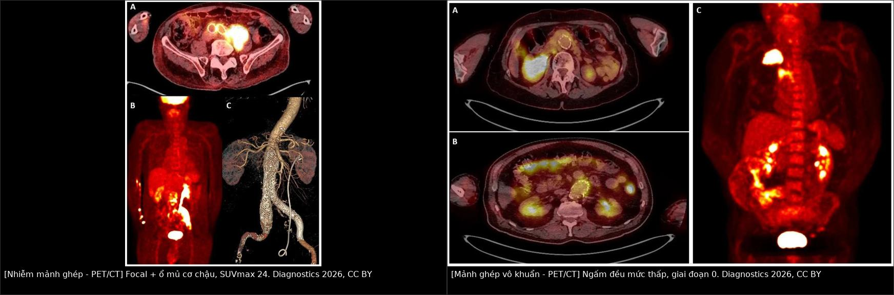
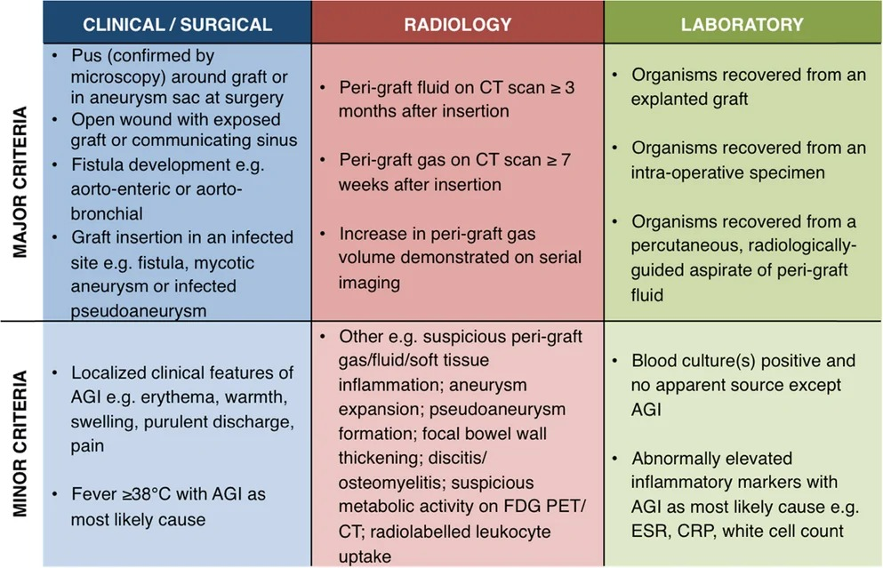
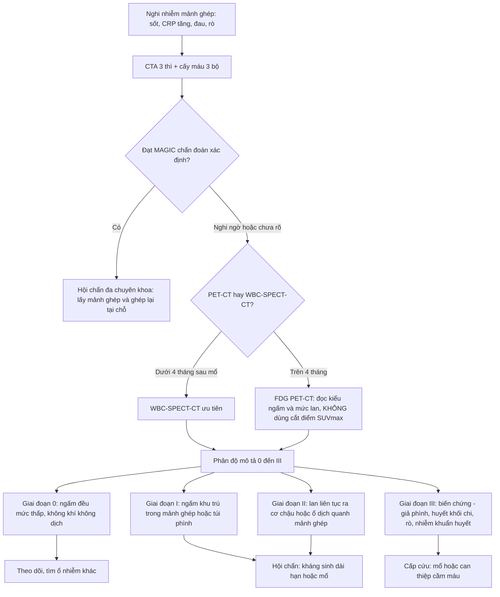
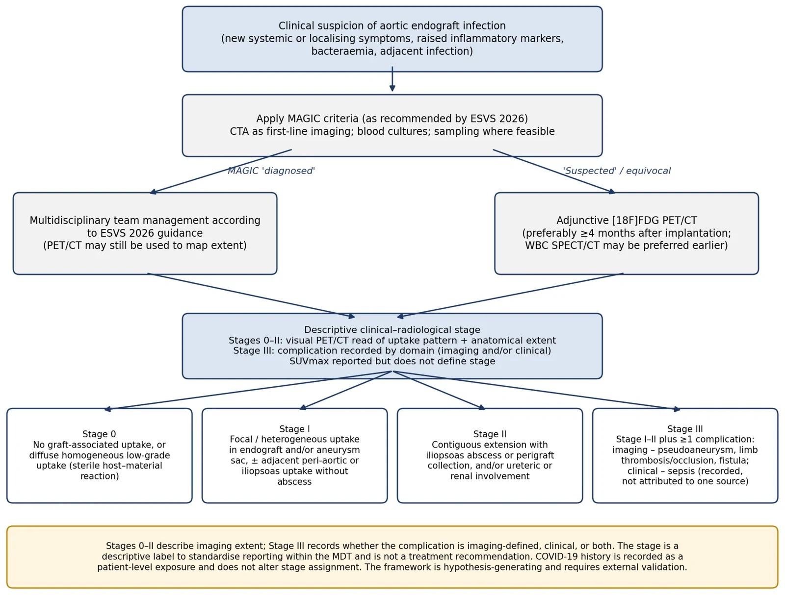
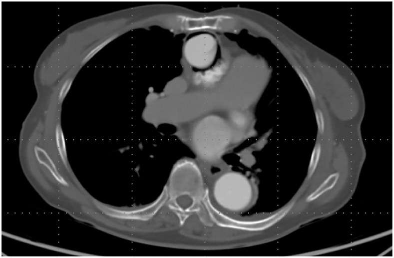
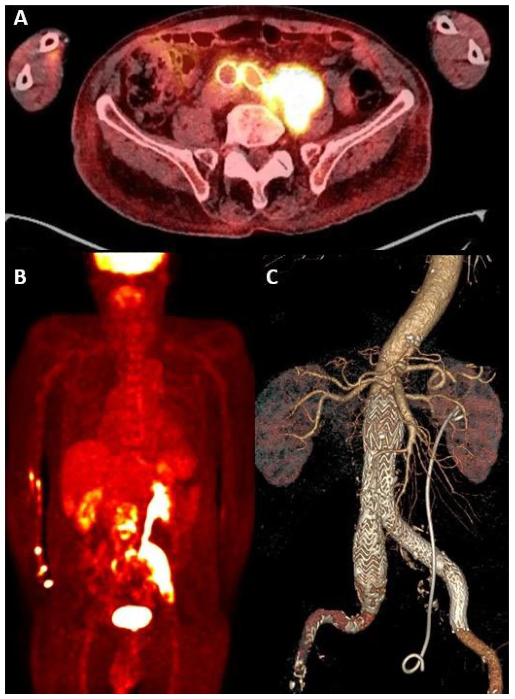
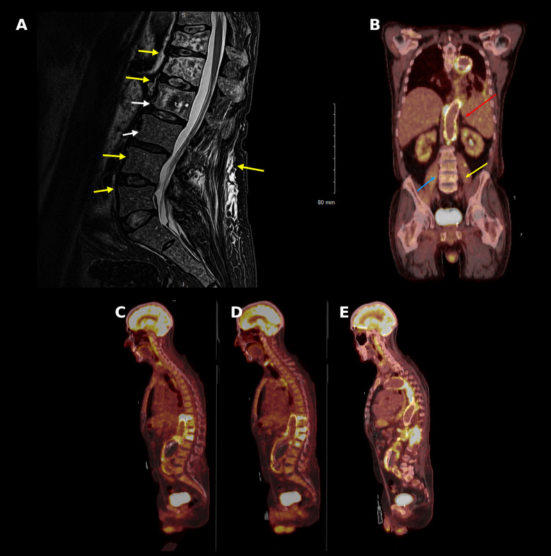

# 944 — Nhiễm mảnh ghép & stent-graft động mạch chủ–chậu / Aortic graft & endograft infection (VGEI)

**Tags:** `pattern:khi-quanh-graft` `pattern:dich-quanh-graft` `vung:dong-mach-chu` `vung:o-bung` `score:MAGIC` `protocol:CTA` `protocol:PET-CT` `protocol:WBC-SPECT` `incidentaloma:khong`

**Mức chắc chắn (certainty):** tổng hợp y văn (literature synthesis) — **1 loạt 129 bệnh nhân** phẫu thuật vì nhiễm mảnh ghép (*Open Forum Infect Dis* 2026, PMC13339074, CC BY), **1 loạt 62 ca ghép lại tại chỗ** (bovine vs Dacron tẩm rifampicin; *Langenbeck's Arch Surg* 2026, PMC13695657, CC BY), **1 loạt 30 ca điều trị kháng sinh duy trì** (PMC13263525, CC BY), **1 loạt 11 ca PET/CT có khung phân độ** (*Diagnostics* 2026, PMC13703720, CC BY) và **2 ca nguyên văn có ảnh** (PMC13245323 CC BY-NC-ND; PMC13343333 CC BY). Nhóm **không có bệnh nhân của mình**; chỗ nguồn lệch nhau (ngưỡng SUVmax, thời điểm PET/CT) được ghi là **mâu thuẫn nguồn**, không chọn bừa.

> **Câu chốt:** nhiễm mảnh ghép động mạch chủ (vascular graft and endograft infection, VGEI) là biến chứng **hiếm nhưng tử vong 10–45%**, chẩn đoán **không bằng một dấu hiệu hình ảnh đơn lẻ** mà bằng **bộ tiêu chuẩn MAGIC 2016** kết hợp lâm sàng – hình ảnh – vi sinh. Bốn số phải thuộc: **(1)** tỉ lệ nhiễm **0,5–4%** mảnh ghép nhân tạo, riêng stent-graft EVAR **~0,6% (0,4–0,8%)** (PMC13339074, PMC13703720); **(2) ngưỡng thời gian của MAGIC** — khí quanh mảnh ghép **≥ 7 tuần** và dịch quanh mảnh ghép **≥ 3 tháng** sau cấy mới là **tiêu chuẩn chính**; sớm hơn là **bình thường sau mổ**; **(3)** tử vong 1 năm **43%** trong loạt 129 ca, biến chứng nặng nhất là **nhiễm khuẩn huyết + rò động mạch chủ–ruột** (PMC13339074); **(4)** hình ảnh **chỉ trả lời "có nhiễm hay không"**, còn **"giữ hay lấy mảnh ghép"** là quyết định của hội chẩn đa chuyên khoa dựa trên **độ vững miệng nối, mức xâm lấn mô quanh mạch và khả năng phẫu thuật của bệnh nhân**.

## 1. Tổng quan bệnh học – cơ chế hình ảnh

### 1.1 Vì sao mảnh ghép nhân tạo lại dễ nhiễm — và vì sao nhiễm lại dai dẳng

- Mảnh ghép Dacron/PTFE là **vật lạ không có mạch máu**. Sau cấy, bề mặt được phủ một lớp **protein huyết tương + fibrin**, rồi tế bào nội mạc chỉ phủ kín **vài cm đầu** từ hai miệng nối — phần còn lại **không bao giờ nội mạc hóa hoàn toàn**. Đây là "đất" cho *Staphylococcus* bám dính.
- Vi khuẩn bám và tạo **màng sinh học (biofilm)**: trong biofilm, vi khuẩn chuyển sang kiểu hình **ngủ, chuyển hóa thấp**, được bao bởi ma trận polysaccharide. Hệ quả kép: **(a)** kháng sinh chỉ thấm được **nồng độ thấp hơn MIC 10–1.000 lần**; **(b)** bạch cầu không thực bào được → **cấy máu âm tính ở một phần ba đến một nửa ca**, và **không có kháng sinh nào "chữa khỏi" khi còn vật lạ**.
- Vì vậy **phẫu thuật lấy mảnh ghép là cách chữa duy nhất**, còn kháng sinh là **bổ trợ hoặc duy trì suốt đời** khi không mổ được. Loạt 25 bệnh nhân **không mổ được**: kháng sinh duy trì kiểm soát nhiễm ở **10/25 (40%)**, và trong 10 ca ngừng thuốc chỉ **6/10 (60%)** không tái phát sau **> 6 tháng** (PMC13263525). Nói cách khác: **ngừng kháng sinh ở người còn mảnh ghép là đánh cược 40% tái phát**.
- Đường vào: **lây trong mổ** (phần lớn), **lan từ ổ nhiễm lân cận** (áp-xe cơ chậu, viêm đốt sống–đĩa, nhiễm catheter), **gieo rắc máu** (nhiễm khuẩn huyết, viêm nội tâm mạc, viêm tủy xương), **nhiễm tại chỗ tiêm/chọc** (tiêm cột sống, đặt stent qua da). Ca Coxiella của chúng tôi minh họa đường **gieo rắc máu từ ổ nhiễm mạn tính** với **blood culture âm** (PMC13343333).

### 1.2 TẠI SAO CT thấy khí — và TẠI SAO khí sớm lại bình thường

- **Vật lý HU:** khí có **−1.000 HU**, mô mềm **20–60 HU**, mỡ **−100 đến −40 HU**, dịch **0–20 HU**, thuốc cản quang trong lòng mạch **150–350 HU**. Vì vậy "khí quanh mảnh ghép" là **điểm đen tuyệt đối trong cửa sổ mô mềm**, không nhầm với mỡ được.
- Sau mổ, khí còn lại trong khoang cấy **được hấp thu dần**: thực nghiệm và lâm sàng cho thấy **khí quanh mảnh ghép sau 7 tuần là bất thường**, còn **dịch quanh mảnh ghép sau 3 tháng là bất thường** — chính hai ngưỡng này được MAGIC đưa vào **tiêu chuẩn chính** (Hình MAGIC). Trước các mốc đó, khí/dịch **không đủ để gọi nhiễm**, và đây là **cạm bẫy số 1** ở bệnh nhân mới mổ.
- **TẠI SAO khí là dấu hiệu mạnh:** khí sinh ra từ **chuyển hóa kỵ khí và lên men của vi khuẩn** trong ổ mủ kín. Khí tự do **tăng thể tích theo thời gian** trên các lần chụp liên tiếp — MAGIC ghi rõ "**tăng thể tích khí quanh mảnh ghép trên các lần chụp**" là tiêu chuẩn chính. Một túi khí **không đổi** trong 6 tháng ít có ý nghĩa hơn **một túi khí to dần trong 3 tuần**.
- **TẠI SAO cần CTA chứ không chỉ CT thường:** cần phân biệt **giả phình/miệng nối hở** (thuốc trong túi phình ở thì động mạch = **endoleak**) với **ổ mủ quanh mảnh ghép** (dịch **không ngấm thuốc**, có **viền ngấm thuốc**). Cùng một "khối quanh mạch", **đậm độ theo thì** quyết định bản chất.

### 1.3 TẠI SAO FDG PET/CT bắt được nhiễm — và TẠI SAO không có ngưỡng SUVmax dùng được

- **Cơ chế:** [18F]FDG là glucose tương tự, được **đại thực bào và bạch cầu trung tính đã hoạt hóa** cùng tế bào viêm bắt giữ qua **GLUT-1/GLUT-3** với tốc độ tỉ lệ với cường độ viêm. Vì vậy FDG **không đặc hiệu cho vi khuẩn**: mọi phản ứng viêm — kể cả **phản ứng chủ–vật liệu vô khuẩn** — đều dương tính.
- **Con số đối chứng:** mảnh ghép **không nhiễm** có **SUVmax trung vị 3,3 (IQR 2,0–4,2)**, mảnh ghép **nhiễm** có **5,7 (IQR 2,2–7,8)** — hai khoảng **chồng lấp gần hết**. Nghiên cứu 21 ca gợi ý **cắt điểm 6,3**, và stent-graft EVAR "vô khuẩn" ở bệnh nhân ung thư có **SUVmax trung bình 2,63 ± 0,48** ngay trong **1–4 tháng đầu** (tất cả trích trong PMC13703720).
- Vì vậy **ESVS 2026** kết luận: **cắt điểm SUVmax không đáng tin**; PET/CT chỉ là **công cụ bổ trợ (Class IIa, Level B)**, và **xạ hình bạch cầu WBC-SPECT/CT được ưu tiên hơn trong 4 tháng đầu sau mổ** (Class IIb, Level C) vì phản ứng chủ–vật liệu ít gây dương tính giả với bạch cầu đánh dấu (PMC13703720).
- **Điều dùng được trên PET/CT:** **kiểu ngấm (pattern)** và **mức lan (extent)**. **Ngấm đều, mức thấp, dọc toàn bộ mảnh ghép = phản ứng vô khuẩn (giai đoạn 0)**; **ngấm khu trú/không đồng nhất + ổ mủ lân cận = nhiễm**. Trong loạt 11 ca, **cả 5 mảnh ghép tham chiếu đều giai đoạn 0**, **6/6 ca nhiễm là giai đoạn II–III**, SUVmax mảnh ghép/túi phình ở ca nhiễm **6,0–16** (PMC13703720).

### 1.4 Dịch tễ – tiên lượng (số để nhớ)

| Chỉ số | Giá trị | Nguồn |
|---|---|---|
| Tỉ lệ nhiễm mảnh ghép nhân tạo | **0,5–4%**; EVAR **~0,6% (0,4–0,8%)** | PMC13339074, PMC13703720 |
| Thời điểm hay gặp | **< 4 tháng** ở **57%**; đa số trong **2 năm đầu**, nhưng có ca **14 tháng** sau EVAR và **1 năm** triệu chứng trước chẩn đoán | PMC13339074, PMC13703720, PMC13343333 |
| Vị trí | **85% ngoài khoang** (chi, cổ, bẹn); 15% trong khoang ngực/bụng | PMC13339074 |
| Vi khuẩn | **đa khuẩn 49%**; *S. aureus* **16%**; *Candida* **27,8%** và gắn với **rò động mạch chủ–ruột thứ phát (p = 0,003)** | PMC13339074, PMC13695657 |
| Tử vong | chu phẫu **10–45%**; tại **1 năm 43%** (tuổi > 75 và nhập ICU là yếu tố độc lập) | PMC13339074 |
| Cắt cụt chi | **10–30%**; tái nhiễm **6–27%** | PMC13339074 |
| Thất bại điều trị sau ghép lại tại chỗ | Dacron tẩm rifampicin **4/41 (9,8%)** vs màng ngoài tim bò **0/21**, tử vong viện **19,5% vs 14,3%** | PMC13695657 |
| Kháng sinh duy trì khi không mổ được | kiểm soát nhiễm **40%**; ngừng thuốc **6/10** không tái phát sau **> 6 tháng** | PMC13263525 |

## 2. Mẫu hình + chẩn đoán phân biệt theo vị trí (gamut)

- **Theo mẫu hình hình ảnh:**
  1. **Khí quanh mảnh ghép** (đơn độc hoặc trong ổ dịch) → nhiễm là chính; phân biệt khí còn lại sau mổ (< 7 tuần), khí trong **rò động mạch chủ–ruột** (bài [938](../938-ro-dong-mach-chu-ruot/lesson.md)).
  2. **Dịch/khối quanh mảnh ghép** → ổ mủ, tụ máu, lymphocele, phản ứng viêm; phân biệt bằng **đậm độ, viền ngấm thuốc, thời gian**.
  3. **Giả phình ở miệng nối** kèm khí/dịch → **giả phình nhiễm (mycotic pseudoaneurysm)**; phân biệt **endoleak vô khuẩn**.
  4. **Ngấm FDG khu trú** → nhiễm; **ngấm đều mức thấp** → phản ứng chủ–vật liệu.
  5. **Lan ra mô lân cận:** áp-xe **cơ chậu**, **viêm đốt sống–đĩa**, **dò vào ruột/phế quản/niệu quản** — đây là các "dấu chỉ điểm" làm chẩn đoán chắc hơn nhiều.
- **Theo vị trí giải phẫu:**
  - **Động mạch chủ lên/quai:** mảnh ghép phẫu thuật; khí quanh mảnh ghép ở trung thất, dễ nhầm **khí trung thất sau mổ**; rò ra **phế quản** gây ho ra máu (tiền triệu chảy máu — tìm dấu hiệu trên CTA).
  - **Động mạch chủ ngực xuống (TEVAR):** khí/dịch quanh stent; **rò ra thực quản** là biến chứng chết người (bài [1844](../1844-ro-hoai-tu-thuc-quan-do-xa/lesson.md)).
  - **Động mạch chủ bụng dưới thận (EVAR/ghép mở):** hay gặp nhất; khí **≥ 7 tuần**, dịch **≥ 3 tháng**; lan ra **cơ chậu** và **cột sống thắt lưng**.
  - **Động mạch chậu – bẹn – chi dưới:** mảnh ghép ngoài khoang, hay gặp **85%**; dễ thấy **khối sưng, rò mủ ở bẹn**, và **giả phình miệng nối**.
  - **Cầu nối ngoài giải phẫu (axillo-bifemoral, fem-fem):** đường đi **dưới da** → nhiễm biểu hiện **đỏ da, rò mủ dọc đường ống**, rất dễ thấy trên lâm sàng.
- **Bắt chước quan trọng nhất:** **endoleak vô khuẩn** (thuốc trong túi phình, không khí, không dịch) và **phản ứng chủ–vật liệu** (ngấm FDG đều, mức thấp). Gọi nhầm hai thể này là nhiễm → **mổ lấy mảnh ghép oan** ở bệnh nhân vừa mổ tim mạch.

## 3. Bảng so sánh phân biệt (ma trận đối chiếu)

| Thực thể (entity) | Hình ảnh điển hình (CTA / PET-CT / MRI) | Chốt vào (rule-in) | Chốt loại (rule-out) | Gợi ý xác nhận |
|---|---|---|---|---|
| **Nhiễm mảnh ghép (VGEI)** | Dịch quanh mảnh ghép **≥ 3 tháng**, khí **≥ 7 tuần** hoặc **tăng thể tích khí**; viền ngấm thuốc; FDG **khu trú/không đồng nhất** | **Khí muộn/tăng dần + dịch muộn + ngấm FDG khu trú + cấy máu dương** | Khí < 7 tuần, dịch < 3 tháng, ngấm FDG đều mức thấp → chưa gọi nhiễm | MAGIC; cấy máu **3 bộ**; chọc hút dưới CT; mcfDNA; hội chẩn |
| **Phản ứng chủ–vật liệu vô khuẩn** | Ngấm FDG **đều, đồng nhất, mức thấp** dọc mảnh ghép; **không khí, không dịch, không ổ mủ**; SUVmax **~2,6** (1–4 tháng đầu) | **Ngấm đều + không có dấu CT cấu trúc + không triệu chứng** | Có **khí muộn / dịch muộn / ổ mủ / SUVmax tăng theo thời gian** → nhiễm | So sánh lần chụp trước; WBC-SPECT/CT nếu < 4 tháng |
| **Endoleak vô khuẩn** | Túi phình **đầy thuốc ở thì động mạch** (type I/II/III), **không khí**, thành túi đều; FDG **không khu trú** | **Thuốc trong túi = endoleak**; bệnh nhân **không sốt, CRP bình thường** | Dịch + khí + FDG khu trú cùng chỗ → nhiễm hóa túi phình | CTA 3 thì; so sánh kích thước túi; siêu âm cản quang |
| **Giả phình nhiễm (mycotic)** | Túi phình **bờ không đều, không lớp vôi**, khí trong thành, **phù mô quanh**, FDG mạnh; thường **sau nhiễm huyết** | **Túi + khí + phù quanh + cấy máu dương** | Lớp vôi liên tục, bờ nhẵn, không khí → phình xơ vữa không nhiễm | CTA mỏng 1 mm; cấy máu; **không chọc** |
| **Rò động mạch chủ–ruột (AEF)** | Khí **trong lòng túi** + **mất liền lục thành ruột tiếp giáp**, ruột dính ĐMC, **máu trong ruột** | **Xuất huyết tiêu hóa + bóng khí trong thành + dính ruột** | Khí chỉ ngoài thành, không dính ruột → nhiễm đơn thuần | Nội soi **thận trọng**; CTA; bài [938](../938-ro-dong-mach-chu-ruot/lesson.md) |
| **Viêm đốt sống–đĩa lan từ mảnh ghép** | Phù tủy xương **≥ 2 đốt liền kề + đĩa**, MRI STIR sáng, **áp-xe cơ chậu** cùng bên; FDG dọc mảnh ghép **ra sau** | **Phù tủy + đĩa + phù cạnh sống cùng bên mảnh ghép** | Thoái hóa đĩa (Modic) không phù cạnh sống, không ổ mủ | MRI **STIR + T1 sau tiêm**; cấy sinh thiết đốt sống; bài [222](../222-viem-dot-song/lesson.md) |

*Trái: **nhiễm** — ổ ngấm FDG khu trú ở mảnh ghép/túi phình và **áp-xe cơ chậu trái (SUVmax 24)**, kèm stent niệu quản. Phải: **vô khuẩn** — ngấm **đều, đồng nhất, mức thấp** dọc mảnh ghép (giai đoạn 0). Cả hai từ *Diagnostics* 2026, **CC BY**. Ảnh ghép letterbox, giữ nguyên tỷ lệ.*

## 4. Protocol chụp + hệ phân độ/điểm chuẩn hóa

### 4.1 Đường đi chẩn đoán (theo MAGIC 2016 + ESVS 2026)

- **Bước 1 — CTA là hình ảnh đầu tay** (ESVS 2026): lát **≤ 1 mm**, **3 thì** (không thuốc, động mạch, tĩnh mạch muộn), cửa sổ mô mềm **và xương**. Không dùng CT không cản quang đơn thuần vì không phân biệt được ổ mủ với endoleak.
- **Bước 2 — cấy máu 3 bộ trước kháng sinh**, cấy dịch ổ mủ/vết thương; nếu cấy máu âm mà vẫn nghi: **chọc hút dịch quanh mảnh ghép dưới CT** (chỉ khi không có chỉ định mổ ngay) hoặc **mcfDNA huyết tương** (đã bắt được *Coxiella burnetii* trong ca PMC13343333 — nhưng phải **xác nhận bằng huyết thanh/ PCR**, không điều trị theo mcfDNA đơn thuần).
- **Bước 3 — PET/CT khi MAGIC chỉ ở mức "nghi ngờ"**: **ưu tiên WBC-SPECT/CT nếu < 4 tháng sau mổ**; nếu PET/CT, đọc theo **kiểu ngấm + mức lan**, **không dùng cắt điểm SUVmax**.
- **Bước 4 — hội chẩn đa chuyên khoa** (phẫu thuật mạch, bệnh nhiễm, CĐHA, vi sinh) quyết định **lấy mảnh ghép + ghép lại tại chỗ / cầu nối ngoài giải phẫu / kháng sinh duy trì**.

### 4.2 Tiêu chuẩn MAGIC 2016 (bộ chuẩn duy nhất đang dùng)

- **Ca "nghi ngờ" (suspected):** **1 tiêu chuẩn chính** *hoặc* **2 tiêu chuẩn phụ từ 3 nhóm khác nhau** (lâm sàng/phẫu thuật, hình ảnh, xét nghiệm).
- **Ca "chẩn đoán xác định" (diagnosed):** **≥ 1 tiêu chuẩn chính + ≥ 1 tiêu chuẩn khác** (bất kỳ nhóm nào).
- **Tiêu chuẩn chính hay dùng trên hình ảnh:** dịch quanh mảnh ghép **≥ 3 tháng** sau cấy; khí quanh mảnh ghép **≥ 7 tuần**; **khí tăng thể tích** trên các lần chụp. **Tiêu chuẩn phụ hình ảnh:** phù mô mềm quanh mảnh ghép, **giãn túi phình**, giả phình, dày thành khu trú, **viêm đốt sống–đĩa**, **ngấm FDG khu trú**, **bắt xạ bạch cầu**.
- Hình dưới là **bảng MAGIC đầy đủ** dùng trong bài — in ra dán ở buồng đọc:

*Bảng MAGIC: 3 nhóm tiêu chuẩn (lâm sàng/phẫu thuật – hình ảnh – xét nghiệm), mỗi nhóm có tiêu chuẩn chính và phụ. Nguồn: *Langenbeck's Arch Surg* 2026, **CC BY**.*

### 4.3 Khung phân độ PET/CT mô tả (đề xuất 2026, chưa được thẩm định ngoài)

*Sơ đồ nguyên văn của bài gốc: MAGIC 2016 → PET/CT bổ trợ → phân độ mô tả 0–III (không phải khuyến cáo điều trị). Nguồn: *Diagnostics* 2026, **CC BY**.*

### 4.4 Điều trị — ba lựa chọn và giá phải trả

| Chiến lược | Chỉ định thực dụng | Kết quả có nguồn |
|---|---|---|
| **Lấy mảnh ghép + ghép lại tại chỗ** (in situ) bằng **màng ngoài tim bò** hoặc **Dacron tẩm rifampicin** | bệnh nhân chịu được mổ, mô quanh mạch còn đủ để khâu | thất bại **0/21 (bò) vs 4/41 (9,8%)**; tử vong viện **14,3% vs 19,5%** (PMC13695657) |
| **Cầu nối ngoài giải phẫu** (axillo-bifemoral) + cắt đoạn nhiễm | ổ nhiễm lan rộng, bẹn dơ, không khâu được vào mô viêm | dùng trong ca 6 của loạt PET/CT; nguy cơ **huyết khối cầu nối** và **cắt cụt 10–30%** |
| **Kháng sinh duy trì suốt đời** (suppressive antimicrobial therapy) | bệnh nhân quá yếu, từ chối mổ, hoặc nhiễm khuẩn trú ẩn không có ổ mủ | kiểm soát **40%**; **6/10** ngừng thuốc không tái phát > 6 tháng; **32%** có tác dụng phụ (PMC13263525) |

- **Kháng sinh:** khởi đầu theo **cấy máu/cấy mô**, sau đó **theo kháng sinh đồ**; thời gian **tối thiểu 6 tuần đường tĩnh mạch** khi đã lấy mảnh ghép, và **suốt đời** khi còn mảnh ghép. *S. aureus* và **Candida** là hai tác nhân phải nghĩ ngay khi có **rò động mạch chủ–ruột**.

## 5. Biến thể bình thường và cạm bẫy

- **Khí quanh mảnh ghép < 7 tuần: bình thường.** Đây là lỗi hay gặp nhất — gọi nhiễm cho bệnh nhân ngày thứ 10 sau mổ rồi đưa đi mổ lại. Ngược lại, **khí xuất hiện muộn hoặc tăng thể tích** thì gần như chắc chắn nhiễm.
- **Dịch quanh mảnh ghép < 3 tháng: bình thường.** Dịch **giảm dần** và **không có viền ngấm thuốc dày** là lành; dịch **tăng** hoặc có **khí** là nhiễm.
- **FDG ngấm đều mức thấp dọc mảnh ghép là phản ứng vô khuẩn**, đặc biệt trong **4 tháng đầu** và ở bệnh nhân ung thư (SUVmax trung bình **2,63**). Đừng đọc "mảnh ghép sáng" thành "mảnh ghép nhiễm".
- **Cạm bẫy endoleak:** thuốc trong túi phình ở thì động mạch là **endoleak**, không phải ổ mủ. Ổ mủ **không ngấm thuốc**, có **viền**; endoleak **đầy thuốc toàn khối**, mờ dần ở thì muộn.
- **Cạm bẫy "thỏa mãn tìm kiếm":** thấy khí quanh mảnh ghép rồi dừng lại — **bỏ sót áp-xe cơ chậu** và **viêm đốt sống–đĩa** cùng bên, là hai ổ nhiễm quyết định thời gian kháng sinh và đường mổ. Luôn **cuộn hết cột sống và cơ chậu** trên cùng bộ ảnh.
- **Cạm bẫy kim loại:** stent-graft gây **giả ảnh dày (streak)** và **ngấm FDG giả do hiệu chỉnh suy giảm** quanh sợi kim loại. Cần xem **ảnh không hiệu chỉnh suy giảm** trước khi gọi ngấm khu trú; CTA cần **lát mỏng + tái tạo đa bình diện** để nhìn miệng nối.
- **Cạm bẫy vị trí:** khí **trong lòng** túi phình (không phải trong thành) gợi ý **rò động mạch chủ–ruột** — tìm **dính ruột, mất liền lục thành ruột**, và hỏi **xuất huyết tiêu hóa**. Bỏ sót = tử vong trong vài giờ.

## 6. Tự lượng giá — Blind Quiz

**Ca 1 — mờ mắt một bên ở người có mảnh ghép động mạch chủ**

- Gợi ý lâm sàng: bệnh nhân có mảnh ghép động mạch chủ lên, nhập viện vì **mờ mắt một bên, đau mắt, sốt**.
- Câu hỏi: (1) Dấu hiệu chính quanh mảnh ghép là gì? (2) Ba chẩn đoán phân biệt cho khí quanh mảnh ghép? (3) Dấu hiệu nào chốt nguyên nhân của viêm nội nhãn nội sinh?

<b>Bấm để hiện đáp án (findings + chẩn đoán)</b>

- **Dấu hiệu:** **túi khí quanh mảnh ghép động mạch chủ lên** (điểm đen −1.000 HU sát thành mảnh ghép), thành mảnh ghép dày, không thấy endoleak trong túi.
- **Chẩn đoán:** **nhiễm mảnh ghép động mạch chủ lên** là **nguồn gieo rắc** gây **viêm nội nhãn nội sinh (endogenous endophthalmitis)** — mắt chỉ là "ngọn", ổ nhiễm thật nằm ở mảnh ghép.
- **Vì sao chốt:** *S. aureus* bám biofilm trên mảnh ghép → **nhiễm khuẩn huyết liên tục** → vi khuẩn bắt giữ ở **mao mạch hắc mạc** (dòng máu chậm, không có hàng rào máu–võng mạc phía hắc mạc) → ổ mủ nội nhãn. Khí quanh mảnh ghép ở bệnh nhân **đã cấy ghép > 7 tuần** là **tiêu chuẩn chính của MAGIC**.
- **Phân biệt:** (a) khí còn lại sau mổ (< 7 tuần); (b) **rò động mạch chủ–ruột** — khí trong lòng túi + dính ruột + xuất huyết tiêu hóa; (c) **giả phình nhiễm** — túi bờ không đều + phù mô quanh. Ca này cấy máu dương và ổ mủ mắt cùng tác nhân → chốt.
- **Nguồn ảnh:** *Ann Thorac Surg Short Rep* 2026, Fig. 1 — PMC13245323, **CC BY-NC-ND**; tác giả Eizawa S, Tanabe M, Tanaka H.

**Ca 2 — sốt kéo dài, đau lưng sau EVAR 14 tháng**

- Gợi ý lâm sàng: nam 78 tuổi, EVAR 14 tháng, **sốt, sụt cân, đau lưng–hông trái**; cấy máu âm.
- Câu hỏi: (1) Mô tả hai ổ ngấm FDG bất thường? (2) Ổ nào là "biến chứng" theo khung phân độ? (3) Vì sao cấy máu âm không loại trừ nhiễm?

<b>Bấm để hiện đáp án (findings + chẩn đoán)</b>

- **Dấu hiệu:** (A) **ngấm FDG khu trú ở mảnh ghép và túi phình** (SUVmax **11**) và **ổ ngấm rất mạnh ở cơ chậu trái** (SUVmax **24**) — áp-xe cơ chậu; (B) hình chiếu toàn thân cho thấy ổ mủ lan xuống; (C) CTA 3D có **stent niệu quản (double J)** do **hẹp/đè ép niệu quản trái**.
- **Chẩn đoán:** **nhiễm mảnh ghép EVAR giai đoạn III** (có biến chứng **áp-xe cơ chậu + nhiễm khuẩn huyết**), MAGIC mức **"nghi ngờ"** (2 tiêu chuẩn phụ ở 2 nhóm).
- **Vì sao chốt:** **ngấm khu trú trong mảnh ghép + ổ mủ lân cận** là dấu hiệu mạnh hơn bất kỳ **cắt điểm SUVmax** nào; SUVmax 24 ở cơ chậu là **ổ mủ**, không phải viêm cơ đơn thuần.
- **Phân biệt:** phản ứng vô khuẩn (ngấm **đều, mức thấp**, không ổ mủ); endoleak (thuốc trong túi, không ổ mủ); **áp-xe cơ chậu do nguyên nhân khác** (bài [1721](../1721-nhiem-khuan-stent-nieu-quan/lesson.md), [222](../222-viem-dot-song/lesson.md)).
- **Nguồn ảnh:** *Diagnostics* 2026, Fig. 4 — PMC13703720, **CC BY**; tác giả Sultan S, Tasopoulou KM, Acharya Y và cs.

**Ca 3 — đau lưng một năm, cấy máu âm, "không tìm ra ổ nhiễm"**

- Gợi ý lâm sàng: nam 69 tuổi, **đã sửa phình động mạch chủ ngực–bụng**, **đau lưng 1 năm**, ớn lạnh vài tháng, dùng prednisone 5 mg/ngày; **cấy máu và cấy mô đốt sống đều âm**.
- Câu hỏi: (1) Dấu hiệu trên MRI và PET/CT? (2) Vì sao hai ổ này phải đọc cùng nhau? (3) Tác nhân nào gây bệnh cảnh "cấy âm, diễn tiến chậm"?

<b>Bấm để hiện đáp án (findings + chẩn đoán)</b>

- **Dấu hiệu:** (A) MRI STIR: **phù tủy xương T10–L2**, mất liền lục mặt khớp, **đĩa bị tổn thương**, **lún T12 và L1**, phù cạnh sống/cơ chậu — **viêm đốt sống–đĩa đa tầng**; (B) PET/CT: **ngấm FDG dọc mảnh ghép ngực–bụng**, lan ra mô cạnh sống **T10–L4**, **áp-xe cơ chậu trái**.
- **Chẩn đoán:** **nhiễm mảnh ghép động mạch chủ ngực–bụng lan liên tục ra cột sống** — tác nhân ***Coxiella burnetii* (sốt Q mạn)**, được phát hiện bằng **mcfDNA huyết tương** sau khi cấy thường quy âm.
- **Vì sao chốt:** nhiễm mảnh ghép và **viêm đốt sống–đĩa cùng bên** là **một ổ nhiễm liên tục**, không phải hai bệnh; **phù tủy + đĩa + phù cạnh sống** loại trừ thoái hóa đĩa đơn thuần.
- **Phân biệt:** viêm đốt sống–đĩa do tụ cầu (cấy máu thường dương, diễn tiến cấp); di căn đốt sống (không phù đĩa, không ổ mủ cơ chậu); thoái hóa Modic (không phù cạnh sống, không ổ mủ). *Coxiella* gây bệnh **âm thầm, cấy âm, huyết thanh là chuẩn chẩn đoán**.
- **Nguồn ảnh:** *Antimicrob Steward Healthc Epidemiol* 2026, Fig. 1 — PMC13343333, **CC BY**; tác giả Jain A, Khalil S, Sohail MR và cs.

## Bài liên quan chéo
- [938 — Rò động mạch chủ–ruột](../938-ro-dong-mach-chu-ruot/lesson.md): biến chứng chết người, cùng bộ tiêu chuẩn MAGIC
- [939 — Rò động mạch chủ–tĩnh mạch chủ](../939-ro-dong-mach-chu-tinh-mach-chu/lesson.md)
- [942 — Rò động mạch chủ–niệu quản](../942-ro-dong-mach-chu-nieu-quan/lesson.md)
- [920 — Nút mạch tiêu hóa](../920-vascular-embolization-gi-bleed/lesson.md): kiểm soát chảy máu khi chưa mổ được
- [1721 — Nhiễm khuẩn stent niệu quản](../1721-nhiem-khuan-stent-nieu-quan/lesson.md): cùng nguyên lý biofilm trên vật lạ
- [222 — Viêm đốt sống–đĩa](../222-viem-dot-song/lesson.md): ổ nhiễm liên tục hay đi kèm
- [1844 — Rò hoại tử thực quản do xạ](../1844-ro-hoai-tu-thuc-quan-do-xa/lesson.md): rò trung thất, cùng nhóm biến chứng chết người
- [935 — Tối ưu liều can thiệp nhi](../935-toi-uu-lieu-can-thiep-nhi-drl/lesson.md): nguyên lý ALARA khi chụp lặp lại

## Ảnh
- Tên file theo quy ước `944_nhiem-graft_Modality_SourceID.jpg`; nguồn + giấy phép từng ảnh trong `images/CREDITS.md`.
- Ảnh ghép đối chiếu `images/composite_nhiem-vs-vo-khuan.jpg` tạo bằng `tools/make_composite.py` (letterbox nền đen, **không crop, không kéo giãn**), chỉ ghép ảnh **CC BY**.
- Ảnh **CC BY-NC-ND** (PMC13245323) dùng **nguyên bản**, không đưa vào composite.

> Không dùng để chẩn đoán độc lập khi chưa có người hướng dẫn.
