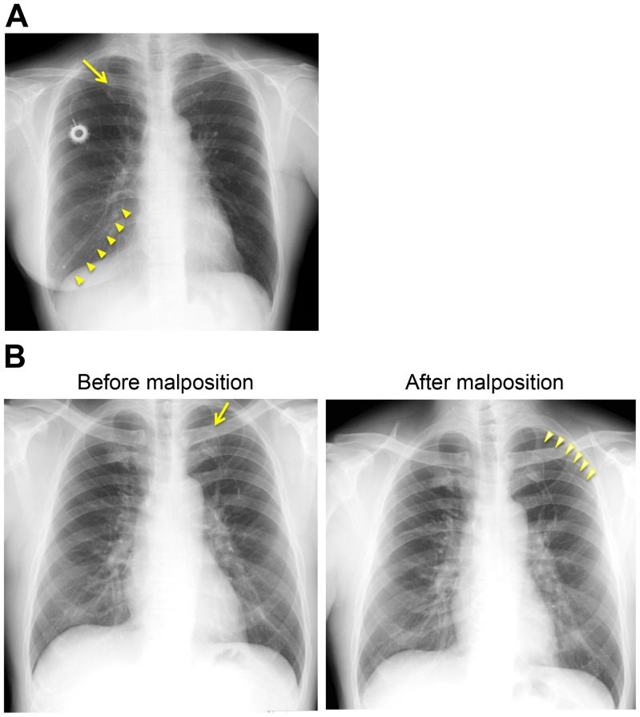
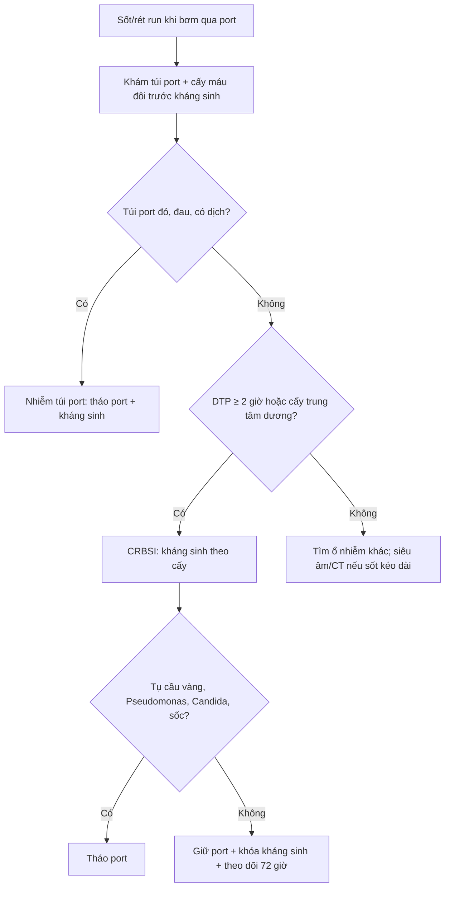
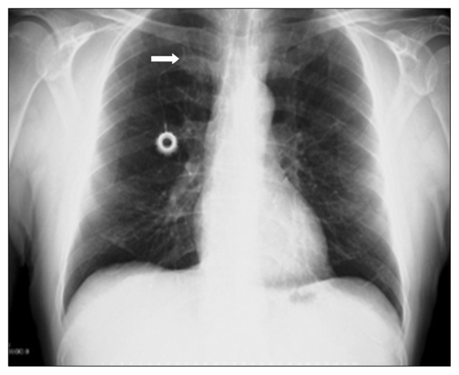
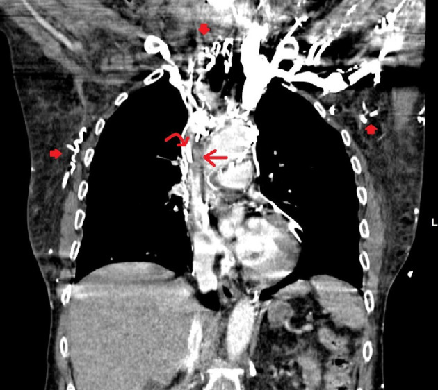
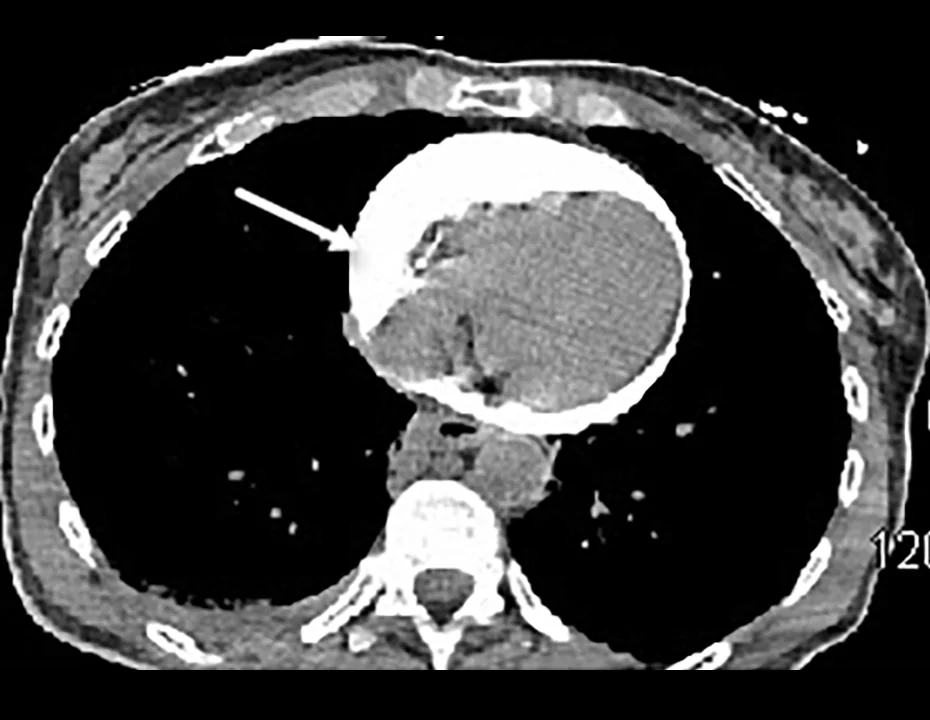

# 945 — Nhiễm & biến chứng buồng tiêm truyền dưới da (port-a-cath) và catheter tĩnh mạch trung tâm / Port-a-cath and central venous catheter complications

**Tags:** `pattern:bien-chung-catheter` `pattern:huyet-khoi` `pattern:di-vat` `pattern:ap-xe` `vung:tinh-mach-cua` `vung:nguc` `vung:thanh-nguc` `protocol:port-a-cath` `protocol:CT-nguc-co-can-quang` `protocol:sieu-am-Doppler` `score:CRBSI` `incidentaloma:port-a-cath`
**Mức chắc chắn (certainty):** tổng hợp y văn (literature synthesis) — số liệu từ đoàn hệ port-a-cath, case report và hướng dẫn; chưa gắn một ca nguyên văn duy nhất.

## 1. Tổng quan — vì sao port hỏng theo 4 cơ chế

- **Port-a-cath (buồng tiêm truyền dưới da, totally implantable venous access device — TIVAD)** gồm buồng kim loại/nhựa đặt dưới da thành ngực hoặc cánh tay, nối với catheter đổ vào **ngã ba tĩnh mạch chủ trên – nhĩ phải (cavoatrial junction)**, lý tưởng ngang **carina + 2,5–3 cm**. Vị trí đầu catheter quyết định 3 biến chứng: quá thấp vào nhĩ phải → loạn nhịp/thủng; quá cao → huyết khối, xoắn; tựa vào thành mạch → mòn và thủng.
- **TẠI SAO nhiễm:** trong 24 giờ đầu, protein huyết tương bám lên bề mặt catheter tạo lớp điều kiện; vi khuẩn da (*Staphylococcus epidermidis*, *S. aureus*) bám và tiết **biofilm** trong lớp fibrin. Biofilm kháng kháng sinh và kháng thực bào → nhiễm **khu trú tại túi port**, **nhiễm khuẩn huyết liên quan catheter (catheter-related bloodstream infection — CRBSI)**, hoặc cả hai. Đây là lý do **cấy máu dương không đủ** để phân biệt nhiễm túi với nhiễm huyết — phải khám túi và lấy cấy đôi.
- **TẠI SAO huyết khối:** sang chấn nội mô khi đặt + dòng chảy chậm trong tĩnh mạch lớn + tình trạng tăng đông của ung thư + vật liệu catheter. **Vỏ fibrin (fibrin sheath)** hình thành quanh catheter từ vài ngày đến vài tuần, có thể tạo **van một chiều**: bơm vào được nhưng **không hút ra được** — dấu hiệu "withdrawal occlusion".
- **TẠI SAO gãy catheter:** đường vào **dưới đòn** bắt catheter đi qua khe giữa **xương đòn và xương sườn 1**; khi vai cử động, catheter bị bóp mạn tính (**pinch-off syndrome**) rồi mỏi vật liệu và gãy. Đường vào **cánh tay** tránh được điểm bóp này: trong 599 ca, gãy catheter **0,88% ở dưới đòn vs 0% ở cánh tay**; tắc catheter **1,75% vs 0%** (p = 0,04) [PMC3948863].
- **TẠI SAO thoát mạch gây ép tim:** catheter đã bị huyết khối/vỏ fibrin neo vào thành mạch; khi **bơm cản quang áp lực cao** (power injection), đầu catheter có thể xuyên thành hoặc bong mảnh, cản quang vào khoang màng tim → **chèn ép tim cấp**. Ca thực tế: bơm **100 mL Isovue-370 ở 325 psi, 1,5 mL/s** qua port có huyết khối ở đầu catheter → ngừng tim 2 phút, CT thấy **dịch màng tim cản quang dày đặc** [PMC13552184].

## 2. Mẫu hình + chẩn đoán phân biệt theo thời điểm và hội chứng

- **Sớm (≤ 30 ngày):** tràn khí màng phổi **0,88%** (đường dưới đòn; 0% đường cánh tay), chọc động mạch **0,58%**, catheter sai vị trí, loạn nhịp, thủng màng tim, thuyên tắc khí [PMC3948863].
- **Muộn (> 30 ngày):** nhiễm **3,1–4,1%**, huyết khối tĩnh mạch **1,17%**, tắc catheter **1,75%**, gãy catheter **0,88%**, di trú **0,88%** [PMC3948863]. Tổng biến chứng sau thủ thuật **10,23% (dưới đòn) vs 4,67% (cánh tay)**, p = 0,01.
- **CRBSI:** **13,63%** trong 455 bệnh nhân ung thư vú; **tiền sử nhiễm khu trú quanh catheter trong 3 tháng** là yếu tố nguy cơ độc lập duy nhất, **OR 3,86** [PMC13268504].
- **Huyết khối liên quan catheter (catheter-related thrombosis — CRT):** không triệu chứng **8,8–18%**, có triệu chứng **2,7–8%** ở bệnh nhân ung thư [PMC13631437].
- **Hội chứng tĩnh mạch chủ trên do catheter:** huyết khối tĩnh mạch trung tâm ở người có dụng cụ **5–42%**; **1–14%** người mang dụng cụ tiến triển thành hội chứng TM chủ trên [PMC8383571].
- **Pinch-off/gãy:** khi gãy và trôi mảnh, vị trí mảnh hay gặp nhất là **động mạch phổi 35%**, **nhĩ phải 27,6%**, **thất phải 22%**, **TM chủ trên/ve ngoại vi 15,4%**; trong 215 ca gãy-trôi, **24,2% không triệu chứng**, còn lại là catheter hỏng (56,3%), loạn nhịp (13%), triệu chứng phổi (4,7%), nhiễm khuẩn huyết (1,8%) [PMC6200171].
- **Rút catheter khó:** gặp **4%** ca rút TIVAD, trong đó **9% do dính nội mạch**; có ca lưu **12 năm** [PMC12143224].
- **Gợi nhớ theo hội chứng — "SIFTS":** **S**ốt khi bơm (CRBSI), **I**nflow tốt nhưng không aspirate được (vỏ fibrin), **F**racture/pinch-off (gãy), **T**hrombosis/SVC (phù mặt–tay), **S**hock khi bơm cản quang (thoát mạch–ép tim).

## 3. Bảng so sánh phân biệt (ma trận đối chiếu)

| Thực thể (entity) | Hình ảnh điển hình | Chốt vào (rule-in) | Chốt loại (rule-out) | Gợi ý xác nhận |
|---|---|---|---|---|
| **Nhiễm túi port** (pocket infection) | Đỏ, căng, đau quanh buồng; siêu âm: ổ dịch quanh buồng; CT: thâm nhiễm/dịch quanh port | **Dấu viêm tại chỗ + ổ dịch quanh buồng** | Không đỏ/không đau túi → nghĩ CRBSI hoặc nguồn khác | Khám + siêu âm túi; **phải tháo port**, không chỉ kháng sinh |
| **CRBSI** | Không có tổn thương đặc hiệu trên CT; cấy máu đôi dương | **Cấy máu trung tâm + ngoại vi dương, DTP ≥ 2 giờ** (hoặc tỷ lệ định lượng ≥ 5:1) | Cấy âm hoặc cấy dương nhưng DTP < 2 giờ → nhiễm từ nguồn khác | Cấy đôi trước kháng sinh; đầu catheter ≥ 15 CFU (Maki) |
| **Huyết khối liên quan catheter** | Siêu âm: tĩnh mạch không xẹp, thấy cục trong lòng; CT: khuyết thuốc trong TM chủ trên | **Khuyết thuốc/không xẹp + phù tay cùng bên** | Tĩnh mạch xẹp hoàn toàn, không khuyết thuốc → không huyết khối | Doppler màu + CT tĩnh mạch; kháng đông 3 tháng |
| **Vỏ fibrin** (fibrin sheath) | Siêu âm: lớp echo dày quanh catheter, có thể di động; chụp cản quang: thuốc chạy ngược dọc catheter | **Bơm được nhưng không hút được** ("withdrawal occlusion") | Hút được dễ dàng → không phải vỏ fibrin đơn thuần | Nghiệm pháp bơm–hút; bơm tPA tại chỗ hoặc thay catheter |
| **Pinch-off / gãy catheter** | X-quang: catheter hẹp lại giữa xương đòn và xương sườn 1; mảnh catheter mất liên tục, có thể ở tim/ĐM phổi | **Dấu pinch-off + mất liên tục catheter** | Catheter liên tục, không hẹp → không gãy | X-quang 2 tư thế/CT; **không kéo mạnh** nếu dính |
| **Di trú / malposition** | Đầu catheter ở tĩnh mạch azygos, mammaria trong, đối bên, hoặc trong nhĩ phải | **Đầu catheter không ở ngã ba TM chủ trên–nhĩ phải** | Đầu đúng vị trí, không triệu chứng | X-quang/CT; chỉnh dưới soi |
| **Hội chứng TM chủ trên do catheter** | CT: hẹp/khuyết thuốc TM chủ trên + tuần hoàn bàng hệ thành ngực; phù mặt–cổ–hai tay | **Hẹp/tắc TM chủ trên + bàng hệ + phù** | Không hẹp, không bàng hệ → do nguyên nhân khác | CTV/CTA; cân nhắc nong–stent |
| **Thoát mạch – ép tim** | CT: dịch màng tim **tăng đậm độ cản quang**; siêu âm: dịch + sụp nhĩ/thất phải thì tâm trương | **Tụt áp/ngừng tim ngay sau bơm cản quang + dịch màng tim cản quang** | Dịch màng tim đậm độ dịch thấp, không liên quan bơm → nguyên nhân khác | Siêu âm cấp cứu; **chọc hút màng tim ngay** |

*Shiono M et al., PLoS One 2014;9(3):e91335 (PMC3948863), Fig. 7, CC BY 4.0 — nguyên bản, không crop.*

## 4. Protocol chụp, chẩn đoán và xử trí

- **Đặt port:** chọc dưới siêu âm, ưu tiên **tĩnh mạch cánh tay** hoặc tĩnh mạch cảnh trong; tránh dưới đòn để giảm pinch-off; xác nhận đầu catheter bằng fluoroscopy/X-quang ngay sau đặt (**carina + 2,5–3 cm**), đo ECG nếu có.
- **Trước khi bơm cản quang áp lực:** xác nhận port **có nhãn power-injectable** (thường **5 mL/s, 300 psi**); nếu không, **không bơm bằng bơm áp lực**.
- **Chẩn đoán CRBSI (IDSA 2009):** cấy máu **đôi (trung tâm + ngoại vi) trước kháng sinh**; **DTP ≥ 2 giờ** hoặc tỷ lệ định lượng trung tâm:ngoại vi **≥ 5:1**; đầu catheter **≥ 15 CFU** (phương pháp Maki). Không cấy dịch trong túi port thay cho cấy máu.
- **Ngưỡng xử trí:** tháo port khi **nhiễm túi/tunnel**, **S. aureus**, **Pseudomonas**, **Candida**, **sốc nhiễm khuẩn**, cấy dương kéo dài **> 72 giờ** dù kháng sinh, hoặc có **viêm nội tâm mạc**. CRBSI không biến chứng do vi khuẩn gram dương khác: có thể giữ port + kháng sinh 7–14 ngày + **khóa kháng sinh (antibiotic lock)**.
- **Huyết khối có triệu chứng:** kháng đông **3 tháng** (LMWH/warfarin/DOAC); tháo catheter nếu không còn cần thiết hoặc huyết khối lan.
- **Sơ đồ xử trí sốt khi đang bơm qua port:**

## 5. Biến thể bình thường và cạm bẫy

- **Vỏ fibrin "một chiều"** là cạm bẫy hay bị gọi là "port tắc": bơm rửa trơn tru nhưng **không hút được máu**. Đừng bơm mạnh để thông — có thể đẩy mảnh huyết khối hoặc làm bong catheter; hút chậm, bơm tPA tại chỗ, hoặc thay catheter.
- **Pinch-off chỉ thấy trên phim đứng:** catheter hẹp lại giữa xương đòn và xương sườn 1, có thể **không thấy trên phim nằm**. So sánh 2 tư thế và phim cũ; đau vai cùng bên khi giơ tay là gợi ý.
- **Đầu catheter trong nhĩ phải** có thể gây **loạn nhịp nhĩ** và tăng nguy cơ thủng — không được coi là "đặt sâu cho chắc".
- **Cản quang trong màng tim vs vôi hóa màng tim:** cản quang **rất tăng đậm độ, lắng theo trọng lực**, kèm tụt áp ngay sau bơm; vôi hóa là đậm độ cao **bám thành, không thay đổi theo tư thế**.
- **Sốt sau bơm port không phải lúc nào cũng do nhiễm:** phản ứng với thuốc, phản ứng truyền, hoặc **nhiễm từ ổ khác**; nhưng phải loại CRBSI trước khi quy cho "sốt do bệnh nền".
- **Rút catheter "dính" (stuck catheter):** **không kéo mạnh** — nguy cơ đứt và trôi mảnh; dùng bóng nong trong lòng mạch hoặc snare dưới DSA [PMC12528561, PMC12143224].
- **Port nhiễm khuẩn kín đáo:** PET/CT có thể tăng hấp thu quanh port nhưng **không đặc hiệu**; quyết định dựa vào lâm sàng + cấy, không dựa vào hình ảnh đơn thuần.

*Ilhan BM, Sormaz İC, Türkay R, Korean J Thorac Cardiovasc Surg 2018;51(5):333 — PMC6200171, Fig. 4, CC BY-NC 4.0 — nguyên bản, không crop.*

## 6. Tự lượng giá — Blind Quiz

**Ca 1 — Bệnh nhân ung thư vú có port dưới đòn phải; đau vai phải khi giơ tay, không sốt. Chụp X-quang ngực.**

- Câu hỏi: Dấu hiệu chính ở đâu? Có mấy mảnh catheter? Chẩn đoán và bước xử trí tiếp theo?

<b>Bấm để hiện đáp án (findings + chẩn đoán)</b>

- **Dấu hiệu:** catheter hẹp-gãy ở đoạn đi qua khe xương đòn – xương sườn 1 (mũi tên); các mảnh đầu xa đã trôi qua tim vào **động mạch phổi** (đầu mũi tên, panel A). Panel B cho thấy catheter bị **đảo ra ngoại vi** sau di trú.
- **Chẩn đoán:** **hội chứng pinch-off có gãy và trôi mảnh catheter**. Mảnh trôi hay vào ĐM phổi (35%), nhĩ phải (27,6%), thất phải (22%).
- **Xử trí:** **không kéo mạnh**; chụp CT/fluoroscopy xác định vị trí mảnh; lấy mảnh bằng snare/bóng qua da và thay port ở đường vào khác (cánh tay/cảnh trong).
- **Nguồn:** Shiono M et al., PLoS One 2014 (PMC3948863), Fig. 7A–B, CC BY 4.0.

**Ca 2 — Nữ 68 tuổi, ung thư đại tràng, port phải; phù mặt, cổ và tay phải tăng dần 4 ngày, khó thở khi nằm.**

- Câu hỏi: Mô tả khuyết thuốc? Dấu hiệu nào chứng tỏ tắc mạn? Chẩn đoán và hướng điều trị?

<b>Bấm để hiện đáp án</b>

- **Findings:** khuyết thuốc lớn trong **tĩnh mạch chủ trên** (mũi tên thẳng), catheter port nằm trong khuyết thuốc (mũi tên cong); nhiều mạch **tuần hoàn bàng hệ** thành ngực/bụng (mũi tên đặc).
- **Chẩn đoán:** **huyết khối TM chủ trên bán tắc quanh catheter port** gây **hội chứng TM chủ trên**. Huyết khối TM trung tâm ở người mang dụng cụ gặp 5–42%; 1–14% tiến triển thành hội chứng TM chủ trên.
- **Xử trí:** kháng đông; nếu triệu chứng nặng và không đáp ứng → **nong bóng/stent tĩnh mạch**; xem xét tháo port nếu không còn chỉ định.
- **Nguồn:** Al-Zakhari R et al., J Med Cases 2020;11(4):106 (PMC8383571), Fig. 1, CC BY-NC 4.0.

**Ca 3 — Nữ 61 tuổi, sốc và ngừng tim 2 phút ngay sau bơm cản quang 100 mL qua port có tiền sử huyết khối đầu catheter.**

- Câu hỏi: Dịch màng tim có gì bất thường? Cơ chế? Việc cần làm ngay?

<b>Bấm để hiện đáp án</b>

- **Findings:** **dịch màng tim tăng đậm độ cản quang** bao quanh tim, chèn ép các buồng tim (mũi tên); trên CT trước đó có **huyết khối quanh đầu catheter** ở TM chủ trên.
- **Cơ chế:** catheter bị huyết khối/vỏ fibrin neo vào thành; bơm **325 psi** làm đầu catheter xuyên thành hoặc bong, cản quang vào khoang màng tim → **chèn ép tim cấp**.
- **Xử trí:** **chọc hút màng tim ngay** (siêu âm dẫn đường) + hồi sức; không bơm thêm qua port; kiểm tra port chỉ được bơm áp lực khi **có nhãn power-injectable**.
- **Nguồn:** Janjua H et al., Am J Case Rep 2026;27:e953197 (PMC13552184), Fig. 2, CC BY-NC-ND 4.0 — nguyên bản.

## Bài liên quan chéo

- [900 – Đại cương IR: kim, đông máu & cửa sổ chọc](../900-ir-fundamentals-biopsy/lesson.md)
- [901 – Tổng quan IR](../901-ir-overview/lesson.md)
- [1721 – Nhiễm khuẩn stent niệu quản: biofilm và vật liệu lạ](../1721-nhiem-khuan-stent-nieu-quan/lesson.md)
- [691 – Sỏi bàng quang & sỏi quanh catheter ở trẻ](../691-soi-bang-quang-va-soi-quanh-catheter-o-tre/lesson.md)
- [095 – Hẹp/tắc tĩnh mạch trung tâm ở bệnh nhân lọc máu](../095-hep-tac-tinh-mach-trung-tam-loc-mau/lesson.md)
- [093 – Hội chứng tĩnh mạch chủ trên](../093-hoi-chung-tinh-mach-chu-tren/lesson.md)
- [075 – Tràn dịch màng tim & chèn ép tim](../075-tran-dich-mang-tim/lesson.md)

## Ảnh

- `945_port-a-cath_XR-PinchOff-Fracture_PMC3948863.jpg` — PLoS One 2014 (PMC3948863), CC BY 4.0.
- `945_port-a-cath_XR-PinchOff_PMC6200171.jpg` — Korean J Thorac Cardiovasc Surg 2018 (PMC6200171), CC BY-NC 4.0.
- `945_port-a-cath_CT-SVC-thrombus_PMC8383571.jpg` — J Med Cases 2020 (PMC8383571), CC BY-NC 4.0.
- `945_port-a-cath_CT-Tamponade_PMC13552184.webp` — Am J Case Rep 2026 (PMC13552184), CC BY-NC-ND 4.0 (nguyên bản, không chỉnh sửa).
- Nguồn, giấy phép và tác giả từng ảnh: `images/CREDITS.md`.

> Không dùng để chẩn đoán độc lập khi chưa có người hướng dẫn.
