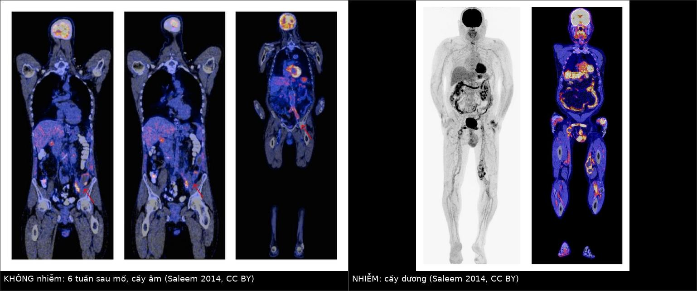
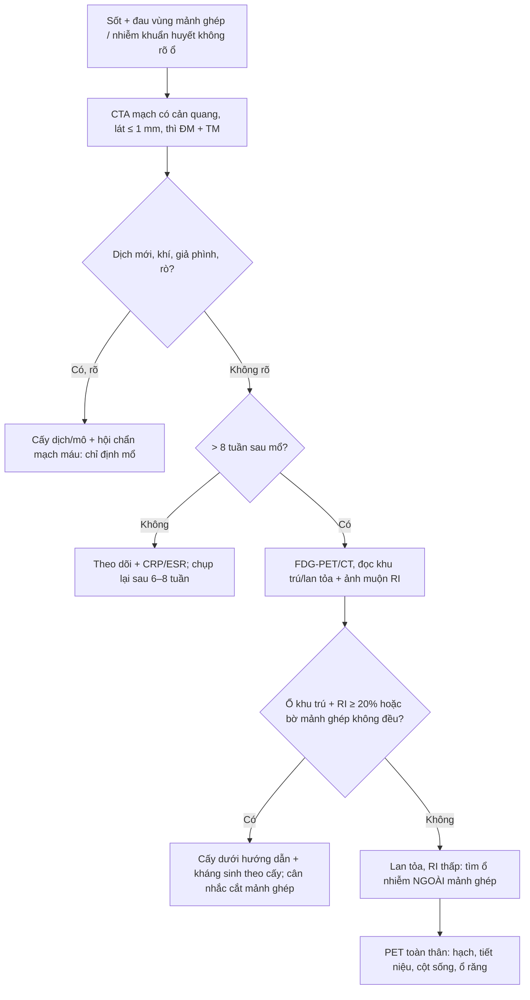
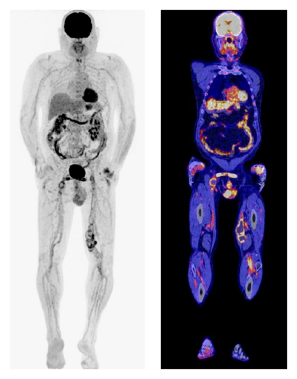
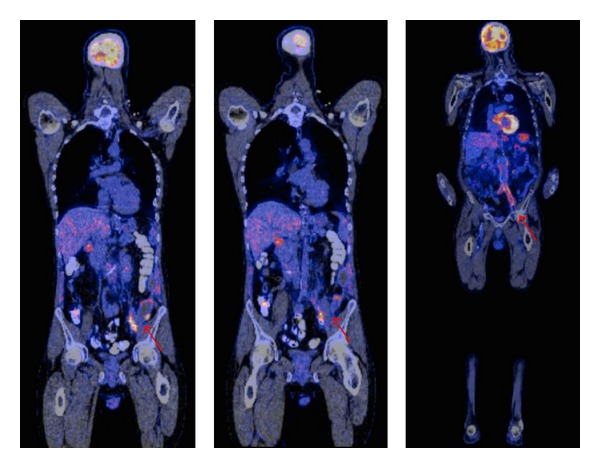
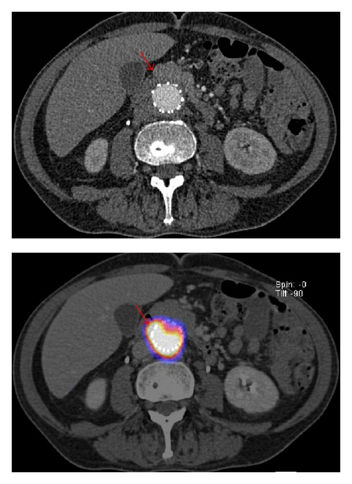

# 946 — Nhiễm trùng mảnh ghép mạch máu: CT không đủ, PET/CT cũng không đủ / Vascular graft & stent-graft infection

**Tags:** `pattern:o-dich-quanh-manh-ghep` `pattern:khi-trong-mo-mem` `pattern:gia-phinh` `pattern:ngam-fdg-khu-tru` `vung:dong-mach-chu` `vung:dong-mach-chau` `vung:bung` `protocol:CTA` `protocol:PET-CT` `protocol:choc-hut-quanh-manh-ghep` `score:FDG-4-diem`

**Mức chắc chắn (certainty):** tổng hợp y văn (literature synthesis) — số liệu từ **tổng quan hệ thống 6 nghiên cứu FDG-PET/CT trong nhiễm mảnh ghép mạch máu** (*BioMed Res Int* 2014, PMC4156987, CC BY) và **nghiên cứu quan sát PET/CT hai thời điểm (dual-time-point) 29 mảnh ghép động mạch chủ** (*Medicine* 2015, PMC4504531, CC BY-ND). Nhóm **không có bệnh nhân của mình**; mọi tỷ lệ dưới đây là số của tác giả gốc, ghi kèm nguồn.

> **Câu chốt:** nhiễm mảnh ghép mạch máu **hiếm nhưng chết người** — **1–6%** chung, **cắt chi 5–25%**, **tử vong tới 25–88%**. CT là **bước đầu**, nhưng dấu CT chỉ có ở **~50% ca** và **có thể bình thường ngay sau mổ**; **CT ở nhiễm độ thấp chỉ nhạy 55%**. FDG-PET/CT tốt hơn nhưng **92% mảnh ghép KHÔNG nhiễm vẫn có ngấm FDG lan tỏa**, và trong **6–8 tuần đầu sau mổ** ngấm là **sinh lý** — nên câu hỏi không phải "có ngấm không" mà là **"ngấm KHU TRÚ hay LAN TỎA, và có tăng dần trên ảnh muộn không"**.

## 1. Tổng quan bệnh học – cơ chế hình ảnh

### 1.1 Vì sao mảnh ghép bị nhiễm, và vì sao chẩn đoán khó

- **Bề mặt lạ = biofilm:** PTFE/Dacron là giá thể cho vi khuẩn bám thành **biofilm** — kháng sinh khuếch tán kém, tế bào miễn dịch không tiếp cận được → nhiễm **âm thầm nhiều năm**, có thể **khởi phát muộn 5–16 năm** sau đặt (ca trong PMC4156987: cầu nối aorto-bi-iliac đặt **16 năm** trước).
- **Đường vào:** nhiễm tại mổ, lan từ ổ nhiễm lân cận (groin, đường tiêu hóa), hoặc **gieo khuẩn qua máu** (bacteremia) — vì vậy **một đợt nhiễm khuẩn huyết ở người có mảnh ghép là chỉ định tìm ổ trên mảnh ghép**.
- **TẠI SAO CT khó:** sau mổ, quanh mảnh ghép **bình thường đã có ít dịch và mô xơ non**; dấu "dịch/khí quanh mảnh ghép" vì thế **không đặc hiệu ở giai đoạn sớm**. Tác giả tổng quan ghi rõ: các dấu CT (dịch khu trú, ứ quanh mảnh ghép, giả phình, dày ruột khu trú, bọt khí) **chỉ có ở ~50% ca nhiễm** và **có thể là bình thường sớm sau mổ** (PMC4156987).
- **TẠI SAO FDG-PET "bắt" được viêm:** đại thực bào/neutrophil hoạt hóa tăng **glucose transporter** và **hexokinase** → tích FDG. Nhưng **phản ứng mô hạt quanh vật lạ** (đại thực bào, nguyên bào sợi, tế bào khổng lồ dị vật) cũng làm điều đó — nên **ngấm FDG quanh mảnh ghép không đồng nghĩa nhiễm**; ngấm **lan tỏa** gặp ở **92% mảnh ghép không nhiễm**, cường độ **không phụ thuộc thời gian sau mổ** (5 tháng–16 năm, trung bình 10 năm) (PMC4156987).
- **TẠI SAO ảnh muộn (dual-time-point) hữu ích:** tổn thương nhiễm giữ FDG (bạch cầu hoạt hóa **tăng hexokinase**, giảm glucose-6-phosphatase) → SUV **tăng thêm** trên ảnh muộn; viêm xơ mạn và mô lành **thải FDG** → SUV **giảm**. Đo **chỉ số giữ (retention index, RI) = (SUVmuộn − SUVđầu)/SUVđầu**; **RI ≥ 20%** là ngưỡng tốt nhất: phát hiện **5/5 mảnh ghép nhiễm**, tốt hơn **SUVmax ≥ 5** trên ảnh đầu (PMC4504531).
- **TẠI SAO cần CTA chứ không chỉ PET:** PET cho biết **"có viêm"**, CTA cho biết **"viêm ở đâu và có biến chứng gì"** — giả phình, rò vào ruột, huyết khối trong lòng, mất liên tục miệng nối; **quyết định mổ dựa vào hình thái**, không dựa vào SUV.

### 1.2 Dịch tễ và các con số quyết định xử trí

- **Tỷ lệ nhiễm mảnh ghép (PMC4156987):** **1–6%** chung; theo vị trí: **< 1%** cầu nối chủ–dưới thận, **1–2%** aortofemoral, **tới 6%** cầu nối dưới bẹn (infrainguinal). Mảnh ghép động mạch chủ: **0,3%** mổ mở, **0,2%** đặt stent-graft nội mạch (PMC4504531).
- **Hậu quả:** **cắt chi 5–25%**, **tử vong tới 25–88%** (PMC4156987).
- **CT:** độ nhạy/độ đặc hiệu **~95%** chỉ đạt được khi **nghi ngờ lâm sàng cao**; ở **nhiễm độ thấp: nhạy 55%, đặc hiệu 100%** (PMC4156987).
- **FDG-PET/CT (6 nghiên cứu, PMC4156987):** Fukuchi 2005 (33 ca, PET) **nhạy 91% / đặc hiệu 64%**; Keidar 2007 (39 ca, PET/CT, đọc định tính) **93% / 91%**; Spacek 2009 (76 ca, PET/CT) **78,2% / 92,7%**; Bruggink 2010 (25 ca) **93% / 70%**.
- **Đọc theo hình thái:** khi có **ổ ngấm khu trú + bờ mảnh ghép không đều**, độ chính xác tới **97%** (Spacek, dẫn qua PMC4504531).
- **Hai thời điểm (PMC4504531, 29 mảnh ghép chủ, 5 nhiễm):** RI nhiễm **0,20–0,89**; RI không nhiễm **−0,36 đến 0,31**; **3 mảnh ghép không nhiễm nhưng viêm hoạt động có RI > 20%** → vẫn có **giả dương**. Ví dụ SUVmax: nhiễm **12,63 → 16,28** (muộn); "không nhiễm" (nhiễm khuẩn tiết niệu) **6,03 → 7,03**.
- **Cửa sổ sinh lý:** trong **6–8 tuần đầu sau mổ**, ngấm FDG quanh mảnh ghép có thể **sinh lý** → tránh kết luận nhiễm trên PET chụp quá sớm (PMC4156987).

## 2. Mẫu hình + chẩn đoán phân biệt theo vị trí (Gamut)

- **Mảnh ghép động mạch chủ ngực:** sốt + đau ngực/đau lưng; biến chứng chết người là **rò động mạch chủ–phế quản/thực quản** (herald bleed) và **giả phình miệng nối** — nối bài 086/938.
- **Mảnh ghép động mạch chủ bụng:** đau lưng + sốt + **dấu viêm (CRP/ESR)**; biến chứng **rò động mạch chủ–ruột** (xuất huyết tiêu hóa + khí trong ổ giả phình), **huyết khối mảnh ghép**, **áp-xe quanh mảnh ghép**, **viêm đốt sống lân cận** (nối 6163).
- **Mảnh ghép chậu/bẹn (infrainguinal):** tỷ lệ nhiễm **cao nhất (tới 6%)**; sưng–đỏ–chảy mủ vùng bẹn, **giả phình miệng nối**, rò ra da; dễ nhầm **nang bạch huyết/hạch viêm**.
- **Cầu nối chạy thận (AV graft):** nhiễm đường hầm, huyết khối, **giả phình tại chỗ chọc**; khác với nhiễm catheter trung tâm/rốn (nối 3045/945).
- **Stent-graft nội mạch:** nhiễm **hiếm hơn (0,2%)** nhưng khi xảy ra **không lấy stent ra được dễ dàng** → thường phải **kháng sinh kéo dài/thay mảnh ghép**; dấu CT: **dịch quanh stent mới xuất hiện, bọt khí, dày thành**.
- **Theo hình thái:** **ổ dịch quanh mảnh ghép** (áp-xe) → **khí** (nhiễm kỵ khí/hoại tử) → **giả phình** (miệng nối nhiễm) → **rò** (ruột/thực quản/phế quản) → **lan ra mô mềm/tủy sống**.

## 3. Bảng so sánh phân biệt (ma trận đối chiếu)

| Thực thể (entity) | Hình ảnh điển hình (CTA / PET-CT) | Chốt vào (rule-in) | Chốt loại (rule-out) | Gợi ý xác nhận |
|---|---|---|---|---|
| **Nhiễm mảnh ghép** | Dịch quanh mảnh ghép **tăng kích thước**, **bọt khí**, dày thành, giả phình miệng nối; PET: **ngấm khu trú, tăng trên ảnh muộn (RI ≥ 20%)**, bờ mảnh ghép không đều | **Ngấm khu trú + RI ≥ 20% + dịch/khí mới + hội chứng viêm** | Ngấm **lan tỏa đều**, không đổi trên ảnh muộn, không dịch/khí → viêm xơ lành | Cấy dịch/mô; PET ≥ 8 tuần sau mổ |
| **Viêm xơ quanh mảnh ghép (hậu phẫu)** | Dịch mỏng, đều, **giảm dần**; mô mềm quanh đồng nhất; ngấm FDG **lan tỏa, nhẹ** | **Ngấm lan tỏa + bệnh nhân không sốt + CRP giảm dần** | Ngấm khu trú mạnh, khí, giả phình → nhiễm | Theo dõi CTA 3 tháng; không chọc |
| **Huyết khối trong lòng mảnh ghép** | Khuyết thuốc **trong lòng**, không có dịch ngoài; FDG **âm hoặc rất nhẹ** | **Khuyết thuốc trong lòng + mạch xa yếu** | Dịch/khí ngoài mảnh ghép + sốt → nhiễm | CTA thì mạch; siêu âm Doppler |
| **Tụ máu quanh mảnh ghép** | Khối đậm độ cao (50–80 HU), **không ngấm thuốc**, hình theo khoang | **Đậm độ máu + không ngấm + tụt Hb** | Ngấm thuốc viền + khí + sốt → áp-xe | CTA; theo dõi kích thước |
| **Giả phình miệng nối (vô khuẩn)** | Túi thông với lòng mạch, **cổ rõ**, không dịch bẩn; FDG **âm/viền nhẹ** | **Cổ rõ + ngấm thuốc đồng thì với ĐM** | Cổ không rõ, bờ mờ, dịch quanh + sốt → giả phình **nhiễm** | CTA; siêu âm; cân nhắc can thiệp |
| **Rò động mạch chủ–ruột** | **Khí trong ổ giả phình sát ruột**, mất mỡ giữa ĐM và ruột, **máu trong lòng ruột** | **Khí trong túi + xuất huyết tiêu hóa (herald bleed)** | Khí đơn thuần sớm sau mổ, không máu → theo dõi | CTA; **nội soi tiêu hóa có thể làm bùng phát chảy máu** (nối 086/938) |
| **Nhiễm mô mềm/hạch lân cận** | Ngấm FDG ở **hạch/cơ/mô mỡ**, mảnh ghép **không ngấm khu trú** | **Ổ ngấm NGOÀI mảnh ghép + mảnh ghép sạch** | Ngấm đúng trên thành mảnh ghép → nhiễm mảnh ghép | PET/CT định vị; cấy ổ nguyên phát |

*Trái: **KHÔNG nhiễm** — Viabahn động mạch chậu trái, PET/CT **6 tuần sau mổ** vì sốt/nhiễm khuẩn huyết; có ngấm FDG quanh mảnh ghép nhưng **cấy âm** (ngấm sinh lý/hậu phẫu + ổ nhiễm khác). Phải: **NHIỄM** — cầu nối chậu–đùi, ngấm **khu trú, đậm, dọc mảnh ghép**, **cấy dương**. Nguồn: Saleem BR và cs, BioMed Res Int 2014, Fig. 2–3, CC BY 4.0 (PMC4156987). Ảnh ghép letterbox bằng `tools/make_composite.py`, giữ nguyên aspect.*

### Cách đọc ngấm FDG quanh mảnh ghép — 4 câu hỏi theo thứ tự

1. **Khu trú hay lan tỏa?** Khu trú = nghi nhiễm; lan tỏa đều dọc mảnh ghép = thường là phản ứng vật lạ.
2. **Bờ mảnh ghép có đều không?** Bờ **không đều/gồ ghép + ổ khu trú** → độ chính xác tới **97%** (Spacek).
3. **Có tăng trên ảnh muộn không?** **RI ≥ 20%** → nghi nhiễm (nhưng 3 ca viêm hoạt động vẫn giả dương).
4. **Có dấu hình thái kèm theo không?** Dịch mới/tăng, khí, giả phình, rò — **hình thái quyết định mổ**, không phải SUV.

## 4. Protocol chụp + phân độ và xử trí

### 4.1 Trình tự chẩn đoán

- **CTA là bước 1, luôn làm:** lát **≤ 1 mm**, **thì động mạch + tĩnh mạch**, dựng MPR; báo cáo 6 mục: (1) **vị trí/loại mảnh ghép**; (2) **dịch quanh mảnh ghép** (kích thước, đậm độ, bờ); (3) **khí**; (4) **giả phình/miệng nối**; (5) **mạch xa + huyết khối**; (6) **lan ra mô mềm/tủy sống/ruột**.
- **FDG-PET/CT:** chụp **≥ 8 tuần sau mổ** (tránh cửa sổ sinh lý **6–8 tuần**), **hai thời điểm** (60 và ~110 phút) nếu nghi nhiễm độ thấp; báo **SUV đầu/muộn + RI**.
- **Chọc hút dịch quanh mảnh ghép dưới hướng dẫn:** là cách lấy **chuẩn vàng vi sinh**, nhưng **chỉ khi có ổ dịch và đã loại trừ giả phình/rò**, và phải coi là thủ thuật **có nguy cơ** (nhiễm đường vào, chảy máu) — không chọc "để chắc".
- **Cấy máu trước kháng sinh**, 2–3 bộ; nếu **Staphylococcus aureus** phân lập được ở người có mảnh ghép → **tìm ổ trên mảnh ghép chủ động**.

### 4.2 Phân độ đọc PET và ngưỡng xử trí

- **Thang 4 điểm (PMC4156987):** **1** = ngấm bằng nền; **2** = thấp, bằng cơ/fat không hoạt động; **3** = trung bình, rõ hơn cơ nhưng **kém hơn bàng quang**; **4** = mạnh, **bằng bàng quang**. **Độ 3–4 = xác suất cao nhiễm mảnh ghép**. Thang 5 điểm tương đương (0–4) với cùng ngưỡng **3–4**.
- **Ngưỡng định lượng:** **SUVmax ≥ 5** trên ảnh đầu (ngưỡng của nghiên cứu PMC4504531) kém chính xác hơn **RI ≥ 20%**; RI **> 20%** cũng gặp ở **viêm hoạt động không nhiễm** → **luôn kết hợp hình thái**.
- **Xử trí (nguyên tắc):** nhiễm mảnh ghép **không chữa khỏi bằng kháng sinh đơn thuần** vì biofilm — cần **lấy bỏ toàn bộ mảnh ghép nhiễm** + **bắc cầu ngoài giải phẫu (extra-anatomic)** hoặc **tái tạo in situ** (mảnh ghép tẩm rifampicin/vancomycin, hoặc tĩnh mạch tự thân) + **kháng sinh 4–6 tuần** (kéo dài hơn nếu cấy dương dai dẳng hoặc còn vật lạ). **Ở bệnh nhân không thể mổ**: kháng sinh **ức chế (suppressive)** dài hạn — kiểm soát triệu chứng, không khỏi.
- **Thời điểm mổ khi có biến chứng:** **rò động mạch chủ–ruột/thực quản = cấp cứu** (nguy cơ chảy máu ồ ạt), không chờ đủ kháng sinh.

## 5. Biến thể bình thường và cạm bẫy

- **Ngấm FDG lan tỏa quanh mảnh ghép là bình thường:** gặp ở **92%** mảnh ghép không nhiễm, **không liên quan thời gian sau mổ** → đừng chẩn đoán nhiễm chỉ vì "có ngấm".
- **PET chụp quá sớm:** trong **6–8 tuần** sau mổ, ngấm là sinh lý — ca "không nhiễm" trong ảnh trên được chụp đúng **6 tuần** sau đặt Viabahn.
- **Ổ nhiễm ngoài mảnh ghép:** nhiễm khuẩn tiết niệu, hạch, ổ răng, viêm đốt sống có thể làm **SUV quanh mảnh ghép tăng giả** (ví dụ **6,03 → 7,03** trong PMC4504531); luôn đọc **toàn thân**, không chỉ vùng mảnh ghép.
- **Đái tháo đường/tăng đường huyết:** ngấm FDG không đặc hiệu hơn ở mô viêm; kiểm tra glucose máu (< 8 mmol/L trong nghiên cứu) trước khi kết luận.
- **"Không có khí không loại trừ":** dấu CT chỉ có ở **~50%** ca nhiễm; **dịch quanh mảnh ghép ở người không sốt, giảm dần** có thể chỉ là hậu phẫu.
- **Đừng chọc giả phình:** chọc hút "ổ dịch" quanh miệng nối có thể là **giả phình** → chảy máu không cầm; luôn CTA/Doppler trước khi chọc.
- **Nhiễm muộn nhiều năm:** tiền sử đặt mảnh ghép **16 năm** vẫn có thể là nguồn nhiễm; đừng loại trừ vì "đã lâu".
- **Satisfaction of search:** thấy một ổ dịch quanh mảnh ghép rồi dừng — phải xem **toàn bộ chiều dài mảnh ghép** và **miệng nối hai đầu**, nơi tổn thương hay khu trú.

## 6. Tự lượng giá — Blind Quiz

**Ca 1 — Nam 70 tuổi, cầu nối chậu–đùi trái 2 năm trước, nay sốt 38,5 °C, đau vùng bẹn trái, CRP tăng. Xem PET/CT toàn thân + CT ngang trước khi mở đáp án.**

- Hỏi: Ngấm FDG nằm ở đâu và có dạng gì? Vì sao đây là **nhiễm mảnh ghép** chứ không phải viêm hậu phẫu?

<b>Bấm để hiện đáp án (findings + chẩn đoán)</b>

- **Dấu hiệu:** ngấm FDG **khu trú, đậm, chạy dọc toàn bộ mảnh ghép** chậu–đùi trái (MIP + ảnh hợp nhất); ổ ngấm **không đối xứng** với bên phải.
- **Chẩn đoán:** **nhiễm mảnh ghép mạch máu** (ca cấy dương trong bài gốc). Chốt: **khu trú + bờ mảnh ghép không đều + hội chứng viêm**; viêm hậu phẫu thường **lan tỏa, nhẹ, giảm dần**.
- **Việc cần làm:** CTA đánh giá miệng nối/giả phình/rò; **cấy máu + cấy dịch**; hội chẩn mạch máu về **lấy mảnh ghép + bắc cầu ngoài giải phẫu** + kháng sinh 4–6 tuần.
- **Nguồn ảnh:** Saleem BR và cs, *BioMed Res Int* 2014;2014:471971, Fig. 3, CC BY 4.0 (PMC4156987).

**Ca 2 — Nam 45 tuổi, đặt Viabahn động mạch chậu trái vì vỡ mạch, **6 tuần sau** nhập viện sốt và nhiễm khuẩn huyết. Xem PET/CT.**

- Hỏi: Có ngấm FDG quanh mảnh ghép — vì sao vẫn **không** gọi là nhiễm? Yếu tố nào trên **thời gian** giúp tránh chẩn đoán sai?

<b>Bấm để hiện đáp án (findings + chẩn đoán)</b>

- **Dấu hiệu:** ngấm FDG **lan tỏa, nhẹ** dọc động mạch chậu trái quanh mảnh ghép Viabahn; **không có ổ dịch/khí/giả phình** trên CT.
- **Chẩn đoán:** **không nhiễm mảnh ghép** (cấy âm trong bài gốc) — ngấm **sinh lý/hậu phẫu** trong cửa sổ **6–8 tuần**, cộng ổ nhiễm khác gây sốt.
- **Bài học:** PET trong **6–8 tuần đầu** sau đặt mảnh ghép **không đáng tin**; nếu bắt buộc phải chụp, dựa vào **hình thái CTA** và **theo dõi**, không dựa vào ngấm lan tỏa.
- **Nguồn ảnh:** Saleem BR và cs, *BioMed Res Int* 2014, Fig. 2, CC BY 4.0 (PMC4156987).

**Ca 3 — Bệnh nhân có stent-graft động mạch chủ bụng, sốt kéo dài. Xem CT ngang và ảnh PET hợp nhất cùng lát.**

- Hỏi: Trên CT **một mình**, dấu hiệu nào là bất thường? Ảnh PET thêm được thông tin gì mà CT không có?

<b>Bấm để hiện đáp án (findings + chẩn đoán)</b>

- **Dấu hiệu:** CT: **mô mềm/dịch quanh stent-graft** (mũi tên đỏ), **không có khí rõ**; PET hợp nhất: **ổ ngấm FDG đậm, khu trú đúng vùng mô mềm quanh mảnh ghép**, không lan tỏa.
- **Chẩn đoán:** **nhiễm mảnh ghép nội mạch** (ca cấy dương). Chốt: **dịch quanh mảnh ghép + ngấm khu trú**; CT đơn thuần chỉ nói "có dịch", PET nói **"dịch đó đang viêm"**.
- **Vì sao quan trọng:** quyết định **mổ lấy mảnh ghép** (khó với stent-graft) hay **kháng sinh ức chế dài hạn** phụ thuộc **bằng chứng nhiễm**, không chỉ "có dịch".
- **Nguồn ảnh:** Saleem BR và cs, *BioMed Res Int* 2014, Fig. 4, CC BY 4.0 (PMC4156987).

## Bài liên quan chéo
- [945 – Nhiễm và biến chứng port-a-cath](../945-nhiem-va-bien-chung-port-a-cath/lesson.md)
- [086 – Rò động mạch chủ–phế quản](../086-ro-dong-mach-chu-phe-quan/lesson.md)
- [938 – Rò động mạch chủ–ruột](../938-ro-dong-mach-chu-ruot/lesson.md)
- [939 – Rò động mạch chủ–tĩnh mạch chủ](../939-ro-dong-mach-chu-tinh-mach-chu/lesson.md)
- [6163 – Viêm đĩa đệm–thân sống và phình ĐMC nhiễm khuẩn](../6163-viem-dia-dem-than-song-va-phinh-dmc-nhiem-khuan/lesson.md)
- [3045 – Catheter rốn sơ sinh (UVC/UAC)](../3045-catheter-ron-so-sinh-uvc-uac/lesson.md)
- [932 – An toàn bức xạ trong CT và DSA](../932-an-toan-buc-xa-ct-dsa/lesson.md)
- [901 – Tổng quan can thiệp mạch](../901-ir-overview/lesson.md)

## Ảnh
- `images/946_nhiem-manh-ghep_PET-CT_PMC4156987.jpg` — PET/CT toàn thân, mảnh ghép nhiễm (Fig. 3).
- `images/946_khong-nhiem_PET-CT_PMC4156987.jpg` — PET/CT, mảnh ghép không nhiễm 6 tuần sau mổ (Fig. 2).
- `images/946_nhiem-manh-ghep_CT-PET_PMC4156987.jpg` — CT ngang + PET hợp nhất, nhiễm stent-graft (Fig. 4).
- `images/composite_nhiem-vs-khong-nhiem.jpg` — ảnh ghép đối chiếu (tạo bằng `tools/make_composite.py`).
- Cả 4 ảnh: **CC BY 4.0** (PMC4156987) → dùng được kể cả thương mại, phải ghi công; ghi chi tiết trong `images/CREDITS.md`.

> Không dùng để chẩn đoán độc lập khi chưa có người hướng dẫn.
