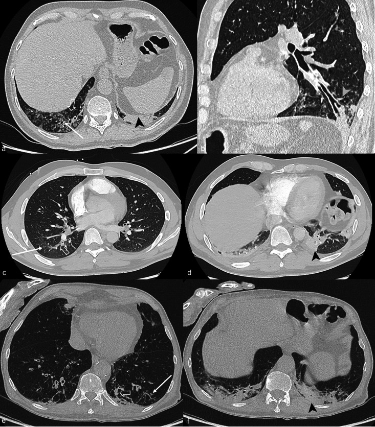
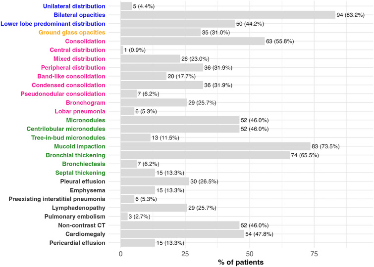
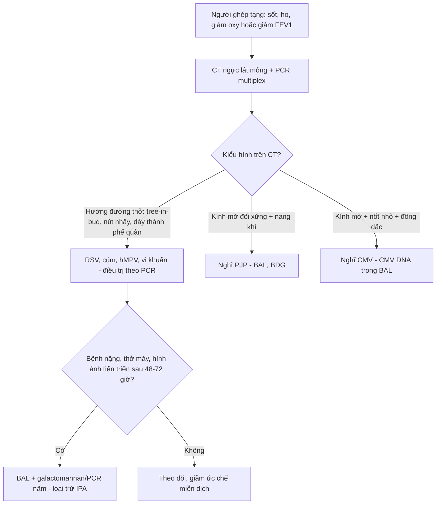
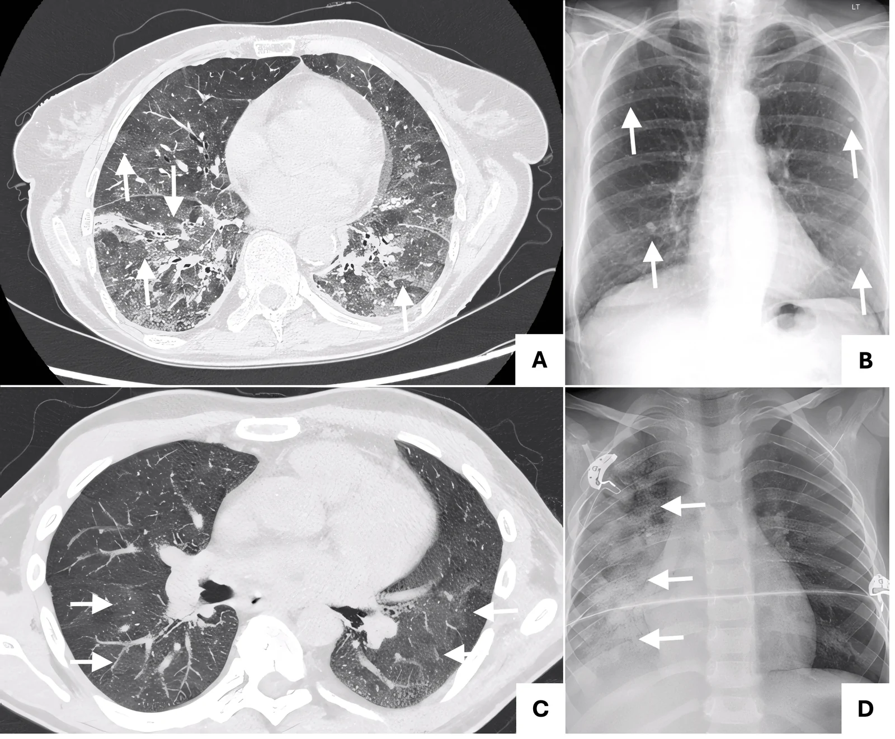
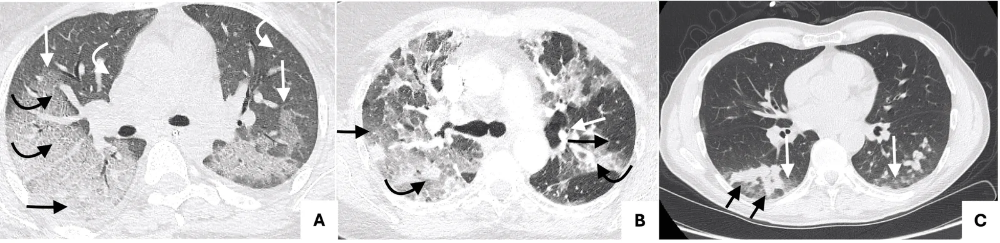
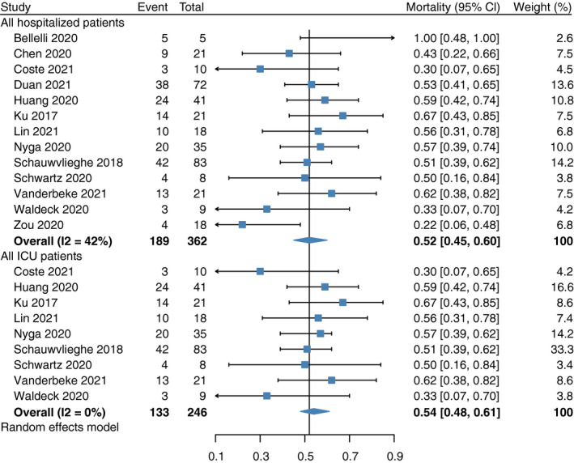

# 947 — Viêm phổi do RSV và cúm ở người ghép tạng: mẫu hình "hướng đường thở" khác CMV/PJP, và bội nhiễm *Aspergillus* / RSV and influenza pneumonia in transplant recipients

**Tags:** `pattern:tree-in-bud` `pattern:day-thanh-phe-quan` `pattern:nut-nhay` `pattern:kinh-mo` `pattern:dong-dac` `vung:phoi` `protocol:CT-nguc-lat-mong` `protocol:PCR-multiplex` `protocol:BAL` `score:CCTS`

**Mức chắc chắn (certainty):** tổng hợp y văn (literature synthesis) — ghép **phân tích gộp hình ảnh CT của RSV 217 ca** (Riccò et al. 2023, *Children* 10:1169, **PMC10378054**, CC BY 4.0), **đoàn hệ CT 113 người lớn nhiễm RSV** (Le Goff et al. 2026, *Infect Dis Ther*, **PMC12783463**, CC BY-NC 4.0), **đoàn hệ 76 người ghép phổi RSV/hMPV** (Jiménez-Gómez et al. 2026, *Life*, **PMC13514294**, CC BY 4.0), **đoàn hệ 1.061 người ghép gan/thận nhiễm cúm** (Arentoft et al. 2023, *Microbiol Spectr*, **PMC10101112**, CC BY 4.0), **tổng quan hệ thống gánh nặng RSV ở người suy giảm miễn dịch** (Saeedi et al. 2026, *Infect Dis Ther*, **PMC13476412**, CC BY-NC 4.0) và **phân tích gộp 6.024 bệnh nhân cúm nhập viện** về bội nhiễm *Aspergillus* (Shi et al. 2022, *Mycoses*, **PMC9306612**, CC BY-NC 4.0). Nhóm **không có bệnh nhân của mình**.

> **Câu chốt:** ở người ghép tạng, **RSV và cúm không cho "kính mờ đối xứng" như CMV hay PJP** mà cho **tổn thương hướng đường thở**: **tree-in-bud, dày thành phế quản, nút nhầy (mucoid impaction)**, kèm kính mờ/đông đặc **vái từng ổ**. Trong đoàn hệ 113 người lớn nhiễm RSV, **nút nhầy 73,5%**, **dày thành phế quản 65,5%**, **đông đặc 55,8%**, **vi nốt 46,0%**; **điểm CT (CCTS) > 6 làm tăng nguy cơ bệnh nặng gấp 3,66 lần**. Nguy hiểm thật sự là **bội nhiễm *Aspergillus* sau cúm**: gộp 14 nghiên cứu, **10% bệnh nhân cúm nhập viện có IPA, tử vong 52%** — nên **CT không được dừng ở "viêm phổi do virus"** mà phải trả lời câu hỏi thứ hai: **có nấm xâm lấn chưa?**

## 1. Tổng quan bệnh học – cơ chế hình ảnh (TẠI SAO)

### 1.1 Hai virus, một điểm chung: tấn công biểu mô đường thở
- **RSV (human respiratory syncytial virus, Paramyxoviridae)** nhiễm **tế bào biểu mô có lông chuyển** của phế quản và tiểu phế quản → **viêm tiểu phế quản (bronchiolitis)** với **phù, thâm nhiễm tế bào đơn nhân, tế bào bong và nút nhầy** bít lòng tiểu phế quản. Ở người ghép tạng, **miễn dịch tế bào T suy giảm** → **tải lượng virus cao hơn, thải virus lâu hơn (nhiều tuần)**, dễ lan xuống phổi và dễ **đồng nhiễm**.
- **Cúm (influenza A/B, Orthomyxoviridae)** nhiễm **biểu mô phế quản và phế nang**; tổn thương nặng gây **tổn thương phế nang lan tỏa (diffuse alveolar damage)** + **viêm nội mô**, nên ngoài đường thở còn **kính mờ và đông đặc**.
- **TẠI SAO tree-in-bud:** "cây nở hoa" là **hình chiếu của tiểu phế quản bị nhét đầy dịch/mủ** (ống cây) với **nốt trung tâm tiểu thùy** ở đầu tận (hoa). Đây là **dấu hiệu của bệnh lý lòng đường thở**, không phải bệnh lý mô kẽ — vì vậy nó **không đặc hiệu cho một virus** mà định hướng **nhóm bệnh**: nhiễm virus đường hô hấp, vi khuẩn, mycobacteria, xơ nang.
- **TẠI SAO dày thành phế quản:** phù niêm mạc + thâm nhiễm viêm quanh phế quản; đo trên CT lát mỏng **> 1–2 mm** ở phế quản phân thùy là bất thường. **TẠI SAO nút nhầy:** chất nhầy + tế bào bong + fibrin đặc lại trong lòng phế quản, cản quang **thấp (dịch)**, có thể **thay đổi vị trí giữa hai lần chụp**.
- **TẠI SAO kính mờ/đông đặc:** khi virus lan xuống phế nang → **dịch và tế bào viêm lấp khoang phế nang một phần (kính mờ)** hoặc **toàn bộ (đông đặc)**; phân bố **vái từng ổ, quanh phế quản, ưu thế đáy** — khác **kính mờ lan tỏa đối xứng** của PJP.

### 1.2 Vì sao người ghép tạng là "ổ" của cả virus và nấm
- **Ức chế miễn dịch T** làm **giảm thanh thải virus** và **giảm hàng rào niêm mạc**; **corticoid liều cao** làm giảm viêm nhưng cũng **che mất sốt và đông đặc**, khiến hình ảnh **nhẹ hơn bệnh thật**.
- **Cúm làm hỏng biểu mô đường thở + giảm bạch cầu** → tạo "đất" cho *Aspergillus* xâm lấn (**influenza-associated pulmonary aspergillosis, IAPA**). Trong phân tích gộp 14 nghiên cứu/6.024 bệnh nhân cúm nhập viện: **IPA 10%**, **tử vong 52%**; phân tích con dùng **tiêu chuẩn AspICU cải tiến** cho **13%**; **ghép tạng nằm trong nhóm yếu tố nguy cơ**.
- **Vì sao hình ảnh IAPA khó đọc:** *Aspergillus* xâm lấn mạch → **nhồi máu hoại tử**; trên CT có thể chỉ là **đông đặc quanh phế quản, dày thành phế quản, nút nhầy** — **trùng lặp hoàn toàn với hình ảnh virus**, nên **chẩn đoán không thể chỉ dựa vào CT**.

### 1.3 Số liệu trụ cột

| Đại lượng | Con số | Nguồn |
|---|---|---|
| **RSV — CT gộp 217 ca** (10 nghiên cứu; 41,0% suy giảm miễn dịch) | Viêm phổi tổ chức hóa **33,65%**; dày vách **33,19%**; kính mờ **28,03%**; **tree-in-bud 27,44%**; **CT bình thường 16,23%**; hai bên **76,06%** | PMC10378054 |
| **RSV — đoàn hệ 113 người lớn** (31,9% suy giảm miễn dịch; tuổi trung vị 72) | **Nút nhầy 73,5%**, **dày thành phế quản 65,5%**, đông đặc 55,8%, **vi nốt 46,0%**; **CCTS trung vị 6 (3–10)** | PMC12783463 |
| **RSV — ngưỡng nặng** | **CCTS > 6: aOR 3,66** (1,63–8,62) cho bệnh nặng (WHO scale ≥ 5); nhóm nặng (n = 66) có CCTS **7 vs 4** (p < 0,001) | PMC12783463 |
| **RSV — gánh nặng ở người ghép** (36 bài) | Nhập viện **37,5–87,5%** (ghép phổi), **37,7–68,0%** (ghép tạng chung); ICU **11,7%** (phổi), **3,9–17,9%** (tạng); thở máy **0–10,4%** (phổi), **3,9–14,3%** (tạng) | PMC13476412 |
| **RSV/hMPV — ghép phổi 76 ca** | Nhiễm đường hô hấp dưới **48,7%**; **giảm FEV1 ≥ 10% ở ngày 14: 29,3%**; ribavirin **không** liên quan độc lập với FEV1 90 ngày | PMC13514294 |
| **Cúm — ghép gan/thận 1.061 ca, 10 mùa** | Tích lũy 5 năm **6,3%**; **nhập viện 65,5%**; **viêm phổi 16,7%**; oseltamivir **65,5%**; không khác biệt cúm A/B | PMC10101112 |
| **IPA sau cúm** (14 nghiên cứu, 6.024 ca) | **IPA 10%**; **tử vong 52%**; AspICU cải tiến **13%** | PMC9306612 |

- **Điểm chết người về ngưỡng:** **CT bình thường 16,23%** ở RSV — **không loại trừ**; và **CCTS chỉ là thang đo mức lan tổn thương**, không phải thang chẩn đoán nguyên nhân.

## 2. Mẫu hình + chẩn đoán phân biệt theo kiểu hình (Gamut)

- **Kiểu A — hướng đường thở (airway-centric):** tree-in-bud + dày thành phế quản + nút nhầy ± đông đặc quanh phế quản. **Gamut:** RSV, cúm, hMPV, adenovirus, bocavirus; **vi khuẩn** (kể cả *S. aureus*, *Pseudomonas*), **mycobacteria**, **ABPA/ABPA-like**. Đây là kiểu **hay gặp nhất ở RSV** nhưng **không định danh được virus**.
- **Kiểu B — kính mờ/đông đặc vái từng ổ:** cúm (nặng), RSV lan xuống phế nang, **CMV**, **PJP**, thải ghép cấp, phù phổi.
- **Kiểu C — nốt + kính mờ quanh nốt (halo):** CMV, *Aspergillus* xâm lấn, nhiễm khuẩn huyết rải rác.
- **Kiểu D — hang/liềm khí:** *Aspergillus* xâm lấn mạch ở người giảm bạch cầu hạt nặng (xem bài 025).
- **Mnemonic phân biệt nhanh:** **RSV/cúm = "đường thở, vái từng ổ"**; **CMV = "kính mờ + nốt nhỏ + đông đặc, đối xứng hơn"**; **PJP = "kính mờ lan tỏa + nang khí, ít nốt"**.

## 3. Bảng so sánh phân biệt (ma trận đối chiếu)

| Thực thể (entity) | Hình ảnh điển hình | Chốt vào (rule-in) | Chốt loại (rule-out) | Gợi ý xác nhận |
|---|---|---|---|---|
| **RSV** | **Tree-in-bud 27%**, **dày thành phế quản 66%**, **nút nhầy 74%**, đông đặc 56%, hai bên 76%; **CT bình thường 16%** | **Tổn thương hướng đường thở + hai bên + bối cảnh ghép/tháng lạnh** | Không có tree-in-bud **không loại trừ** (chỉ 27% có) | **PCR multiplex** dịch mũi họng; BAL nếu nặng |
| **Cúm** | Kính mờ vái từng ổ ± đông đặc; có thể tree-in-bud; **nặng → đông đặc lan tỏa** | **Kính mờ/đông đặc vái từng ổ + sốt cấp + PCR cúm dương** | Hình ảnh "đường thở đơn thuần" không loại trừ; **đông đặc lan tỏa không loại trừ bội nhiễm** | PCR cúm; **cấy/BAL + galactomannan khi nặng** |
| **CMV** | Kính mờ 100%, lưới 53%, **nốt nhỏ 32%**, đông đặc 62%, halo 32% | **Kính mờ + nốt nhỏ + đông đặc ở người ghép** | Hình ảnh đường thở rõ **không loại trừ** (đồng nhiễm) | **CMV DNA trong BAL**, mô học/IHC |
| **PJP** | Kính mờ lan tỏa đối xứng, lưới, **nang khí**, ít nốt | **Kính mờ + nang khí + LDH tăng + BDG dương** | Đông đặc/nốt rõ → nghĩ CMV hoặc đồng nhiễm | BAL nhuộm Grocott/PCR |
| **IPA sau cúm** | Đông đặc quanh phế quản, dày thành phế quản, nút nhầy; **hang/liềm khí ở người giảm bạch cầu hạt** | **Bệnh nặng + PCR cúm + hình ảnh mới tiến triển**; **galactomannan dương** | CT "chỉ giống virus" **không loại trừ** — IPA 10% ca cúm nhập viện | **BAL + galactomannan/PCR nấm**, cấy nấm |
| **Viêm phổi vi khuẩn** | Đông đặc thùy, **tree-in-bud mủ**, dày thành phế quản | **Đông đặc thùy + sốt + bạch cầu tăng** | Tree-in-bud đơn thuần **không loại trừ** virus | Cấy đờm/BAL, procalcitonin (giá trị hạn chế) |

*Hình: panel HRCT đại diện của bệnh nhân nhiễm RSV — dày thành phế quản, nút nhầy, vi nốt và kính mờ quanh phế quản. Le Goff M et al., *Infect Dis Ther* 2026 (PMC12783463), Fig. 3, **CC BY-NC 4.0** — nguyên bản, không crop/ghép.*

*Hình: biểu đồ tần suất dấu hiệu CT (n = 113): nút nhầy, dày thành phế quản, đông đặc, vi nốt. Cùng nguồn, Fig. 2, **CC BY-NC 4.0**.*

## 4. Protocol chụp + thang điểm + xử trí

### 4.1 Chụp
- **CT ngực lát mỏng ≤ 1 mm, không cản quang** là chuẩn; chụp **thì hít vào**; thêm **tư thế nằm sấp** khi nghi tổn thương phụ thuộc (không cần cho câu hỏi virus).
- **Khi nào chụp:** người ghép có **sốt + ho + giảm oxy** hoặc **giảm FEV1 ≥ 10%** (ở ghép phổi, 29,3% ca RSV/hMPV có mức giảm này ở ngày 14) → CT để **xác định mức lan và loại trừ bội nhiễm**, không để "chẩn đoán virus".
- **Đo và ghi:** mức lan theo thùy, **CCTS**, có/không **tree-in-bud, nút nhầy, dày thành phế quản, hang, tràn dịch** — bốn dấu hiệu này đổi xử trí.

### 4.2 Xét nghiệm
- **PCR multiplex dịch mũi họng** là bước đầu; **BAL** khi bệnh nặng, thất bại điều trị, hoặc ghép phổi (để lấy mẫu **galactomannan + PCR nấm + cấy**).
- **Galactomannan huyết thanh/BAL** khi: cúm nặng, nhập ICU, thở máy, hình ảnh tiến triển sau 48–72 giờ — vì **IPA 10% và tử vong 52%**.

### 4.3 Điều trị (khung, không thay phác đồ đơn vị)
- **Cúm:** **oseltamivir** sớm (trong loạt ghép gan/thận, **65,5%** được dùng); không chờ kết quả PCR nếu bệnh cảnh phù hợp mùa cúm.
- **RSV:** **giảm ức chế miễn dịch** là can thiệp có bằng chứng nhất; **ribavirin** dùng theo quyết định từng ca — trong đoàn hệ 76 ca ghép phổi, ribavirin **không** liên quan độc lập với thay đổi FEV1 90 ngày (có thể do nhiễu chỉ định).
- **IPA:** khi nghi → **kháng nấm** theo phác đồ + **giảm ức chế miễn dịch**; **không chờ** hình ảnh hang/liềm khí.
- **Phòng bệnh:** tiêm chủng cúm/RSV theo hướng dẫn ở người ghép; kiểm soát lây nhiễm (RSV lây bệnh viện đã được ghi nhận).

## 5. Biến thể bình thường và cạm bẫy

- **Biến thể bình thường:** **dày thành phế quản nhẹ ở đáy** do phụ thuộc; **nút nhầy nhỏ** sau gây mê/thở máy; **vi nốt trung tâm tiểu thùy rải rác** ở người hút thuốc — đừng gọi là "tree-in-bud" nếu **không thấy ống cây**.
- **Cạm bẫy 1 — "CT bình thường nên không phải virus":** **16,23%** ca RSV có CT bình thường; quyết định dựa **PCR + bệnh cảnh**.
- **Cạm bẫy 2 — gán mọi kính mờ cho CMV:** RSV/cúm cũng cho kính mờ; **điều trị CMV muộn** vì chờ "hình ảnh điển hình" là lỗi hai chiều (xem bài 1789).
- **Cạm bẫy 3 — bỏ sót IPA vì "đã có chẩn đoán virus":** **10%** ca cúm nhập viện có IPA; **hình ảnh giống hệt virus**; phải **galactomannan/BAL** khi nặng.
- **Cạm bẫy 4 — dùng corticoid liều cao "để giảm viêm":** làm **che sốt, giảm đông đặc**, và **tăng nguy cơ nấm**; không dùng thay kháng virus/kháng nấm.
- **Cạm bẫy 5 — đọc nút nhầy thành "đông đặc u":** nút nhầy **thay đổi giữa hai lần chụp**, không ngấm thuốc, thường kèm dày thành phế quản — không phải khối.

## 6. Tự lượng giá — Blind Quiz

**Ca 1 — người ghép phổi, sốt và ho**

- Gợi ý lâm sàng: bệnh nhân ghép phổi, sốt nhẹ, ho tăng, FEV1 giảm; CT lát mỏng trong 7 ngày đầu.
- Câu hỏi: Ba dấu hiệu chính? Hai chẩn đoán phân biệt hàng đầu? Xét nghiệm nào chốt nguyên nhân?

<b>Bấm để hiện đáp án (findings + chẩn đoán)</b>

- Dấu hiệu: **dày thành phế quản**, **nút nhầy** trong lòng phế quản phân thùy, **vi nốt/kính mờ quanh phế quản** — mẫu hình hướng đường thở.
- Chẩn đoán: **RSV** (hoặc cúm/hMPV) — không phân biệt được bằng hình ảnh; chốt bằng **PCR multiplex**, BAL khi nặng.
- Nguồn ảnh: Le Goff M et al., *Infect Dis Ther* 2026 (PMC12783463), Fig. 3, **CC BY-NC 4.0**.

**Ca 2 — kính mờ vái từng ổ ở người ghép thận**

- Gợi ý lâm sàng: người ghép thận, sốt cao, đau cơ, khó thở; PCR cúm A dương.
- Câu hỏi: Mô tả tổn thương? Vì sao phải nghĩ tới bội nhiễm nấm dù PCR cúm đã dương?

<b>Bấm để hiện đáp án (findings + chẩn đoán)</b>

- Dấu hiệu: **kính mờ vái từng ổ, phân bố ngoại vi/đáy** (panel A); panel B là tổn thương khác của cùng hình (nốt vôi hóa do varicella cũ) — không phải tổn thương cấp.
- Chẩn đoán: **viêm phổi do cúm**. Bội nhiễm *Aspergillus* xảy ra ở **10%** ca cúm nhập viện, tử vong **52%** → cần **galactomannan/BAL** nếu nặng hoặc hình ảnh tiến triển.
- Nguồn ảnh: Campbell A et al., *Cureus* 2026 (PMC13687686), Fig. 4, **CC BY 4.0**.

**Ca 3 — cùng kính mờ nhưng khác nguyên nhân**

- Gợi ý lâm sàng: người ghép tạng, sốt kéo dài, giảm bạch cầu; không có triệu chứng đường thở trên.
- Câu hỏi: Dấu hiệu nào **khác** với RSV/cúm ở Ca 1–2? Nếu chỉ thấy kính mờ đối xứng, có loại trừ RSV/cúm không?

<b>Bấm để hiện đáp án (findings + chẩn đoán)</b>

- Dấu hiệu: **kính mờ hai bên đối xứng + đông đặc + nốt nhỏ trung tâm tiểu thùy + dày vách** — mẫu hình "mô kẽ + phế nang" chứ không phải "đường thở".
- Chẩn đoán: **CMV** (bài 1789). Không loại trừ RSV/cúm khi chỉ có kính mờ — **PCR multiplex + CMV DNA** song song.
- Nguồn ảnh: Campbell A et al., *Cureus* 2026 (PMC13687686), Fig. 5, **CC BY 4.0**.

**Câu 4 — ngưỡng quyết định (không cần ảnh)**

- Câu hỏi: Bệnh nhân cúm nhập ICU, CT xấu đi sau 48 giờ. Xác suất IPA và tử vong xấp xỉ bao nhiêu? Làm gì trước khi có kết quả nấm?

<b>Bấm để hiện đáp án</b>

- **IPA 10%** ca cúm nhập viện (13% nếu dùng AspICU cải tiến); **tử vong 52%**.
- Việc cần làm: **BAL + galactomannan/PCR nấm + cấy**, và **bắt đầu kháng nấm** khi nghi ngờ cao, không chờ hang/liềm khí.
- Nguồn ảnh: Shi C et al., *Mycoses* 2022 (PMC9306612), Fig. 3, **CC BY-NC 4.0**.

## Bài liên quan chéo
- [1789 — Viêm phổi do CMV ở người ghép tạng](../1789-viem-phoi-do-cmv-o-nguoi-ghep-tang/lesson.md)
- [1826 — Viêm phổi do thuốc ức chế mTOR](../1826-viem-phoi-do-thuoc-uc-che-mtor/lesson.md)
- [025 — Tổn thương phổi tạo hang: dấu liềm khí](../025-ton-thuong-phoi-tao-hang/lesson.md)

> Không dùng để chẩn đoán độc lập khi chưa có người hướng dẫn.
