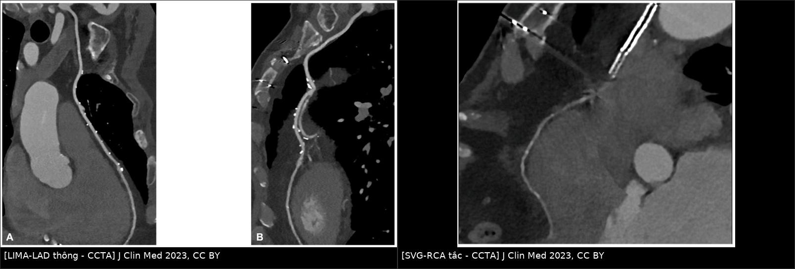
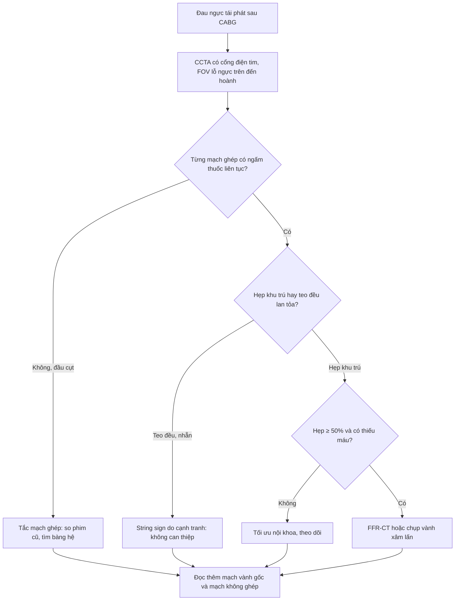
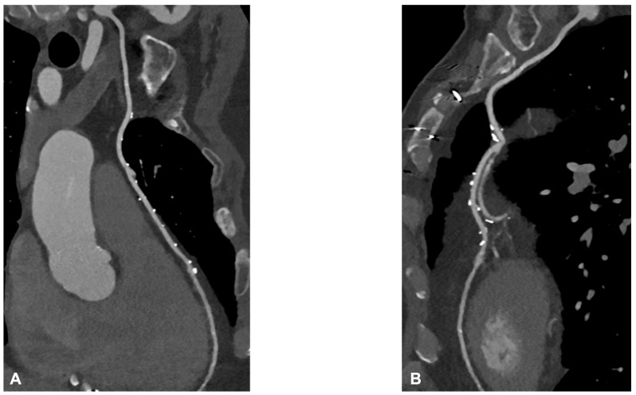
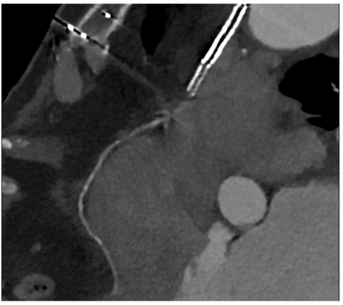

# 953 — CTA mạch ghép bắc cầu động mạch vành: đọc thân ghép, hai miệng nối và "string sign" / CT angiography of coronary artery bypass grafts

**Tags:** `pattern:hep-mach-ghep` `pattern:tac-mach-ghep` `pattern:hep-mieng-noi` `pattern:co-that-mach` `vung:vanh` `anatomy:mach-ghep-cabg` `protocol:CCTA-ECG-gated` `score:CAD-RADS`

**Mức chắc chắn (certainty):** tổng hợp y văn (literature synthesis) — số liệu chính từ **tổng quan có hệ thống về CCTA sau tái thông** (*J Clin Med* 2023, PMC10672590, CC BY), **phân tích gộp 31 nghiên cứu / 1.975 bệnh nhân / 5.364 mạch ghép** (*Int J Cardiol* 2016, PMID 27439070) và **phân tích gộp 64 lát cắt** (*Int J Cardiol* 2016, PMID 27140337). Nhóm **không có bệnh nhân của mình**; các con số là của tác giả gốc.

> **Câu chốt:** mạch ghép **dễ đọc hơn mạch vành gốc** (đường kính lớn, ít vôi hóa, ít di động) — phân tích gộp cho **độ nhạy 96,1% / độ đặc hiệu 96,3%** cho hẹp–tắc mạch ghép (PMID 27439070). Nhưng có **ba cái bẫy làm báo cáo sai**: **(1) "string sign" do cạnh tranh dòng chảy** (co thắt lan tỏa mạch ghép động mạch, không phải hẹp thật), **(2) hẹp miệng nối xa bị artifact do di động**, và **(3) chỉ đọc mạch ghép mà bỏ mạch vành gốc** — trong **5 năm đầu, 50% ca đau ngực sau CABG là do bệnh mạch gốc tiến triển**, không phải do mạch ghép (PMC10672590).

## 1. Tổng quan bệnh học – cơ chế hình ảnh

### 1.1 Vì sao mạch ghép "thay đổi theo thời gian" — và vì sao điều đó đọc được trên CT

- **Ba giai đoạn thất bại của mạch ghép** (giải thích trực tiếp hình thái trên CTA):
  1. **< 1 tháng — huyết khối sớm:** yếu tố kỹ thuật (miệng nối hẹp, ghép bị gập/xoắn, dòng chảy cạnh tranh), không phải xơ vữa. Trên CT: **tắc hoàn toàn** hoặc **hẹp khu trú ngay miệng nối**.
  2. **1 tháng – 1 năm — tăng sinh nội mạc (intimal hyperplasia):** lớp cơ trơn di trú vào nội mạc, **hẹp lan tỏa, nhẵn, không vôi** — hay gặp ở **tĩnh mạch hiển (SVG)**.
  3. **> 1 năm — xơ vữa mạch ghép:** mảng xơ vữa **mềm, dễ vỡ, lan tỏa**; trên CT có thể **không vôi** nên khó thấy, hoặc **vôi hóa lấm tấm** gây **blooming** đánh giá thấp lòng mạch.
- **Con số patency quyết định cách đọc:**
  - **Tắc mạch ghép** nói chung **3–10%** (PMC10672590).
  - **LIMA:** tắc trong năm đầu **5,7% ở nam / 3,4% ở nữ** (PMC10672590).
  - **SVG:** tắc **12% trong 6 tháng đầu**, **25% sau 5 năm**, **patency còn ~50% sau ≥ 15 năm** (PMC10672590).
  - **Đau ngực tái phát sau CABG** trong **5 năm đầu**: **50% do bệnh mạch vành gốc tiến triển**, phần còn lại do mạch ghép (PMC10672590).
- **TẠI SAO mạch ghép đọc tốt trên CT:** đường kính **≥ 3 mm** (SVG) và **2–3 mm** (LIMA), **ít vôi hóa hơn** mạch vành gốc, và **nằm ngoài màng tim** (SVG ở trung thất trước, LIMA dọc thành ngực) nên **ít di động theo nhịp tim** → ít artifact chuyển động hơn (PMC10672590).
- **TẠI SAO mạch vành gốc sau CABG lại khó:** bệnh lan tỏa, vôi hóa nặng, và **đoạn xa nhỏ**; độ nhạy phát hiện hẹp ≥ 50% ở **mạch nhận và mạch không được ghép chỉ 83–90%** (PMC10672590).

### 1.2 Nguyên lý dòng chảy: cạnh tranh và "string sign"

- **Cạnh tranh dòng chảy (competitive flow):** nếu mạch vành gốc **còn thông tốt**, máu đi đường gốc "dễ" hơn → lưu lượng qua mạch ghép động mạch thấp → **mạch ghép co nhỏ lan tỏa, đều, nhẵn** (tự điều hòa theo nhu cầu).
- **"String sign" (dấu sợi chỉ):** hình ảnh **mạch ghép LIMA/ĐM quay teo đều như sợi chỉ** trên CTA, **không có mảng xơ vữa, không hẹp khu trú**. Đây là **hiện tượng sinh lý**, không phải hẹp — nhưng nếu báo "hẹp nặng" sẽ đẩy bệnh nhân đi chụp vành xâm lấn vô ích. Ngược lại, **hẹp thật** thường **khu trú ở miệng nối** hoặc **không đều**, kèm **mảng/vôi**.
- **Hệ quả lâm sàng:** mạch ghép teo do cạnh tranh **vẫn có thể cấp máu khi cần** (dòng chảy dự trữ); chỉ can thiệp khi có **hẹp thật + bằng chứng thiếu máu** (FFR-CT/CT tưới máu hoặc nghiệm pháp gắng sức) (PMC10672590: **chỉ 49% hẹp ≥ 50% trên CCTA có FFR xâm lấn bất thường**).

### 1.3 Số liệu độ chính xác — dùng để phản biện "chụp CT không đủ tốt"

- **Phân tích gộp 31 nghiên cứu (≥ 64 lát cắt, 1.975 bệnh nhân, 5.364 mạch ghép):** gộp hẹp + tắc — **độ nhạy 96,1%** (95% CI 94,3–97,4), **độ đặc hiệu 96,3%** (95,1–97,3); **tĩnh mạch nhạy hơn động mạch** (97,6% vs 89,2%, p = 0,004) (PMID 27439070).
- **Phân tích gộp 64 lát cắt:** tắc mạch ghép **nhạy 0,99 / đặc hiệu 0,99**; hẹp > 50% **nhạy 0,98 / đặc hiệu 0,98**; AUC 0,99 (PMID 27140337).
- **Một số ca đơn lẻ thấp hơn:** độ chính xác phát hiện hẹp của 64 lát cắt **nhạy 80% / PPV 72,7%**, trong khi **patency** vẫn **chính xác 95%** (PMID 22833506) — tức **"thông hay tắc" rất chắc, "hẹp bao nhiêu %" kém chắc hơn**.
- **Chỉ định:** bộ tiêu chuẩn sử dụng hợp lý 2010 xếp CCTA là **"Appropriate"** để đánh giá **độ thông mạch ghép ở bệnh nhân có triệu chứng thiếu máu** (PMC10672590).

## 2. Mẫu hình + chẩn đoán phân biệt theo vị trí (gamut)

### 2.1 Đọc theo giải phẫu — 5 điểm phải trả lời cho mỗi mạch ghép

1. **Nguyên ủy:** LIMA từ **ĐM dưới đòn trái** (phải đưa FOV lên **lỗ ngực trên** mới thấy); SVG từ **ĐM chủ lên** (miệng nối gần ở mặt trước ĐM chủ).
2. **Thân ghép:** đường kính, mảng xơ vữa, vôi hóa, gập/xoắn.
3. **Miệng nối xa:** vị trí hay bị **hẹp thật** và hay bị **artifact di động nhất**.
4. **Mạch nhận + dòng chảy xa (run-off):** mạch nhận có hẹp/tắc không, có **cạnh tranh dòng chảy** không.
5. **Mạch vành gốc không được ghép:** bệnh tiến triển — nguồn gốc 50% ca đau ngực trong 5 năm đầu.

### 2.2 Gamut theo kiểu mạch ghép

- **ĐM ngực trong trái → LAD (LIMA-LAD):** bờ cong dọc thành ngực trước, đường kính 2–3 mm; hay gặp **co thắt/string sign**, **hẹp miệng nối xa**, **tổn thương khi lấy mạch** (kẹp, xoắn).
- **ĐM quay → nhánh vành:** thành dày, dễ **co thắt**; nguy cơ **hẹp lan tỏa do cạnh tranh**.
- **SVG → RCA / OM / PDA:** đi từ ĐM chủ lên, **băng qua trung thất trước**; hay **thoái hóa lan tỏa**, **vôi hóa**, **tắc muộn**; dễ bị **gập ở mỏm tim** khi đến RCA.
- **Ghép tuần tự (sequential) / T-graft, Y-graft:** phải đọc **từng miệng nối bên (side-to-side)**; hẹp một miệng nối bên không làm tắc cả chuỗi nhưng gây **thiếu máu vùng**.
- **Ghép kèm stent trong mạch ghép:** **blooming** của khung stent làm lòng khó đọc (12% stent vành không đủ chất lượng chẩn đoán — PMC10672590).

### 2.3 Gamut theo hình thái "hẹp"

- **Hẹp khu trú tại miệng nối** → hẹp thật (kỹ thuật, tăng sinh nội mạc).
- **Teo đều, nhẵn, dài suốt thân** → **string sign/co thắt do cạnh tranh** (không phải hẹp).
- **Hẹp lan tỏa + vôi lấm tấm** → thoái hóa SVG.
- **Tắc hoàn toàn + đầu cụt (stump)** → tắc mạch ghép; cần tìm **tuần hoàn bàng hệ** và mạch nhận còn thông.
- **Túi phình giả ở miệng nối gần ĐM chủ** → biến chứng nhiễm/giả phình, cần CTA/ siêu âm xác nhận.

## 3. Bảng so sánh phân biệt (ma trận đối chiếu)

| Tình trạng (entity) | Hình ảnh điển hình trên CCTA | Chốt vào (rule-in) | Chốt loại (rule-out) | Gợi ý xác nhận |
|---|---|---|---|---|
| **Mạch ghép thông bình thường** | Lòng ngấm thuốc đều từ nguyên ủy → miệng nối xa → mạch nhận; thành mỏng, không mảng | **Cản quang liên tục suốt chiều dài, không bậc thang** | Có đoạn mất cản quang **kèm đầu cụt** → tắc | So sánh với phim cũ; đo đường kính |
| **Hẹp miệng nối xa** | Hẹp **khu trú, không đều**, thường kèm vôi/mảng; mạch nhận xa còn ngấm thuốc | **Hẹp khu trú đúng vị trí nối + mạch nhận xa còn thuốc** | Teo **đều, nhẵn suốt thân** → string sign | FFR-CT hoặc chụp vành xâm lấn |
| **String sign (cạnh tranh dòng chảy)** | Mạch ghép động mạch **teo đều như sợi chỉ**, không mảng, không hẹp khu trú; mạch gốc thông tốt | **Teo lan tỏa + mạch gốc thông + không vôi/mảng** | Hẹp **khu trú** hoặc **mất đoạn** → hẹp/tắc thật | Đo FFR-CT; không can thiệp nếu không thiếu máu |
| **Tắc mạch ghép** | **Không ngấm thuốc** toàn bộ thân, **đầu cụt**; mạch nhận có thể còn nhờ bàng hệ | **Mất cản quang liên tục + đầu cụt** | Có **dòng mảnh** xuyên suốt (pseudo-occlusion) → còn thông | Chụp thì muộn; so phim cũ |
| **Thoái hóa SVG** | Thành dày, **vôi lấm tấm**, hẹp **lan tỏa, không đều** | **Vôi + hẹp lan tỏa nhiều năm sau mổ** | Hẹp **khu trú** ở miệng nối → hẹp thật đơn thuần | Đo % hẹp; PET/CT nếu nghi viêm |
| **Gập/xoắn mạch ghép** | **Góc gấp nhọn** ở mỏm tim/thân, hẹp tại chỗ gấp, đầu xa còn thuốc | **Hẹp đúng chỗ gấp + tư thế thay đổi theo nhịp thở** | Hẹp không liên quan tư thế → mảng thật | MPR đa bình diện, thì thở khác nhau |
| **Hẹp trong stent mạch ghép** | **Bloom** quanh stent, lòng không đều; khó đo chính xác | **Stent + lòng hẹp trong stent** | Stent **không đủ chất lượng** → không kết luận | CCTA lặp với PCCT/dual-source; chụp xâm lấn |

*Trái: LIMA → LAD, dựng MPR cong — lòng ngấm thuốc đều từ ĐM dưới đòn đến miệng nối xa, mạch nhận phía dưới còn thuốc. Phải: SVG → RCA đã đặt stent — đoạn stent sáng, **lòng mạch ghép phía sau không ngấm thuốc**, phù hợp tắc. Nguồn: *J Clin Med* 2023;12(22):7104 (PMC10672590), Fig. 5 và Fig. 6 — Tonet E và cs, **CC BY 4.0**; ảnh ghép letterbox.*

## 4. Protocol chụp + cách phân độ

### 4.1 Chuẩn bị và thông số (khác CCTA thường ở **trường chụp** và **cổng điện tim**)

- **Trường chụp:** từ **lỗ ngực trên (đm dưới đòn)** đến **dưới cơ hoành** — phải thấy **nguyên ủy LIMA** và toàn bộ SVG; bỏ đoạn này là **mất chỗ hẹp phổ biến nhất của LIMA**.
- **Đồng bộ điện tim:** **ECG-gated** (retrospective hoặc prospective có padding); **tần số tim ≤ 65/phút** (chẹn beta/ivabradine trước chụp), **nitroglycerin dưới lưỡi** giãn mạch.
- **Lát cắt ≤ 0,6 mm**, tái tạo **0,5–0,75 mm**, bước **5%** trong thì tâm trương; dùng **MPR cong** dọc từng mạch ghép + MIP/VR.
- **Máy mới:** detector rộng **16 cm** chụp tim trong **một nhịp**; **dual-source** thời gian phân giải **~300 ms (75 ms mỗi 1/4 vòng)**; **photon-counting CT** tăng phân giải không gian, giảm liều và lượng cản quang (PMC10672590).
- **Thuốc cản quang:** liều theo cân nặng, tốc độ cao (4–5 mL/s) + chaser nước muối; cửa sổ chụp **thì động mạch vành** (bolus tracking ở ĐM chủ lên).
- **Artifact phải khai báo:** **dây thép xương ức**, **kẹp phẫu thuật (hemostatic clips)** quanh miệng nối, **stent cũ**, **di động miệng nối xa**, **loạn nhịp**.

### 4.2 Phân độ — không có RADS riêng cho mạch ghép

- **Cách báo cáo 4 mức cho từng mạch ghép:** **thông (patent)** / **hẹp < 50%** / **hẹp ≥ 50%** / **tắc (occluded)** — kèm **vị trí** (nguyên ủy, thân, miệng nối xa) và **mạch nhận**.
- **Mạch vành gốc:** dùng **CAD-RADS 2.0 (2022)** để phân loại hẹp và khuyến nghị; **CAD-RADS không thay thế** việc mô tả mạch ghép.
- **Chức năng:** **FFR-CT** hoặc **CT tưới máu (stress CT perfusion)** khi hẹp 50–90% và cần quyết định can thiệp — vì **49% hẹp ≥ 50% trên CCTA có FFR bình thường** (PMC10672590).

## 5. Biến thể bình thường và cạm bẫy

- **Biến thể bình thường:** **LIMA nhỏ, teo đều ở người mạch gốc còn tốt** (string sign sinh lý); **SVG hơi rộng và thành mỏng** ngay sau mổ; **miệng nối tận–bên hơi gấp góc** do đường đi giải phẫu, không phải hẹp.
- **Cạm bẫy 1 — đọc string sign thành hẹp:** dẫn tới chụp vành xâm lấn và can thiệp mạch ghép **không cần thiết**; chốt bằng **mạch gốc thông + teo đều + không mảng**.
- **Cạm bẫy 2 — hẹp miệng nối xa do di động:** miệng nối xa là nơi **di động mạnh nhất**; luôn đọc **nhiều thì (5–10%)** và **MPR đa bình diện** trước khi gọi hẹp.
- **Cạm bẫy 3 — bỏ sót nguyên ủy LIMA:** FOV bắt đầu quá thấp (ngang cung ĐM chủ) → không thấy **lỗ LIMA ở ĐM dưới đòn**, dễ báo "không thấy mạch ghép".
- **Cạm bẫy 4 — tắc giả do thì chụp:** "pseudo-occlusion" khi cản quang chưa tới mạch ghép; đọc **thì muộn** hoặc so **mạch nhận** trước khi kết luận tắc.
- **Cạm bẫy 5 — chỉ đọc mạch ghép:** **50% đau ngực trong 5 năm đầu do mạch gốc tiến triển**; báo cáo thiếu phần này là báo cáo thiếu một nửa chẩn đoán.
- **Cạm bẫy 6 — vôi hóa và stent gây đánh giá thấp:** blooming làm lòng "hẹp giả"; nếu stent không đủ chất lượng thì **không kết luận**, đề nghị **PCCT/dual-source** hoặc chụp xâm lấn (12% stent vành không đọc được — PMC10672590).

## 6. Tự lượng giá — Blind Quiz

**Ca 1 — Nam 62 tuổi, đau ngực khi gắng sức 8 năm sau CABG (LIMA-LAD).**

- Gợi ý lâm sàng: đau ngực điển hình, ECG không thiếu máu cấp; đã mổ CABG 8 năm.
- Câu hỏi: mô tả đường đi mạch ghép; lòng mạch có ngấm thuốc liên tục không? Có hẹp miệng nối không? Cần đọc thêm gì?

<b>Bấm để hiện đáp án (findings + chẩn đoán)</b>

- Dấu hiệu: mạch ghép đi từ **ĐM dưới đòn trái**, xuống dọc thành ngực trước rồi **nối tận–bên vào LAD**; lòng ngấm thuốc **liên tục, đều**, không mảng, không hẹp miệng nối; **mạch nhận phía xa còn cản quang tốt** (ảnh A và B).
- Chẩn đoán: **LIMA-LAD thông, không hẹp** — nguyên nhân đau ngực phải tìm ở **mạch vành gốc/mạch không ghép**, vì bệnh gốc tiến triển chiếm **50%** ca đau ngực trong 5 năm đầu.
- Nguồn ảnh: *J Clin Med* 2023;12(22):7104 (PMC10672590), Fig. 5 — Tonet E và cs, **CC BY 4.0**.

**Ca 2 — Nam 70 tuổi, đau ngực kiểu mạch vành, tiền sử CABG + stent trong mạch ghép.**

- Gợi ý lâm sàng: đau ngực tăng dần 3 tháng; không sốt, troponin âm tính.
- Câu hỏi: mạch ghép có thông không? Dấu hiệu nào chốt tắc? Vì sao không đo % hẹp trong stent?

<b>Bấm để hiện đáp án (findings + chẩn đoán)</b>

- Dấu hiệu: SVG đi từ ĐM chủ lên xuống theo rãnh liên thất sau; **đoạn stent sáng rõ nhưng lòng mạch ghép phía sau stent không ngấm thuốc**, không thấy cột cản quang liên tục tới mạch nhận.
- Chẩn đoán: **tắc mạch ghép tĩnh mạch (SVG) đã đặt stent** — đầu cụt + mất cản quang liên tục là chốt; cần đối chiếu phim cũ và tìm **bàng hệ** cho vùng RCA.
- Không đo % hẹp trong stent: **blooming + beam hardening** làm lòng giả hẹp; stent không đủ chất lượng thì **không kết luận**, chuyển **chụp xâm lấn**.
- Nguồn ảnh: *J Clin Med* 2023;12(22):7104 (PMC10672590), Fig. 6 — Tonet E và cs, **CC BY 4.0**.

**Ca 3 — Nữ 58 tuổi, khó thở khi gắng sức; CCTA: LIMA teo đều như sợi chỉ, LAD gốc không hẹp.**

- Gợi ý lâm sàng: không đau ngực điển hình, không dấu thiếu máu trên ECG; mạch vành gốc chỉ hẹp nhẹ.
- Câu hỏi: đây là hẹp thật hay hiện tượng sinh lý? Cần làm gì tiếp?

<b>Bấm để hiện đáp án (findings + chẩn đoán)</b>

- Dấu hiệu: **teo đều, nhẵn, dài suốt thân LIMA**, không có mảng xơ vữa, không hẹp khu trú; **mạch gốc LAD thông tốt**.
- Chẩn đoán: **string sign do cạnh tranh dòng chảy** — hiện tượng sinh lý, **không phải hẹp**; mạch ghép vẫn có dự trữ dòng chảy.
- Xử trí: **không can thiệp**; tìm nguyên nhân khó thở khác; nếu vẫn nghi thiếu máu → **FFR-CT/CT tưới máu** hoặc nghiệm pháp gắng sức, không đặt stent mạch ghép theo hình ảnh đơn thuần.
- Cơ sở: 49% hẹp ≥ 50% trên CCTA có FFR bình thường (PMC10672590).

## Bài liên quan chéo
- [800 – Tổng quan Tim mạch](../800-cardiovascular-overview/lesson.md)
- [810 – CTA động mạch vành và CAD-RADS](../810-coronary-cta-cadrads/lesson.md)
- [820 – MRI tim: LGE và mapping](../820-cardiac-mri-lge-mapping/lesson.md)
- [1897 – Co thắt mạch vành và MINOCA](../1897-co-that-mach-vanh-va-minoca/lesson.md)
- [830 – TAVI và bệnh cấu trúc tim](../830-tavi-structural-heart/lesson.md)

## Ảnh
- `953_cabg-cta_LIMA_CCTA_PMC10672590.jpg` — CCTA MPR cong LIMA-LAD thông (CC BY 4.0).
- `953_cabg-cta_SVG-tac_CCTA_PMC10672590.jpg` — CCTA SVG-RCA tắc, có stent (CC BY 4.0).
- `composite_cabg-thong-vs-tac.jpg` — ảnh ghép đối chiếu thông vs tắc (CC BY 4.0; letterbox, không crop).
- Nguồn, giấy phép và tác giả từng ảnh: `images/CREDITS.md`.

> Không dùng để chẩn đoán độc lập khi chưa có người hướng dẫn.
