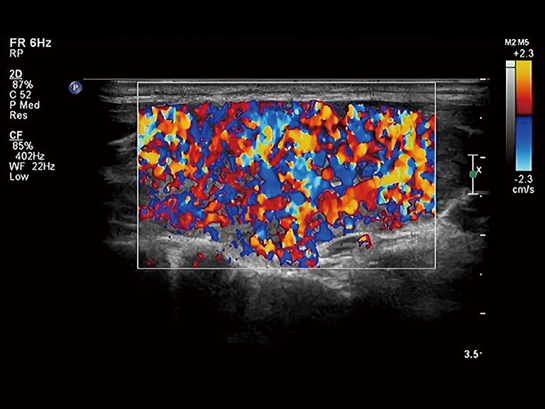
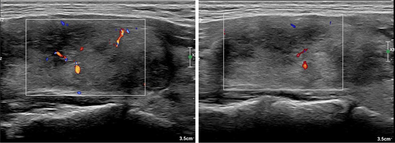
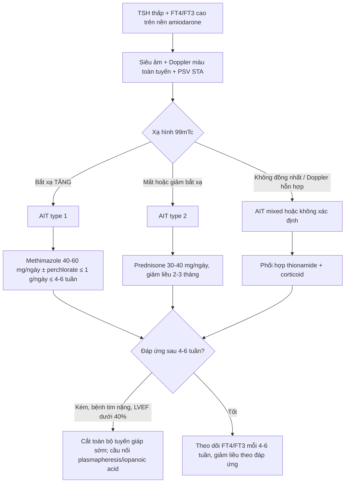
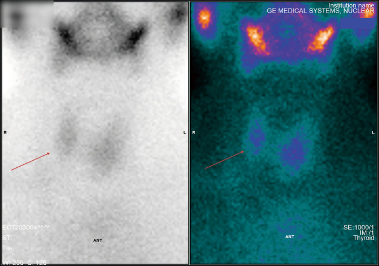

# 968 — Cường giáp do amiodarone (AIT): type 1 hay type 2 — Doppler màu & xạ hình quyết định thuốc / Amiodarone-induced thyrotoxicosis: type 1 versus type 2

**Tags:** `pattern:cuong-giap` `pattern:vien-giap` `pattern:giam-bat-xa` `pattern:inferno` `vung:tuyen-giap` `score:PSV` `protocol:Doppler` `protocol:xaq-tuyen-giap`

**Mức chắc chắn (certainty):** tổng hợp y văn (literature synthesis) — số liệu lấy từ các bài **open access đã đọc toàn văn**: Bai et al., *Quant Imaging Med Surg* 2025 (PMC12682467, CC BY-NC-ND 4.0 — **628 bệnh nhân**, định nghĩa AIT1/AIT2 theo siêu âm + xạ hình, **PSV STA**); Cappellani et al., *J Endocrinol Invest* 2024 (PMC10859339, CC BY 4.0 — đối chiếu **ETA 2018 vs ATA 2016**, liều thuốc, phẫu thuật); Guðjónsson et al., *J Intern Med* 2025 (PMC12374759, CC BY 4.0 — **262 bệnh nhân Iceland**, tỉ lệ tích lũy); Frey et al., *Eur Thyroid J* 2026 (PMC13097270, CC BY 4.0 — **101 ca cắt toàn bộ tuyến giáp**, MACE 5 năm). Bài **không** có ca nguyên văn riêng của nhóm; ca 1–3 là hình minh họa nguyên văn của PMC12682467, ghi rõ Fig.

> **Câu hỏi gốc của bài:** bệnh nhân **72 tuổi**, rung nhĩ, đã dùng **amiodarone 200 mg/ngày 14 tháng**. Mệt, sụt 4 kg, nhịp nhanh 118 lần/phút, **TSH < 0,01 mIU/L**, **FT4 41 pmol/L**. Siêu âm: tuyến giáp **to, không nhân**, Doppler màu **rực lửa toàn tuyến**, **PSV động mạch giáp trên 132 cm/s**; xạ hình 99mTc **bắt xạ tăng**. Vậy đây là **AIT type 1 hay type 2** — và vì sao câu trả lời đổi hẳn thuốc điều trị (methimazole hay prednisone), trong khi FT3/FT4 không giúp phân biệt?

## 1. Tổng quan — vì sao amiodarone gây hai kiểu cường giáp hoàn toàn khác nhau

**A. Bệnh học (pathology) và cơ chế:**

- **Amiodarone là một "bể iod" gắn vào thuốc chống loạn nhịp:** mỗi viên **200 mg chứa 75 mg iod**, chuyển hóa giải phóng khoảng **6–7 mg iod vô cơ/ngày** — gấp **50–100 lần** nhu cầu iod hằng ngày; iod niệu có thể tới **15.000 µg/ngày** (PMC12682467). Thời gian bán hủy **40–60 ngày**, cá biệt **tới 100 ngày**; thuốc tích trong mô mỡ và cơ quan nên **ảnh hưởng tuyến giáp kéo dài nhiều tuần–nhiều tháng sau khi ngừng**, có khi **> 6 tháng** mới hồi phục (PMC12682467).
- **Type 1 — nhiễm độc giáp do iod (Jod–Basedow):** iod dư là **nguyên liệu tổng hợp hormon** trên một tuyến **đã có nhân độc/tự trị tiềm ẩn** hoặc bệnh Graves ẩn → **tăng tổng hợp và phóng thích hormon**, giống hệt cường giáp do iod từ cản quang (bài 1898). Nhu mô **còn chức năng**, nên **bắt xạ và tưới máu tăng**.
- **Type 2 — viêm giáp hủy (destructive thyroiditis):** amiodarone và chất chuyển hóa desethylamiodarone **gây độc trực tiếp tế bào nang giáp** → viêm, hoại tử nang, **rò hormon đã tổng hợp sẵn** vào máu. Tuyến **không tăng tổng hợp**, nên **bắt xạ mất/giảm** và **vùng viêm giảm mạch**.
- **Type hỗn hợp/không xác định (mixed/indefinite):** cả hai cơ chế cùng lúc trên tuyến có nhân + viêm; trong loạt 628 người của PMC12682467 có **8 ca mixed** trong **80 ca cường giáp (10%)**.
- **Vì sao hình ảnh lại là "trọng tài":** xét nghiệm hormon **không phân biệt được hai type** — trong chính loạt trên, **FT3 11,95 vs 12,67 pmol/L**, **FT4 36,7 vs 38,71 pmol/L**, **TSH 0,15 vs 0,16 mIU/L** (type 1 vs type 2, khác biệt không có ý nghĩa thực hành). Kháng thể **TRAb** dương gợi Graves nhưng **âm không loại trừ type 1**; **siêu âm bắt đầu và xạ hình xác nhận** là con đường duy nhất để chọn thuốc đúng.
- **Vì sao Doppler màu phản ánh cơ chế:** tưới máu tuyến do **VEGF/NO phụ thuộc TSH-receptor** → tuyến **tổng hợp hormon mạnh** thì giãn mạch, tăng lưu lượng (hình **"inferno"** — toàn tuyến rực màu). Ngược lại, **nang giáp bị phá hủy** thì vùng viêm **giảm tín hiệu mạch**, còn mô lành quanh đó vẫn có mạch — tạo hình **"vùng giảm mạch khu trú trong nền có mạch"**. Đây là lý do **không được chỉ nhìn "tuyến có màu hay không"** mà phải đọc **phân bố**.
- **Vì sao xạ hình 99mTc (pertechnetate) chứ không phải 131I:** 99mTc được **NIS** bắt như iod nhưng **không tham gia tổng hợp hormon**, nên **không bị ảnh hưởng bởi hiện tượng ức chế Wolff–Chaikoff** do bể iod; hình chụp **20–30 phút** sau tiêm, liều **74–185 MBq (2–5 mCi)**, đếm **300–500k** (PMC12682467). Vì vậy **bắt xạ tăng = tuyến đang tổng hợp (type 1)**, **mất bắt xạ = viêm hủy (type 2)**.

**B. Ngưỡng định lượng bắt buộc (cửa 1 Argon):**

| Đại lượng | Con số | Ý nghĩa thực hành |
|---|---|---|
| Iod/viên amiodarone 200 mg | **75 mg iod**, ~**6–7 mg iod vô cơ/ngày**, **50–100×** nhu cầu | Bể iod khổng lồ, không "rửa" nhanh được |
| Thời gian bán hủy | **40–60 ngày** (tới **100 ngày**) | Ngừng thuốc không làm AIT biến mất ngay |
| Tần suất AIT | **5–10%** người dùng amiodarone (PMC13097270); **9,2%** (KTC 5,6–12,7) trong đoàn hệ Iceland, **tích lũy 5 năm 19,0%** (PMC12374759) | AIT là biến cố **phổ biến**, không phải ca hiếm |
| Đỉnh năm điều trị | **9,8%/năm ở năm thứ 3** (PMC12374759) | Theo dõi **suốt** thời gian dùng thuốc, không chỉ 3 tháng đầu |
| Phân bố type (loạt 628) | cường giáp **80/628 (12,74%)**: **type 1 = 32**, **type 2 = 40**, **mixed = 8** (PMC12682467) | Type 2 chiếm đa số; mixed ~10% |
| PSV động mạch giáp trên | **> 100 cm/s → AIT1**; **< 45–50 cm/s → AIT2/bình thường** (PMC12682467) | Ngưỡng **định lượng** để chốt type khi Doppler màu mơ hồ |
| Bắt xạ 99mTc | **tăng** (type 1) / **mất–giảm** (type 2) | Không dùng RAIU 131I trong bể iod |
| Liều thuốc | methimazole **40–60 mg/ngày** (ETA) / **40 mg** (ATA); perchlorate **≤ 1 g/ngày, ≤ 4–6 tuần**; prednisone **30 mg** (ETA) / **40 mg** (ATA)/ngày (PMC10859339) | Liều **dưới khuyến cáo = không khác gì không điều trị** |
| Phẫu thuật | **101 ca** cắt toàn bộ tuyến giáp: tử vong chu phẫu **2,0%**; **MACE 5 năm 61,4% vs 24,0%** (LVEF < 40% vs ≥ 40%); tử vong tim **30,8% vs 1,3%** (PMC13097270) | Cắt giáp **không xóa được nguy cơ tim** ở nhóm LVEF thấp |

## 2. Mẫu hình + chẩn đoán phân biệt theo kiểu bắt xạ/tưới máu (Gamut)

**Bước 1 — xác nhận cường giáp thật:** TSH bị ức chế + FT4/FT3 tăng, sau loại trừ **giả cường giáp** (bệnh nặng, heparin, biotin liều cao, kháng thể kháng hormon).

**Bước 2 — chia gamut theo cặp "tưới máu × bắt xạ":**

- **Tưới máu TĂNG toàn tuyến + bắt xạ TĂNG:** **AIT type 1** (tuyến có nhân/tự trị) · **Graves** (bướu giáp lan tỏa, có thể TRAb +) · **nhân độc/tuyến đa nhân độc** (bắt xạ khu trú) · **cường giáp do iod khác** (cản quang — bài 1898).
- **Tưới máu BÌNH THƯỜNG/GIẢM + bắt xạ MẤT–GIẢM:** **AIT type 2** · **viêm giáp bán cấp (de Quervain)** (đau cổ, ESR cao) · **viêm giáp không đau/yên lặng** · **viêm giáp sau sinh** · **viêm giáp Hashitoxicosis** · **cường giáp giả do dùng hormon** (bắt xạ mất, thyroglobulin thấp).
- **Tưới máu vùng giảm mạch nằm trong nền có mạch + bắt xạ hỗn hợp:** **AIT mixed/không xác định** — đây là nhóm **không được đoán bừa**, phải điều trị phối hợp hoặc chờ đáp ứng.
- **Bắt xạ tăng ngoài tuyến giáp:** **struma ovarii**, **di căn ung thư giáp biệt hóa** (bắt xạ ổ bụng/ngực) — hiếm nhưng đổi hoàn toàn hướng xử trí.

**Mnemonic "I-A-T":** **I**od (type 1 — tổng hợp), **A**poptosis/viêm (type 2 — hủy), **T**ogether (mixed) — đi kèm câu hỏi: *tuyến có nhân không, Doppler toàn tuyến hay khu trú, xạ hình còn bắt xạ không?*

## 3. Bảng so sánh phân biệt (ma trận đối chiếu)

| Thực thể (entity) | Hình ảnh điển hình (US / Doppler màu / xạ hình) | Chốt vào (rule-in) | Chốt loại (rule-out) | Gợi ý xác nhận |
|---|---|---|---|---|
| **AIT type 1** | Tuyến **to, có nhân/đa nhân**; Doppler **"inferno" toàn tuyến**; **PSV STA > 100 cm/s**; 99mTc **bắt xạ tăng** | **Bể iod + bắt xạ tăng + tưới máu tăng** | Bắt xạ mất hoàn toàn + vùng giảm mạch → type 2 | Methimazole **40–60 mg/ngày** ± perchlorate **≤ 1 g/ngày, ≤ 4–6 tuần** |
| **AIT type 2** | Tuyến **bình thường/hơi to, không nhân**; vùng **giảm hồi âm, giảm mạch**; **PSV STA < 45–50 cm/s**; 99mTc **mất bắt xạ** | **Bắt xạ mất + vùng giảm mạch khu trú** | Tưới máu tăng lan tỏa + bắt xạ tăng → type 1/Graves | Prednisone **30 mg (ETA)–40 mg (ATA)/ngày**, giảm liều **2–3 tháng** |
| **AIT mixed/không xác định** | Có nhân + vùng giảm hồi âm; Doppler **hỗn hợp**; bắt xạ **không đồng nhất** | **Hai mẫu hình cùng tồn tại** | Một mẫu hình thuần nhất | Phối hợp thionamide + corticoid; **hoặc** thionamide 4–6 tuần rồi thêm corticoid nếu kém đáp ứng |
| **Graves** | Bướu giáp **lan tỏa**, hồi âm **giảm đều**, Doppler tăng; **TRAb +**; bắt xạ **tăng đều** | **TRAb + + bắt xạ tăng đều + mắt lồi** | Bể iod + tuyến có nhân + TRAb âm → AIT1 | Thionamide, 131I, hoặc cắt giáp |
| **Viêm giáp bán cấp** | Tuyến **đau**, hồi âm giảm **dạng bản đồ**, Doppler **giảm**; bắt xạ **mất**; **ESR/CRP cao** | **Đau cổ + ESR cao + bắt xạ mất** | Không đau + bể iod + amiodarone → AIT2 | NSAID/corticoid, **không** dùng thionamide |
| **Giả cường giáp do hormon ngoại sinh** | Tuyến **bình thường**, Doppler bình thường; bắt xạ **mất**; **thyroglobulin thấp** | **Bắt xạ mất + thyroglobulin thấp + không bệnh tuyến** | Thyroglobulin cao/bướu giáp → bệnh tuyến thật | Ngừng thuốc, hỏi tiền sử |

*Hình trái/phải: tuyến giáp tăng sinh mạch lan tỏa kiểu **"inferno"** trên Doppler màu — mô hình của **tăng tổng hợp hormon** (type 1). Nguồn: Bai QS et al., Quant Imaging Med Surg 2025 (PMC12682467), Fig. 6, CC BY-NC-ND 4.0 — ảnh nguyên bản, không cắt/ghép.*

*Vùng **giảm hồi âm** với **tín hiệu mạch thưa** bên trong, trong khi mô tuyến lành quanh đó vẫn có mạch — mô hình của **viêm hủy nang giáp** (type 2). Nguồn: Bai QS et al., Quant Imaging Med Surg 2025 (PMC12682467), Fig. 2, CC BY-NC-ND 4.0.*

## 4. Protocol chụp + thuật toán điều trị

**A. Siêu âm + Doppler màu (bước 1, làm ngay tại giường):**

- Đầu dò **linear 7–12 MHz** (PMC12682467), đặt **dọc/ngang** qua thùy phải, trái, eo; đo **3 đường kính** và **thể tích** (công thức ellipsoid: dài × rộng × cao × 0,52), ghi nhân và **đặc điểm hồi âm**.
- **Doppler màu toàn tuyến** ở thang vận tốc thấp (**PRF 2–3 kHz**, gain vừa đủ, không "nhấn" đầu dò) — đọc **phân bố** chứ không chỉ "có màu"; ghi hình **"inferno"** nếu toàn tuyến rực màu.
- **Doppler xung động mạch giáp trên (STA):** cửa sổ **1–2 mm** giữa tuyến, góc ≤ 60°, lấy **3 phổ liên tiếp**, ghi **PSV trung bình**; **STA được chọn vì nông, dễ lặp lại, ít phụ thuộc người làm** (PMC12682467). Ngưỡng: **> 100 cm/s** nghi type 1; **< 45–50 cm/s** nghi type 2.
- **Không dùng siêu âm một mình để chốt type** khi bể iod lớn và tuyến không nhân — luôn ghép xạ hình.

**B. Xạ hình tuyến giáp 99mTc-pertechnetate (bước 2):**

- **74–185 MBq (2–5 mCi)** tiêm tĩnh mạch, chụp tĩnh **20–30 phút** sau tiêm, collimator năng lượng thấp, mặt trước, **300–500k counts** (PMC12682467).
- Đọc: **bắt xạ tăng** (type 1) · **mất/giảm** (type 2) · **không đồng nhất** (mixed/nhân độc).
- **Tránh 131I/RAIU** khi bể iod lớn: kết quả **thường thấp ở cả hai type**, dễ đọc nhầm type 2.

**C. Thuật toán chọn thuốc (theo ETA 2018/ATA 2016, qua PMC10859339):**

**D. Ngưỡng xử trí và bằng chứng ngoại khoa:**

- **Không ngừng amiodarone một cách máy móc:** quyết định **ngừng hay tiếp tục** phải bàn với tim mạch; ngừng thuốc **không làm hết AIT ngay** do bể iod và thời gian bán hủy dài (PMC12682467).
- **Liều thấp hơn khuyến cáo = vô hiệu:** một nghiên cứu thực hành cho thấy điều trị **dưới liều** tương đương **không điều trị** về kiểm soát cường giáp và biến cố tim (PMC10859339) — đây là lỗi hay gặp khi "sợ" methimazole ở người già.
- **Cắt toàn bộ tuyến giáp** khi: kháng trị, **không thể ngừng amiodarone**, hoặc **bệnh tim nặng**. Số liệu 101 ca: **tử vong chu phẫu 2,0%**, biến chứng **7,8–11,8%**; ở **LVEF < 40%**, **MACE 5 năm 61,4% vs 24,0%** và **tử vong tim 30,8% vs 1,3%** so với LVEF ≥ 40% (PMC13097270). **Mổ sớm khi còn nhiễm độc giáp** ở nhóm LVEF < 40% có tử vong chu phẫu **0% vs 40%** nếu chờ hồi phục sinh hóa (PMC10859339) — **chờ "euthyroid" ở nhóm này có thể là sai lầm chết người**.
- **Cầu nối trước mổ:** plasmapheresis, iopanoic acid, cholestyramine khi cần mổ mà bệnh nhân còn nhiễm độc nặng (các ca trong PMC13010327/PMC13015783 — dẫn link, không trích số).

## 5. Biến thể bình thường và cạm bẫy

- **Bể iod làm RAIU thấp ở CẢ HAI type** — đây là cạm bẫy số 1: thấy "bắt xạ thấp" rồi kết luận type 2 trong khi tuyến vẫn có nhân và Doppler rực lửa. **Luôn đọc Doppler trước, xạ hình sau.**
- **"Inferno" không phải đặc quyền của AIT1:** Graves, bướu giáp nhiễm độc, thậm chí viêm giáp giai đoạn hồi phục đều có thể tăng mạch. **Bối cảnh amiodarone + nhân + TRAb** mới định hướng.
- **Tuyến không nhân không loại trừ type 1:** vùng tự trị có thể **nhỏ, không thấy trên siêu âm thường**; nếu xạ hình tăng khu trú mà siêu âm "sạch", vẫn là type 1.
- **Type 2 có thể chuyển thành suy giáp** sau nhiều tháng — **không dùng liều thionamide kéo dài "để chắc"**, vì sẽ đẩy bệnh nhân sang suy giáp iatrogenic.
- **Mixed/không xác định không được "đoán bừa" theo xạ hình:** phối hợp thuốc có **nhiều biến cố hơn** (đặc biệt tổn thương tủy do thionamide: **1,35% vs 0,14%** so với cường giáp khác) (PMC10859339) — chỉ dùng khi thật sự có bằng chứng hai cơ chế.
- **Corticoid liều thấp trong type 2** làm chậm hồi phục và kéo dài nhiễm độc; **taper quá nhanh** gây tái phát — cần **2–3 tháng** và theo FT4/FT3.
- **Đừng quên ổ nhịp:** kiểm soát tần số bằng **chẹn beta** thận trọng (có thể tụt huyết áp ở bệnh tim nặng); **không dùng chẹn beta không chọn lọc** ở người có co thắt phế quản.
- **Cản quang iod gần đây** (bài 1898) có thể tạo **Jod–Basedow** giống hệt type 1 — hỏi kỹ lịch chụp CT trong 2–3 tháng trước.

## 6. Tự lượng giá — Blind Quiz

**Ca 1 — Nam 68 tuổi, rung nhĩ, amiodarone 18 tháng. Sụt cân, run tay, nhịp nhanh. Nhìn Doppler màu trước, mô tả phân bố mạch.**

- Gợi ý lâm sàng: đang dùng thuốc chống loạn nhịp chứa iod; tuyến to đều, không nhân rõ.
- Câu hỏi: Mạch tăng **toàn tuyến** hay **khu trú**? Cần thêm xạ hình gì để chốt type? Hai chẩn đoán phân biệt hàng đầu?

<b>Bấm để hiện đáp án (findings + chẩn đoán)</b>

- Dấu hiệu: **tăng sinh mạch lan tỏa toàn tuyến** — hình **"inferno"**; kèm tuyến to, không nhân.
- Chẩn đoán: **AIT type 1** (tăng tổng hợp do iod) — vì mô tuyến còn chức năng và tăng tưới máu; xác nhận bằng **xạ hình 99mTc bắt xạ tăng** và **PSV STA > 100 cm/s**.
- Phân biệt: Graves (TRAb +, bướu lan tỏa) và viêm giáp bán cấp (đau, ESR cao, bắt xạ mất).
- Nguồn ảnh: Bai QS et al., Quant Imaging Med Surg 2025 (PMC12682467), Fig. 6, CC BY-NC-ND 4.0.

**Ca 2 — Nữ 74 tuổi, amiodarone 2 năm, mệt và sụt cân. Siêu âm thấy một vùng giảm hồi âm; Doppler màu đặt trên vùng đó.**

- Gợi ý: không đau cổ, không sốt; FT4 tăng nhẹ; tuyến không có nhân đặc.
- Câu hỏi: Vì sao **vùng giảm hồi âm lại giảm mạch** trong khi mô quanh còn mạch? Type nào? Thuốc đầu tay?

<b>Bấm để hiện đáp án (findings + chẩn đoán)</b>

- Dấu hiệu: **vùng giảm hồi âm, giảm tín hiệu mạch bên trong**, mô tuyến lành quanh còn mạch — mô hình **viêm hủy nang giáp**.
- Chẩn đoán: **AIT type 2** — vì nang giáp bị phá hủy, không còn tổng hợp nên **không tăng mạch và mất bắt xạ**; điều trị **prednisone 30–40 mg/ngày** giảm liều 2–3 tháng, **không dùng thionamide**.
- Nguồn ảnh: Bai QS et al., Quant Imaging Med Surg 2025 (PMC12682467), Fig. 2, CC BY-NC-ND 4.0.

**Ca 3 — Nữ 61 tuổi, amiodarone 1 năm, FT4 38 pmol/L, TSH 0,02. Xạ hình 99mTc: tuyến giáp gần như không thấy, chỉ thấy tuyến nước bọt.**

- Gợi ý: không đau cổ; siêu âm tuyến hơi to, hồi âm không đồng nhất.
- Câu hỏi: Bắt xạ mất nói lên điều gì về cơ chế? Có loại trừ được type 1 hoàn toàn bằng hình này không?

<b>Bấm để hiện đáp án (findings + chẩn đoán)</b>

- Dấu hiệu: **tuyến giáp mất bắt xạ**, hình chỉ còn tuyến nước bọt và mô mềm cổ.
- Chẩn đoán: **AIT type 2** (viêm hủy) — hormon thoát ra từ nang bị phá hủy, không cần tổng hợp mới.
- **Phản biện:** bể iod có thể làm **giảm bắt xạ ở cả type 1**, nên hình này **chỉ có giá trị khi ghép Doppler** (không có "inferno", PSV thấp); nếu Doppler tăng lan tỏa mà xạ hình mất bắt xạ, phải xếp **mixed/không xác định** và không được dùng thionamide đơn thuần.
- Nguồn ảnh: Bai QS et al., Quant Imaging Med Surg 2025 (PMC12682467), Fig. 5, CC BY-NC-ND 4.0.

## Bài liên quan chéo

- [700 – Tổng quan Đầu Mặt Cổ](../700-head-neck-overview/lesson.md)
- [230 – Tuyến giáp & hạch cổ (TI-RADS)](../230-tuyen-giap-hach-co/lesson.md)
- [940 – Đốt nhiệt nhân giáp độc (RFA vs 131I)](../940-dot-nhiet-nhan-giap-doc-aftn-rfa-vs-i131/lesson.md)
- [941 – Đốt tuyến cận giáp](../941-dot-tuyen-can-giap/lesson.md)
- [1898 – Nhiễm độc giáp do iod sau cản quang (Jod–Basedow)](../1898-nhiem-doc-giap-do-iod-jod-basedow/lesson.md)
- [933 – An toàn thuốc cản quang](../933-an-toan-thuoc-can-quang/lesson.md)

> Không dùng để chẩn đoán độc lập khi chưa có người hướng dẫn.
