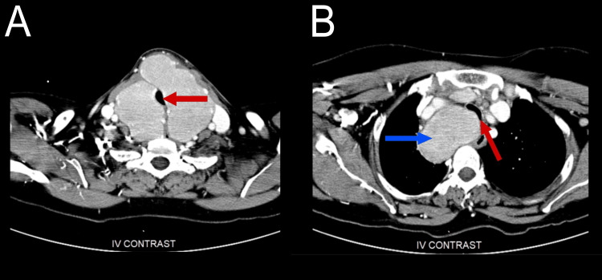
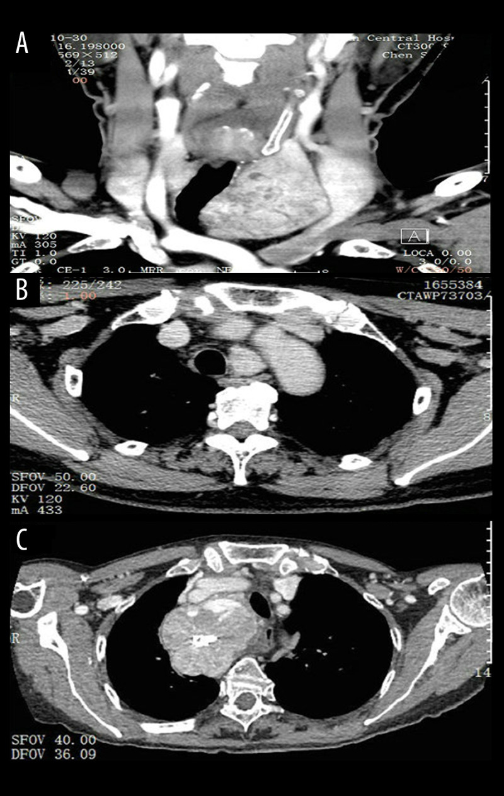
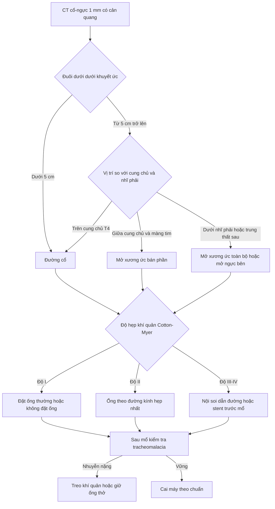
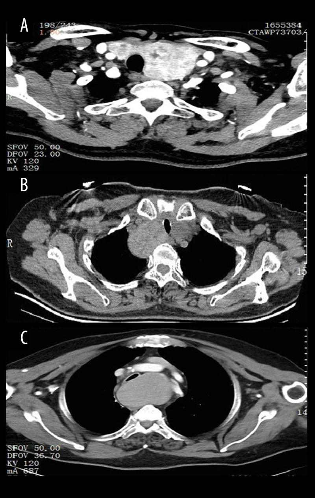

# 972 — Bướu giáp thòng trung thất: CT đánh giá chèn ép khí quản & khi nào phải mở xương ức / Retrosternal (substernal, diving) goiter

**Tags:** `pattern:khung-trung-that` `pattern:hep-khi-quan` `pattern:lech-khi-quan` `pattern:xo-hoa` `vung:tuyen-giap` `vung:khi-quan` `vung:trung-that` `protocol:CT` `protocol:CT-can-quang` `score:Cotton-Myer` `score:Zuo-RG`

**Mức chắc chắn (certainty):** tổng hợp y văn (literature synthesis) — biên từ toàn văn/abstract các bài mở: tổng quan về chỉ định mở xương ức (PMC12670237), **phân tích gộp 102 nghiên cứu – 15.719 bệnh nhân** (PMC12793967), tổng quan hệ thống 93 bài về đường tiếp cận (PMC12201918), loạt **48 bệnh nhân có hẹp khí quản** kèm phân độ (PMC9380444), phân tích gộp 17 nghiên cứu về **tracheomalacia** (PMC11891280), loạt 116 bệnh nhân (dẫn trong PMC12670237). Không có ca do nhóm tự chụp; 3 ca trong quiz dựng từ ảnh công bố.

> **Câu hỏi thực hành:** nữ **64 tuổi**, bướu cổ **20 năm**, 6 tháng nay khó thở khi nằm, nuốt vướng, không khàn tiếng; TSH bình thường. CT ngực–cổ có cản quang: tuyến giáp đa nhân, **phần dưới xuống dưới eo trên 5,8 cm**, khí quản bị **chèn còn 7 mm** ở ngang cung động mạch chủ. Bệnh nhân hỏi: **"Có phải mổ không? Có phải mở xương ức không? Nguy hiểm gì?"**
> Bài chốt **năm quyết định**: **(1) bướu giáp thòng nghĩa là > 50% tuyến nằm dưới eo trên (hoặc > 3 cm dưới khuyết ức khi cổ ngửa) — không phải "bướu to"; (2) mổ là điều trị duy nhất triệt để, kể cả khi không triệu chứng, vì **ung thư 12,4%** và **27,6% bệnh nhân hoàn toàn không có triệu chứng**; (3) **88,7%** cắt được qua đường cổ, chỉ **10,4%** cần can thiệp lồng ngực; (4) ba con số dự báo phải mở xương ức: **đuôi dưới ≥ 5 cm dưới khuyết ức** (Se 94%, Sp 86,5%), **chiều dài sọ–đuôi ≥ 66 mm** và **thể tích phần trung thất ≥ 162 cm³**; (5) nguy cơ thật của ca này không phải mổ mà là **đường thở**: **48,6%** có chèn ép khí quản trên CT và **1,4%** có tracheomalacia — nguyên nhân thất bại cai máy thở sau mổ.**

## 1. Tổng quan bệnh học – cơ chế hình ảnh: vì sao tuyến giáp "rơi" xuống ngực và vì sao CT là chuẩn

### 1.1 Định nghĩa — ba cách nói cùng một chuyện, nhưng số đo khác nhau

- **Theo khối lượng:** > 50% tuyến giáp nằm trong trung thất (cách dùng phổ biến nhất: **21/102 nghiên cứu** trong phân tích gộp 15.719 bệnh nhân, PMC12793967).
- **Theo khoảng cách trên CT:** tuyến xuống **> 3 cm dưới khung ngực (thoracic inlet)** khi cổ ngửa, hoặc **quá đốt sống T4** (PMC12670237).
- **Theo lâm sàng (ATA):** tuyến nhô ra dưới khuyết ức/xương đòn khi bệnh nhân nằm ngửa, cổ hơi ngửa (PMC9350059).
- **Dịch tễ:** bướu giáp ảnh hưởng ~**5%** dân số; thể thòng trung thất chiếm **5–15,7%** các bướu giáp; **nữ : nam ≈ 1,6 : 1**, tuổi chẩn đoán trung bình **58** (PMC12670237, PMC12793967). **85–90%** xuống trung thất **trước**, **10–15%** xuống **sau** (PMC12670237).

### 1.2 TẠI SAO tuyến giáp lại xuống trung thất

- Tuyến giáp **không có vỏ xơ cố định**; nó treo vào sụn giáp–khí quản bằng dây chằng Berry và bị "kéo" bởi **áp lực âm trong lồng ngực khi hít vào**. Khi bướu lớn dần (thường **> 5 năm**), trọng lượng + áp lực âm + khoang trung thất trước rộng rãi tạo **đường trượt** dọc khí quản và bó mạch cảnh.
- **Vì sao thòng xuống thì hiếm khi tự lên lại:** khung ngực là **vòng xương cứng**; eo trên (thoracic inlet) có đường kính xấp xỉ **bằng hoặc nhỏ hơn** đường kính bướu sau khi đã phình → hiện tượng **"iceberg"**: phần chìm lớn hơn phần nổi, và tuyến bị "khóa" dưới xương ức.
- **Vì sao chèn ép khí quản mới là vấn đề, không phải kích thước:** khí quản là **ống sụn–màng mềm** chạy ngay sau eo giáp. Bướu lớn ép từ trước ra sau và từ một bên sang bên kia → **giảm diện tích cắt ngang**. Ép kéo dài gây **thiếu máu nuôi sụn khí quản** → **nhuyễn sụn (tracheomalacia)** và mất đàn hồi; đây là lý do bệnh nhân có thể **khó thở nặng lên đột ngột sau gây mê hoặc khi nằm ngửa**.

### 1.3 Vật lý hình ảnh: vì sao CT, và vì sao mô tuyến giáp "sáng" hơn cơ

- **Siêu âm không nhìn được dưới xương ức:** xương và khí phổi **phản xạ/chặn sóng âm** (acoustic shadowing), nên phần thòng trung thất là "vùng mù". CT không bị giới hạn này và cho **trục dọc (z-axis)** — thứ quyết định chiều dài sọ–đuôi và thể tích phần trung thất.
- **TẠI SAO tuyến giáp tăng đậm độ trên CT không cản quang:** tế bào nang giáp tập trung **iod** (nguyên tử số 53, K-edge 33,2 keV) ở nồng độ cao nhất cơ thể → nhu mô giáp **~70–120 HU**, so với **cơ 40–60 HU**. Đây là lý do khối giáp trong trung thất **"sáng" hơn cơ và hơn hạch**, giúp phân biệt với u trung thất khác ngay trên phim **không cản quang**.
- **Vôi hóa:** bướu lâu năm thoái hóa → **vôi hóa thô, cục, thành vòng** (> **130–200 HU**), thường gặp ở bướu đa nhân; vôi hóa **viền vỏ liên tục** gợi ý lành tính, còn vôi hóa **lấm tấm trong nhân đặc** phải loại trừ ung thư.
- **TẠI SAO cần thì cản quang:** (1) tách khối giáp khỏi **động mạch cảnh, tĩnh mạch cánh tay đầu, động mạch chủ**; (2) phát hiện **huyết khối tĩnh mạch** do chèn ép; (3) đánh giá **độ ngấm thuốc của nhân** (nhân giáp ngấm mạnh hơn cơ, ung thư thường ngấm kém hơn nhu mô lành); (4) quy hoạch mổ: thấy rõ **mạch máu bất thường** trước khi mở.
- **Cạm bẫy vật lý:** iod trong thuốc cản quang làm **tuyến giáp tăng đậm độ giả tạo** trong vài tuần, và có thể gây **cường giáp do iod (Jod–Basedow)** — đặc biệt ở bướu đa nhân đã có nhân tự chủ (xem [968](../968-cuong-giap-do-amiodarone-ait-type-1-2/lesson.md), [1898](../1898-nhiem-doc-giap-do-iod-jod-basedow/lesson.md)).

### 1.4 Con số nằm lòng của bướu giáp thòng trung thất

- **Triệu chứng (gộp 15.719 bệnh nhân):** khối cổ **71,1%**, triệu chứng chèn ép **64,8%**, **không triệu chứng 27,6%**; trên hình ảnh: **lệch khí quản 60,6%**, **chèn ép khí quản 48,6%** (PMC12793967).
- **Ung thư trong bướu thòng:** **12,4%** (KTC 10,4–14,6%) trong phân tích gộp; các loạt riêng báo **3–21%**, thể nhú chiếm ~**19%** ở nhóm không triệu chứng (PMC12793967, PMC12670237).
- **Đường mổ:** chỉ **88,7%** cắt hoàn toàn qua cổ; **10,4%** cần can thiệp lồng ngực (PMC12793967). Gộp theo định nghĩa "dưới eo trên": **6,12%** (31 nghiên cứu, 3.441 bệnh nhân); các loạt đơn lẻ **1–11%**; phân tích gộp của 69 nghiên cứu cũng ra **~6%** (PMC12670237).
- **Biến chứng (loạt 116 ca cắt qua cổ):** liệt dây thanh **thoáng qua 2,58%**, **vĩnh viễn 1,72%**; hạ calci máu **thoáng qua 8,62%**, **vĩnh viễn 1,72%**; **không tử vong** (PMC12670237). Hạ calci vĩnh viễn chung của phẫu thuật giáp lớn: **1–3%**.
- **Tracheomalacia sau mổ:** **1,4%** (146/1.108 bệnh nhân, 17 nghiên cứu) — biểu hiện **rít, khó cai máy**, xử trí bằng **đặt nội khí quản kéo dài hoặc mở khí quản** (PMC11891280).
- **Loạt 48 ca có hẹp khí quản (PMC9380444):** 38 nữ/10 nam, trung vị **50 tuổi**; type I/II/III = **28/12/8**; hẹp khí quản độ I/II/III = **31/11/6**; **41/48 (85,4%)** mổ đường cổ, **4** + mở xương ức, **2** + nội soi lồng ngực, **1** + đường dưới mũi ức; **2** liệt dây thanh hồi phục sau 3 tháng; **không tử vong**.

## 2. Mẫu hình + chẩn đoán phân biệt theo vị trí và nguồn gốc (Gamut)

- **Theo nguồn gốc:**
  - **Thứ phát (secondary):** tuyến cổ phì đại rồi thòng xuống — chiếm đa số; có **cầu mô giáp liên tục** qua eo trên.
  - **Nguyên phát trong lồng ngực (primary intrathoracic):** mô giáp **hoàn toàn trong trung thất**, không liên tục với tuyến cổ; nuôi bởi mạch trung thất → **khó mổ qua cổ**, nguy cơ mở xương ức cao.
  - **Hỗn hợp (mixed):** tuyến cổ + nhân lạc trung thất cùng tồn tại (PMC9350059).
- **Theo khoang:** **trung thất trước 85–90%** (dễ mổ qua cổ nếu trên cung chủ); **trung thất sau 10–15%** (sau khí quản/thực quản, sát cột sống — **khó**, dễ tổn thương dây thanh và thực quản).
- **Phân độ Zuo trên CT (PMC9380444):**
  - **Type I:** > một nửa bướu cổ đã vào sau xương ức, **đuôi dưới tới bờ trên cung động mạch chủ**.
  - **Type II:** gần như toàn bộ sau xương ức, **đuôi dưới ra sau cung chủ hoặc vào trung thất sau**.
  - **Type III:** bướu khổng lồ trong lồng ngực, có thể **chèn ép tĩnh mạch chủ trên** (phối hợp [093](../093-hoi-chung-tinh-mach-chu-tren/lesson.md)).
- **Chẩn đoán phân biệt khối trung thất trước–trên (4T + phần còn lại):**

| Nhóm | Thực thể | Dấu hiệu phân biệt cốt lõi |
|---|---|---|
| Tuyến giáp | Bướu giáp thòng, u giáp, mô giáp lạc chỗ | **Liên tục với tuyến cổ + đậm độ cao 70–120 HU + vôi hóa thô** |
| Tuyến ức | Thymoma, tăng sản ức, ung thư ức | Trung thất trước, **không liên tục cổ**, đồng nhất, có thể có nhược cơ |
| Mô bẩm sinh | Teratoma, lymphangioma, nang ức | **Mỡ −40 đến −120 HU + vôi hóa răng/xương** (teratoma); **T2 rất sáng, không ngấm** (lymphangioma) |
| Hạch | Lymphoma, di căn | **Nhiều hạch, chùm, đồng nhất 40–60 HU**, không vôi hóa, ngấm nhẹ |
| Mạch máu | Phình động mạch chủ/cảnh, giả phình | **Đồng đậm độ với lòng mạch ở mọi thì**, có huyết khối viền |
| Khác | Bướu giáp chèn ép + **hội chứng tĩnh mạch chủ trên** | Phù mặt–cổ–hai tay + tuần hoàn bàng hệ thành ngực |

- **Gamut theo mức độ hẹp khí quản (Cotton-Myer áp dụng cho hẹp do bướu, PMC9380444):** độ I **< 50%**, độ II **51–70%**, độ III **71–99%**, độ IV **không còn lòng** (tắc hoàn toàn).

## 3. Bảng so sánh phân biệt (ma trận đối chiếu)

| Thực thể (entity) | Hình ảnh điển hình (CT) | Chốt vào (rule-in) | Chốt loại (rule-out) | Gợi ý xác nhận |
|---|---|---|---|---|
| **Bướu giáp thòng thứ phát** | Khối đậm độ cao liên tục với tuyến cổ, đẩy/lệch khí quản, vôi hóa thô | **Cầu mô giáp qua eo trên + đậm độ 70–120 HU + vôi hóa** | Mất liên tục hoàn toàn + nuôi bởi mạch trung thất → thể nguyên phát | CT cổ–ngực cản quang 1 mm; siêu âm phần cổ |
| **Bướu giáp nguyên phát trong lồng ngực** | Khối giáp **hoàn toàn dưới eo trên**, không cầu nối; có thể lớn hơn eo trên | **Không liên tục + mô giáp đồng đậm độ, ngấm như tuyến** | Có cầu nối rõ → thể thứ phát | CT + xạ hình 99mTc/123I nếu cần chứng minh mô giáp |
| **Thymoma** | Khối trung thất trước, bờ rõ, đồng nhất, ngấm thuốc vừa | **Vị trí trước cung chủ, không liên tục cổ, không vôi hóa thô** | Đậm độ cao như giáp + liên tục cổ → bướu giáp | MRI/CT; sinh thiết sau mổ; myasthenia |
| **Teratoma** | Hỗn hợp **mỡ + dịch + vôi hóa/xương/răng** | **Mỡ −40 đến −120 HU + vôi hóa dạng xương** | Đồng đậm độ mô mềm → không phải teratoma | CT; AFP/β-hCG nếu trẻ |
| **Lymphoma** | Hạch chùm, đồng nhất, **không vôi hóa**, bọc mạch (CT angiogram sign) | **Nhiều hạch, đối xứng, không vôi hóa, ngấm nhẹ** | Đậm độ cao + vôi hóa thô → giáp | PET-CT, sinh thiết hạch |
| **Phình động mạch chủ/cảnh** | Đồng đậm độ lòng mạch, vôi hóa thành, huyết khối viền | **Đồng đậm độ mọi thì + nối với mạch gốc** | Không nối mạch, đậm độ mô → khối đặc | CTA, siêu âm Doppler |
| **Hẹp khí quản do nguyên nhân khác** (di chứng đặt ống, u, vòng mạch) | Hẹp **đoạn dài, đối xứng**, không khối giáp quanh | **Không có khối giáp + tiền sử đặt ống/mổ** | Có khối giáp ép một bên → do bướu | Nội soi khí quản, CT động học |

*CECT cổ–ngực một bệnh nhân bướu giáp đa nhân: (A) khối giáp lớn **chèn hẹp lòng khí quản** (mũi tên đỏ) ngay trên eo trên; (B) xuống thấp hơn, khí quản vừa **bị đẩy lệch** vừa bị ép (mũi tên đỏ) bởi phần giáp thòng, cạnh các mạch lớn (mũi tên xanh). Đây là lý do phải **đo ở lát hẹp nhất**, không đo ở lát thấy khối to nhất. Nguồn: Cureus 2024, Fig. 1, PMC11654889, CC BY 4.0 (nguyên bản, không cắt).*

*Phân độ theo vị trí đuôi dưới: (A) **type I** — đuôi tới bờ trên cung chủ; (B) **type II** — xuống ngang cung chủ/trung thất sau; (C) **type III** — bướu lớn trong lồng ngực, chèn ép khí quản rõ. Type càng cao thì khả năng phải mở xương ức càng lớn. Nguồn: Med Sci Monit 2022, Fig. 1, PMC9380444, CC BY-NC-ND 4.0 (nguyên bản, không cắt/không ghép).*

## 4. Protocol chụp + hệ phân độ và ngưỡng quyết định đường mổ

### 4.1 Protocol CT

- **Phạm vi:** **cổ + ngực** trong một lần chụp, **cổ hơi ngửa**, tư thế **nằm ngửa**, chụp **thì hít vào** (ghi rõ trên phiếu — hết thở ra làm hẹp giả).
- **Kỹ thuật:** lát **≤ 1 mm**, tái tạo **đa bình diện (MPR)** coronal + sagittal; **không cản quang** để đo đậm độ/vôi hóa, **có cản quang** (thì tĩnh mạch hoặc chia 3 thì) để tách mạch và đánh giá nhân.
- **Bắt buộc báo cáo (checklist 10 mục):**
  1. **Chiều dài sọ–đuôi phần dưới eo trên** (mm) — ngưỡng **≥ 50 mm**;
  2. **Thể tích phần trung thất** (cm³) — ngưỡng **≥ 162 cm³**;
  3. **Đường kính ngang lớn nhất của khối so với eo trên** (khối > eo trên = "iceberg");
  4. **Vị trí đuôi dưới** so với **cung chủ / T4 / nhĩ phải / carina**;
  5. **Có vào trung thất sau hoặc dưới carina không**;
  6. **Đường kính khí quản tại lát hẹp nhất**: trước–sau, ngang, **diện tích cắt ngang**, **% hẹp** so với khí quản lành;
  7. **Chiều dài đoạn hẹp** và **khoảng cách từ dây thanh** (quyết định ống nội khí quản);
  8. **Lệch trục khí quản** (mm) và góc;
  9. **Vôi hóa, nhân nghi ác, hạch trung thất**;
  10. **Liên quan thực quản, động mạch cảnh, tĩnh mạch cánh tay đầu, dây thanh quản** — và **có mô giáp lạc chỗ** không.
- **Khi nào thêm:** **CT động học thì hít vào–thở ra** hoặc **nội soi khí quản** nếu nghi **tracheomalacia**; **siêu âm tuyến giáp** để đánh giá nhân/TI-RADS phần cổ; **xạ hình** nếu nghi mô giáp lạc chỗ hoặc cường giáp.

### 4.2 Phân độ & ngưỡng

- **Hẹp khí quản (Cotton-Myer, áp dụng cho bướu giáp — PMC9380444):** độ I **< 50%**, II **51–70%**, III **71–99%**, IV **tắc hoàn toàn**. Độ III là ngưỡng **gây mê phải có kế hoạch đường thở riêng**.
- **Ngưỡng dự báo cần can thiệp lồng ngực:**

| Ngưỡng | Giá trị | Nguồn |
|---|---|---|
| Đuôi dưới dưới khuyết ức | **≥ 5 cm** → Se **94%**, Sp **86,5%** | PMC12670237 |
| Chiều dài sọ–đuôi | **≥ 66 mm** (nhóm mở rộng: **77 mm** vs **31 mm**) | PMC12670237 |
| Thể tích phần trung thất | **≥ 162 cm³** (**264** vs **40 cm³**); Se/NPV **100%** trong loạt 47 ca | PMC12670237 |
| Khối lớn | **> 15 cm** đường kính | PMC12670237 |
| Vị trí | **dưới cung chủ, trung thất sau, dưới carina** | PMC12670237 |
| Hình dạng | **"iceberg"/hình chuông**, khối **rộng hơn eo trên** | PMC12670237 |
| Bối cảnh | **tái phát sau mổ**, mật độ tuyến cao (**OR 47** cho mở xương ức), tiền sử **> 160 tháng** | PMC12670237 |

- **Chọn đường mổ theo vị trí (PMC12670237):** **trên cung chủ (T4)** → đường cổ; **giữa cung chủ và màng tim** → **mở xương ức bán phần**; **dưới nhĩ phải** → **mở xương ức toàn bộ**; **trung thất sau** → xương ức hoặc **mở ngực bên** tùy độ sâu.
- **Kết cục:** **88,7%** chỉ cần đường cổ; **10,4%** cần thêm can thiệp lồng ngực; gộp theo định nghĩa eo trên **6,12%** (PMC12793967, PMC12670237).
- **Điều trị không mổ (chọn lọc, không thay thế mổ):** **I-131** giảm thể tích tuyến **~30%**; **RFA** ở 22 bệnh nhân bướu trong lồng ngực: **giảm thể tích 64,6%** sau trung vị **12 tháng**, cần **CT/MRI** (không chỉ siêu âm) để theo dõi (PMC12670237). Không dùng cho bướu **chèn ép nặng, nghi ung thư, type III**.
- **Kế hoạch đường thở (quan trọng hơn cả đường mổ):** độ I → đặt ống thường hoặc **mổ không đặt ống (non-intubated)**; độ II → chọn ống theo đường kính hẹp nhất; **độ III → nội soi phế quản dẫn đường đặt ống khi bệnh nhân còn thức, hoặc đặt stent khí quản trước** rồi mới mổ; **không bao giờ để bệnh nhân nằm ngửa thở tự do trong phòng chờ** (PMC9380444). Sau mổ: **kiểm tra độ mềm của khí quản**, nếu nhuyễn nặng → **treo khí quản (tracheopexy)** hoặc giữ ống thở.

## 5. Biến thể bình thường và cạm bẫy

- **Tuyến giáp "đi xuống" nhưng không thòng:** ở người cổ ngắn, tuyến có thể chạm eo trên khi **cổ duỗi** — không đủ tiêu chuẩn nếu **< 3 cm** dưới eo trên và không có phần trung thất thật. **Đo lại đúng tư thế** trước khi gọi là bướu thòng.
- **Lệch khí quản ≠ chèn ép:** lệch gặp **60,6%** nhưng chèn ép chỉ **48,6%** (PMC12793967); một khí quản lệch mà **không hẹp lòng** không giải thích được khó thở.
- **CT tĩnh không chẩn đoán được tracheomalacia:** sụn khí quản **mềm ra theo thời gian**; trên CT tĩnh khí quản có thể **tròn đều**, nhưng khi thở ra hoặc sau khi lấy bướu, thành khí quản **sụp vào**. Muốn chốt: **CT thì thở ra** hoặc **nội soi khí quản động**. Tỉ lệ **1,4%** nhưng là nguyên nhân **thất bại cai máy** và phải mở khí quản.
- **Hết thở ra làm hẹp giả:** chụp ở thì thở ra có thể làm đường kính khí quản giảm **> 20%**; luôn ghi rõ thì hít vào và so sánh với khí quản lành.
- **"Iceberg" trên X-quang:** phim ngực chỉ thấy phần nổi; bướu có thể **lớn gấp nhiều lần** phần thấy được → **không đánh giá độ lớn bằng X-quang**, phải CT.
- **Mô giáp lạc chỗ bị gọi nhầm là u trung thất:** nếu khối **đồng đậm độ tuyến giáp** nhưng **không liên tục với cổ**, đừng kết luận u — **xạ hình 99mTc/123I** hoặc **FNA + thyroglobulin** sẽ chứng minh.
- **Cường giáp do iod sau cản quang:** bướu đa nhân lâu năm có thể có **nhân tự chủ**; thuốc cản quang iod (**~23 g iod** trong 78 mL Omnipaque 300) có thể gây **Jod–Basedow** sau vài tuần — hỏi TSH trước, theo dõi sau (xem [1898](../1898-nhiem-doc-giap-do-iod-jod-basedow/lesson.md)).
- **Sai lầm "bướu nhỏ thì an toàn":** ngưỡng quyết định là **chiều dài và thể tích phần trung thất**, không phải cảm giác khi sờ cổ; một bướu "nhỏ" nhưng **đuôi ≥ 5 cm** vẫn có thể cần mở xương ức.
- **Bỏ sót ung thư trong bướu:** **12,4%** bướu thòng có ung thư; nhân **đặc, giảm âm, vi vôi hóa, ngấm thuốc kém** trong bướu đa nhân phải **FNA** trước khi quyết định chỉ "theo dõi".

## 6. Tự lượng giá — Blind Quiz

**Ca 1 — Nữ 64 tuổi, bướu cổ 20 năm, khó thở khi nằm.**

- Gợi ý: bướu đa nhân, không khàn tiếng, TSH bình thường.
- Câu hỏi: (1) Khí quản bị gì, đo ở đâu? (2) Ba chẩn đoán phân biệt của khối trung thất trước–trên? (3) Dấu hiệu nào trên CT quyết định đường mổ?

<b>Bấm để hiện đáp án (findings + chẩn đoán)</b>

- **Findings:** khối giáp đậm độ cao, đa nhân, **liên tục với tuyến cổ**, đẩy và **chèn hẹp khí quản**; đo tại **lát hẹp nhất** (không phải lát khối to nhất). Ở (B), khí quản vừa lệch vừa hẹp, sát mạch lớn.
- **Chẩn đoán:** **bướu giáp thòng trung thất thể thứ phát** — vì tuyến giáp "rơi" theo trục khí quản và bị khóa dưới eo trên, phần chìm lớn hơn phần nổi.
- **Ba phân biệt:** thymoma (không liên tục cổ, đồng nhất), lymphoma (hạch chùm, không vôi hóa), teratoma (mỡ −40 đến −120 HU + vôi hóa răng/xương).
- **Quyết định đường mổ:** chiều dài **dưới eo trên**, **thể tích phần trung thất**, **vị trí so với cung chủ/nhĩ phải**, **trung thất sau/dưới carina**.
- **Nguồn ảnh:** Cureus 2024, Fig. 1, PMC11654889, CC BY 4.0.

**Ca 2 — Nam 55 tuổi, khó thở 2 tháng, X-quang thấy khí quản hẹp; CT có bướu giáp.**

- Gợi ý: bướu lớn, không di căn, không khàn tiếng.
- Câu hỏi: (1) Phân độ type I–III dựa vào mốc nào? (2) Ca nào trong ba ca có nguy cơ phải mở xương ức cao nhất? (3) Vì sao phải đo khoảng cách tới dây thanh?

<b>Bấm để hiện đáp án (findings + chẩn đoán)</b>

- **Mốc phân độ:** đuôi dưới so với **cung động mạch chủ** (type I tới bờ trên cung; type II ra sau cung/trung thất sau; type III bướu lớn trong lồng ngực, có thể chèn tĩnh mạch chủ trên).
- **Nguy cơ cao nhất:** **type III** (và type II có thành phần trung thất sau) — vì đuôi dưới **dưới cung chủ/nhĩ phải**, khối **rộng hơn eo trên**.
- **Vì sao đo tới dây thanh:** quyết định **loại ống, độ sâu đặt ống và kế hoạch đường thở**; hẹp **độ III** cần nội soi dẫn đường hoặc stent trước mổ.
- **Nguồn ảnh:** Med Sci Monit 2022, Fig. 1, PMC9380444, CC BY-NC-ND 4.0 (nguyên bản).

**Ca 3 — Bệnh nhân bướu giáp thòng, mổ lấy bướu qua đường cổ, 6 giờ sau không cai được máy, rít thì hít vào.**

- Gợi ý: bướu đã lấy, khí quản trên CT trước mổ hẹp nặng; không có tràn khí, không chảy máu.
- Câu hỏi: (1) Ba độ hẹp trên CT tương ứng Cotton-Myer nào? (2) Vì sao vẫn khó thở dù đã lấy bướu? (3) Xử trí?

<b>Bấm để hiện đáp án (findings + chẩn đoán)</b>

- **Phân độ:** (A) **độ I < 50%**, (B) **độ II 51–70%**, (C) **độ III 71–99%**; độ IV là mất hoàn toàn lòng.
- **Chẩn đoán:** **tracheomalacia** sau giải ép — sụn khí quản đã mất đàn hồi vì bị ép lâu, khi bướu được lấy đi thì thành khí quản **sụp vào khi thở ra**; gặp **1,4%** bệnh nhân mổ giáp (146/1.108).
- **Xử trí:** giữ ống thở/đặt nội khí quản kéo dài, **CPAP/PEEP** để "mở" khí quản, **treo khí quản (tracheopexy)**, hoặc **mở khí quản** nếu thất bại; nội soi khí quản để xác nhận.
- **Nguồn ảnh:** Med Sci Monit 2022, Fig. 2, PMC9380444, CC BY-NC-ND 4.0 (nguyên bản).

## Bài liên quan chéo
- [230 – Tuyến giáp & hạch cổ: TI-RADS](../230-tuyen-giap-hach-co/lesson.md)
- [940 – Nhân giáp ĐỘC (AFTN): RFA vs I-131 vs mổ](../940-dot-nhiet-nhan-giap-doc-aftn-rfa-vs-i131/lesson.md)
- [941 – Đốt nhiệt tuyến cận giáp: bẫy "đốt nhầm nhân giáp"](../941-dot-tuyen-can-giap/lesson.md)
- [093 – Hội chứng tĩnh mạch chủ trên (SVCS)](../093-hoi-chung-tinh-mach-chu-tren/lesson.md)
- [1768 – "Cổ đông cứng" sau xạ & đường thở khó](../1768-co-dong-cung-sau-xa-duong-tho-kho/lesson.md)
- [1769 – Mở khí quản/FONA ở cổ đã xạ](../1769-co-dong-cung-sau-xa-duong-tho-kho/lesson.md)
- [700 – Tổng quan Đầu Mặt Cổ](../700-head-neck-overview/lesson.md)

## Ảnh
- Tên file theo quy ước `972_slug_Modality_SourceID.jpg`; nguồn + giấy phép từng ảnh trong `images/CREDITS.md`.
- Không tạo ảnh ghép: 2 trong 3 ảnh là **CC BY-NC-ND** (không cho phép phái sinh) → chỉ dùng **nguyên bản**.

> Không dùng để chẩn đoán độc lập khi chưa có người hướng dẫn.
