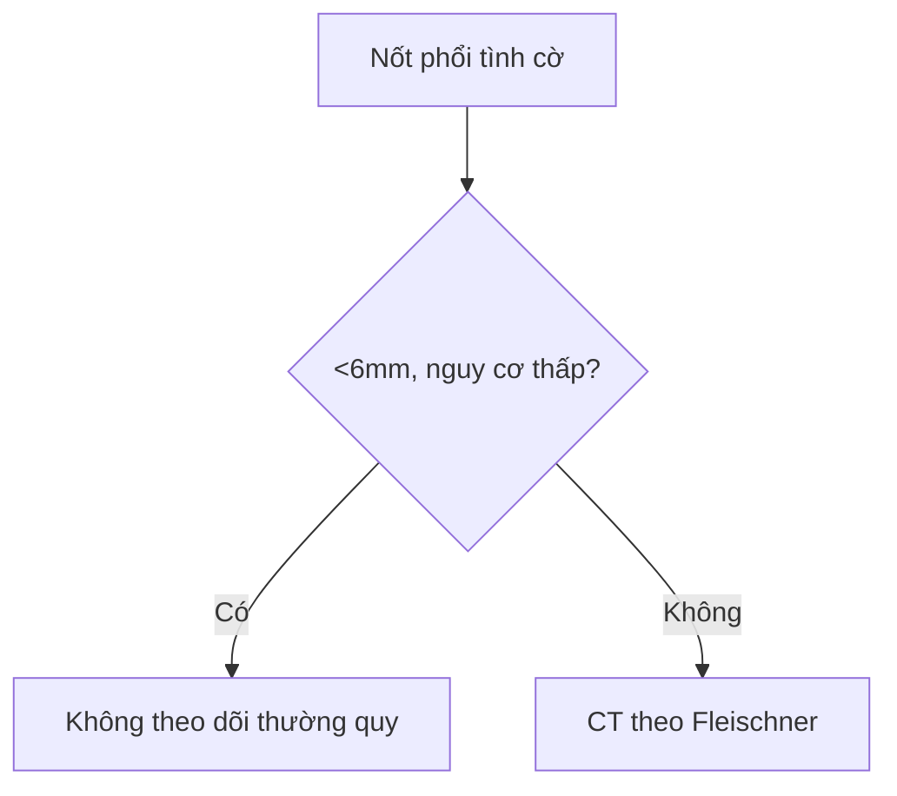

# Khung lesson.md — CĐHA (copy nguyên khung, điền vào)

> Xóa dòng này khi viết bài thật. Việt hóa 100%: tiếng Việt trước, thuật ngữ Anh trong ngoặc ở lần đầu.

```yaml
---
unit_id: "020"
subspecialty: Chest
anatomical_location: "phổi (lung)"
primary_pattern: "nốt (nodule)"
tags: [pattern:not, vung:phoi, score:Lung-RADS, protocol:Fleischner, incidentaloma:not-phoi]
certainty: tong-hop-y-van  # ca-nguyen-van / tong-hop-y-van / suy-luan + ghi vì sao ở đầu bài
sources: [Radiopaedia, RadiologyAssistant, Eurorad]
---
```

**ID:** NNN — **Tên Việt / Tên Anh (English term)**
**Mức chắc chắn (certainty):** ca nguyên văn (verbatim case) / tổng hợp y văn (literature synthesis) / suy luận (inference) — ghi rõ 1 nhãn + vì sao.

## 1. Tổng quan bệnh học – cơ chế hình ảnh
- Bệnh học (pathology) + sinh lý bệnh (pathophysiology) ngắn gọn.
- BẮT BUỘC giải thích TẠI SAO (theo Argon): thời gian T1/T2, khuếch tán (diffusion) trên DWI/ADC, Hounsfield trên CT, bản chất mô (mỡ (fat), máu bán cấp (subacute blood)/methemoglobin, mucin, xơ (fibrosis)/collagen, hoại tử (necrosis)) — không chỉ liệt kê tăng/giảm tín hiệu.

## 2. Mẫu hình + chẩn đoán phân biệt theo vị trí (gamut)
- Liệt kê mẫu hình (pattern) → gamut theo vị trí (location).
- Ví dụ: nốt (nodule) phổi → gamut theo vùng: trung tâm / ngoại vi / màng phổi (pleura).

## 3. Bảng so sánh phân biệt (ma trận đối chiếu)
| Thực thể (entity) | Hình ảnh điển hình (US/CT/MRI theo thì) | Chốt vào (rule-in) | Chốt loại (rule-out) | Gợi ý xác nhận |
|---|---|---|---|---|
| ... | ... | **...** | **...** | ... |

- Ảnh ghép đối chiếu: `` — tạo bằng `tools/make_composite.py`, cùng chuỗi xung đặt cạnh nhau, dải đen `[Tên bệnh - chuỗi xung] + attribution`.

## 4. Protocol chụp + hệ phân độ/điểm chuẩn hóa
- Protocol (giao thức) chụp: chỉ định, thông số, thuốc cản quang (contrast).
- Hệ phân độ (grading/scoring system): phiên bản + ngưỡng xử trí.
- Nếu có RADS (Fleischner, Lung-RADS, BI-RADS...): vẽ Mermaid flowchart, vd:


## 5. Biến thể bình thường và cạm bẫy
- Biến thể bình thường (normal variant) dễ nhầm + cách tránh overcall.
- Cạm bẫy (pitfall): giả ảnh (artifact), thỏa mãn tìm kiếm (satisfaction of search).

## 6. Tự lượng giá — Blind Quiz ngay trên trang tĩnh (không cần app)
> Mẫu copy-paste cho mỗi ca: ảnh + câu hỏi gợi mở ở NGOÀI, dấu hiệu + chẩn đoán giấu trong `<details>`. Mở trên Pages: tự đoán rồi bấm mở đáp án.

**Ca 1 — ...**


- Gợi ý lâm sàng (clinical context): tuổi/giới/triệu chứng ngắn, không lộ chẩn đoán.
- Câu hỏi: Mô tả dấu hiệu (finding) chính? Đưa 3 chẩn đoán phân biệt (differential)? Dấu hiệu nào chốt (clincher)?

<details><summary><b>Bấm để hiện đáp án (findings + chẩn đoán)</b></summary>

- Dấu hiệu (findings): ... (mũi tên/mô tả vị trí tổn thương trong ảnh).
- Chẩn đoán (diagnosis): ... — vì ... (cơ chế vật lý/mô bệnh 1 câu).
- Nguồn ảnh: ... (attribution đầy đủ).
</details>

**Ca 2–3:** lặp lại khung trên. Ảnh ghép đối chiếu (`images/composite_*.jpg`) cũng bọc quiz tương tự: hiện lưới ảnh ngoài, giấu nhãn bệnh trong `<details>`.

## Bài liên quan chéo
- [NNN – Tên](../NNN-slug/lesson.md)

## Ảnh
- Tên file: `NNN_slug_Modality_SourceID.jpg` (vd `020_not-phoi_CT_Radiopaedia-rIDxxxxx.jpg`). Nguồn + giấy phép (license) từng ảnh trong `images/CREDITS.md`.
- Không tải được (paywall / cấm, vd AuntMinnie): dẫn link gốc ở đây + trong `sources.md`.

> Không dùng để chẩn đoán độc lập khi chưa có người hướng dẫn.
